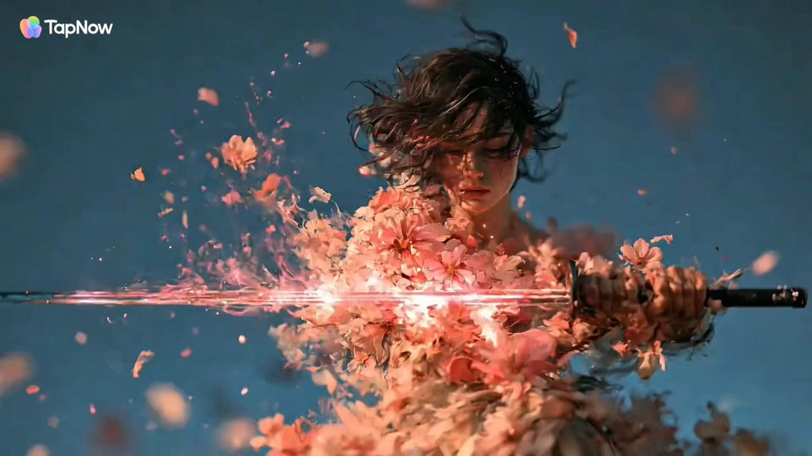
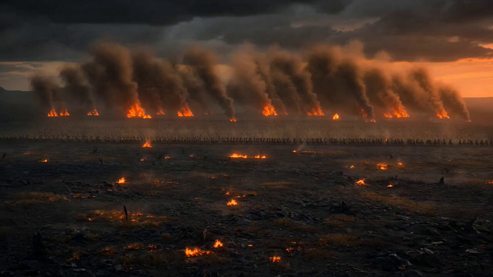
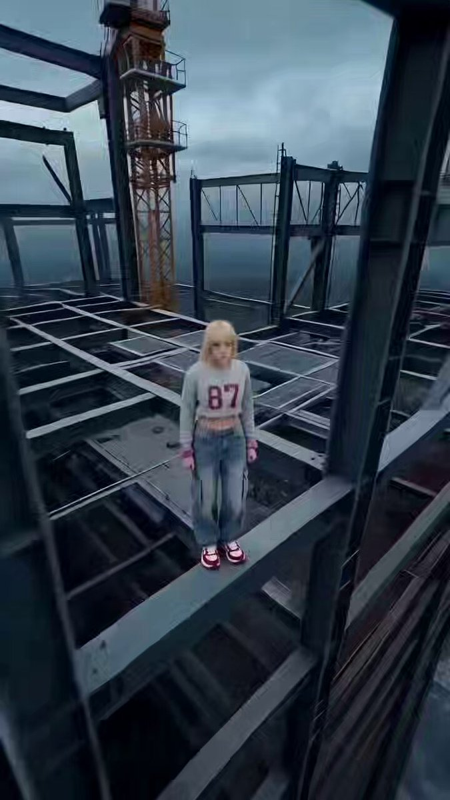

[Seedance 2.0 prompt archive](../seedance-2-0.md)

<a id="action-fantasy"></a>
# ⚔️ Action / Fantasy (47)

<a id="action-fantasy-case-1"></a>
<!-- Case 1: Street Rap MV Performance (by @songguoxiansen) -->
### Case 1: [Street Rap MV Performance](https://x.com/songguoxiansen/status/2033175478765289598) (by [@songguoxiansen](https://x.com/songguoxiansen))

| Output |
| :----: |
| <a href="https://x.com/songguoxiansen/status/2033175478765289598"></a> |

**Prompt:**

```
16:9 horizontal screen, street rap MV style, neon purple and blue cool tones, explosive cool and fierce atmosphere. 0-3 seconds: Medium shot push-in, city street night scene with flashing neon lights, an 80-year-old silver-haired woman stands in front of a graffiti wall, short silver-white hair styled in a neat slick-back, distinct square face contour, sword-like eyebrows slanting towards the temples, eyes sharp like electricity, wrinkles at the corners of her eyes like badges of time, a confident smile on the corner of her mouth, wearing a black leather jacket over a white printed T-shirt (large black letters "YOLO" on the chest) + black cargo pants + white high-top sneakers, a thick gold chain necklace around her neck, silver bracelet on her wrist, holding up a microphone with both hands, strong drum beats of the BGM start, the old woman's eyes sharpen, and her lips open to start Rap. 3-7 seconds: Medium shot + close-up switch, the old woman starts rapping, with an extremely strong sense of rhythm, her silver hair flying with her head-nodding movements, one hand holding the microphone, the other hand making gestures to match the rhythm—index finger pointing at the camera, palm cutting the rhythm up and down, making hip-hop gestures, movements are smooth and flowing, eyes sharp and looking directly at the camera, wrinkles vividly jumping with her expression, lips opening and closing rapidly to spit out lyrics: [Rap Lyrics] "Eighty-year-old legs, can jump better than you! Silver hair flowing, this is my pride! Don't call me old, my Flow is better than yours, when you were playing rap, I was listening to disco!" (Fast speed, strong rhythm, fierce attitude) Quick cuts: facial close-ups, hand movements, full-body swaying, side silhouettes, synchronized with the BGM beat. 7-11 seconds: Dance segment, the camera pulls back to show the full body, the old woman starts dancing—first the classic hip-hop bounce, then a neat street dance freeze, followed by a body wave transmitting from the shoulders to the toes, and then a quick footwork workout, movements are clean and sharp, silver hair flies under the neon lights, the leather jacket flutters in the air, she continues to Rap while dancing: [Rap Lyrics] "Legs and feet are nimble, speed is not slow, my lyrics are carved in time! You play with phones, I play with beats, eighty years of life, written into this verse!" (Faster rhythm, stronger tone) Low-angle upward shot + 360-degree surrounding shot, capturing the old woman's cool and fierce dance moves. 11-15 seconds: Climax ending, the old woman makes a cool turn, her silver hair arcs in the air, she faces the camera and makes a "shush" gesture with her finger, then her lips move closer to the microphone, singing the last line in a low, magnetic voice: [Reality Lyrics] "Time never defeats a beauty, I just changed the way I experience youth..." (Slow rhythm, deep emotion, lingering finish) The camera slowly pushes in for a close-up of the old woman's eyes, the wrinkles at the corners of her eyes are all stories, her gaze is still sharp yet with a hint of kindness, the BGM abruptly stops at the climax, the frame freezes on the old woman's cool yet slightly gentle smile, vignetting + neon purple light halo.
```

<a id="action-fantasy-case-2"></a>
<!-- Case 2: Black Cat Desert Martial-Arts Duel (by @nopinduoduo) -->
### Case 2: [Black Cat Desert Martial-Arts Duel](https://x.com/nopinduoduo/status/2039915824216261101) (by [@nopinduoduo](https://x.com/nopinduoduo))

| Output |
| :----: |
| <a href="https://x.com/nopinduoduo/status/2039915824216261101"></a> |

**Prompt:**

```
15-second Original Desert Martial Arts Short Film: A black cat warrior in light armor stands alone in a desert where yellow sand is flying all over the sky, facing the pursuers. The shots combine slow motion and fast editing; under backlight, the yellow sand rolls like ink mist. The character's movements are elegant yet ferocious, with tattered but flowing robes. Holding a short weapon, he shuttles and counterattacks at high speed. The overall tone is cold, lonely and oppressive, with high-end colors and obvious shallow depth of field, just like a high-quality oriental martial arts movie.
```

<a id="action-fantasy-case-3"></a>
<!-- Case 3: Live-Action Breathing Technique Duel (by @johnAGI168) -->
### Case 3: [Live-Action Breathing Technique Duel](https://x.com/johnAGI168/status/2021610292979876208) (by [@johnAGI168](https://x.com/johnAGI168))

| Output |
| :----: |
| <a href="https://x.com/johnAGI168/status/2021610292979876208"></a> |

**Prompt:**

```
Live-Action Anime Adaptation · Breathing Technique Decisive Battle (15 seconds · Super Burning Special Effects Version)
【Core Focus】: Water Breathing (Blue Water Dragon) VS Thunder Breathing (Golden Lightning), live-action extreme speed duel.

【Style】: Hollywood live-action anime adaptation film quality, dark samurai style, 4K ultra-clear, extreme fast cuts, explosive particle light effects, no gore.
【Duration】: 15 seconds
【Scene】: Misty forest under the moonlight, muddy ground, falling leaves.

[00:00-00:05] Shot 1: Water Melody Prelude · Starting Stance (Sense of charging)
Visuals: A young samurai wearing a green and black checkered haori (jacket), lowering his center of gravity under the moonlight, gripping his sword with both hands.
Action: He takes a deep breath, and the surrounding air instantly solidifies. As he draws his sword, a giant blue water dragon, condensed from high-pressure water flow, appears out of thin air, rotating rapidly around his body and blade, emitting the roar of flowing water.
Special Effects Details: The water flow has a realistic sense of splashing, illuminating the dark forest.

[00:05-00:10] Shot 2: Thunder Flash · Charge (Sense of extreme speed)
Visuals: The opponent, a blonde swordsman wearing a yellow triangular patterned haori, is crouched extremely low, adopting the posture of Iaijutsu (sword drawing technique).
Action: The ground suddenly explodes, and he instantly transforms into a dazzling golden lightning afterimage, refracting and charging through the forest in a "Z" shape at a speed undetectable by the naked eye.
Special Effects Details: Golden electric arcs and scorched fallen leaves remain in the places he passes.

[00:10-00:15] Shot 3: Water and Thunder Collision · Final Sound (Ultimate move clash)
Visuals: Extreme speed collision. The young samurai swings the giant blue water dragon down to meet the attack, and the blonde swordsman, transformed into lightning, crashes into him head-on.
Action: The two swords violently collide in the center of the frame.
Special Effects Spectacle: The blue water dragon and the golden lightning instantly explode, forming a massive water-thunder energy storm that spreads outwards. The surrounding large trees are snapped in half by the energy wave, and mud and light obscure the camera. The scene ends in an extremely dazzling blue, yellow, and white light.
```

<a id="action-fantasy-case-4"></a>
<!-- Case 4: 20-Cut High-Speed Anime Sequence (by @tebasaki3D) -->
### Case 4: [20-Cut High-Speed Anime Sequence](https://x.com/tebasaki3D/status/2039903531415552048) (by [@tebasaki3D](https://x.com/tebasaki3D))

| Output |
| :----: |
| <a href="https://x.com/tebasaki3D/status/2039903531415552048"></a> |

**Prompt:**

```
Anime high-speed cut test — 20 hard cuts in 10 seconds (0.5 seconds per cut, no fade-in/fade-out, no transitions).
[0.0 seconds to 0.5 seconds]: Cut 1 — Close-up. Anime Girl A: Long crimson hair, vivid green eyes. Winks at the camera.
```

<a id="action-fantasy-case-5"></a>
<!-- Case 5: Watch a grease-stained mechanic fix (by @sebatheepan) -->
### Case 5: [Watch a grease-stained mechanic fix](https://x.com/sebatheepan/status/2040079840754205010) (by [@sebatheepan](https://x.com/sebatheepan))

| Output |
| :----: |
| <a href="https://x.com/sebatheepan/status/2040079840754205010"></a> |

**Prompt:**

```
Watch a grease-stained mechanic fix
a violently rattling junker like it’s a martial arts fight.

Wrenches flying, spark plugs thrown like knives, hood slammed with a thunderous boom.

From rusty disaster to purring monster in seconds.
```

<a id="action-fantasy-case-6"></a>
<!-- Case 6: Samurai Revenge Short Film (by @sailorv321) -->
### Case 6: [Samurai Revenge Short Film](https://x.com/sailorv321/status/2040127822908596305) (by [@sailorv321](https://x.com/sailorv321))

| Output |
| :----: |
| <a href="https://x.com/sailorv321/status/2040127822908596305"></a> |

**Prompt:**

```
A short film about a samurai who loses his life on a burning battlefield and wakes up as a baby in another world.
The first half is a fierce battle on a battlefield covered in mud and flames. The young samurai challenges his final duel, seems to win for a moment, but is ultimately cut down and falls. His vision tilts low, and his consciousness fades as he is enveloped in fire and smoke.
```

<a id="action-fantasy-case-7"></a>
<!-- Case 7: Stylized 3D Battle Animation (by @johnAGI168) -->
### Case 7: [Stylized 3D Battle Animation](https://x.com/johnAGI168/status/2039924160567058725) (by [@johnAGI168](https://x.com/johnAGI168))

| Output |
| :----: |
| <a href="https://x.com/johnAGI168/status/2039924160567058725"></a> |

**Prompt:**

```
Stylized 3D animation with exaggerated proportions, sharp kung-fu-soccer choreography, and controlled rhythmic energy. CHARACTERS - Football master: an impeccably focused martial-arts soccer prodigy in a fitted training top, wrapped wrists, tapered athletic pants, and classic football boots. Piercing gaze. Every movement follows a precise rhythm: pause -> burst -> lock. Theatrical, hypnotic, absolute master of the field. - Opponent goalkeeper: tense, exhausted, intimidated, standing before the goal line under immense pressure. ENVIRONMENT Futuristic night football stadium with glowing floodlights, wet grass, drifting mist, roaring crowd silhouettes, dramatic contrast. MOOD Aggressive precision. Football master = total control. Goalkeeper = anxious, overwhelmed. TIMELINE 0:00-0:02 (Close-up) The ball rests at the player's feet. He taps it lightly once, then rolls his ankle and snaps into a low martial stance, one hand extended, one foot pinning the ball, energy coiling before release. 0:02-0:05 (Action sequence) He flicks the ball high into the air. Launching upward, he strikes it in mid-air with a flurry of kung-fu kicks and spinning leg strikes, each impact perfectly controlled. The ball accelerates, glowing with spiraling energy trails like a dragon sphere. 0:05-0:08 (Tracking shot) He lands and sprints forward with impossible precision footwork, dribbling through multiple defenders in braided arcs, body feints, sweeping turns, and explosive step-overs. The camera tracks low and fast as the glowing ball never leaves his control. 0:08-0:11 He plants his foot, twists his waist, and unleashes a violent, rhythmic power shot. The kick lands with a percussive burst, grass and mist exploding outward, the ball becoming a blazing comet with frosted vapor and shockwave ripples. 0:11-0:13 The goalkeeper dives desperately as the ball curves through the air in a smoking arc, slicing through the frame with dragon-fire energy, then smashes into the top corner of the net. 0:13-0:15 FINAL REVEAL The net whips violently. Smoke and light dissipate. The glowing ball settles in the goal. The goalkeeper lies stunned. The football master stands in silence, turns away calmly, and flicks his wrist as the crowd erupts. Epic, ultra-detailed, cinematic, premium animation, powerful lighting, heroic finish.
```

<a id="action-fantasy-case-8"></a>
<!-- Case 8: Fast-Paced Comedic Parody Short (by @drjoetw) -->
### Case 8: [Fast-Paced Comedic Parody Short](https://x.com/drjoetw/status/2039905967597613558) (by [@drjoetw](https://x.com/drjoetw))

| Output |
| :----: |
| <a href="https://x.com/drjoetw/status/2039905967597613558"></a> |

**Prompt:**

```
A fast-paced comedic parody Seedance 2 short set in an ancient imperial study. An orange cat dressed as Qin Shi Huang in Han-style golden dragon robes sits behind a large desk. Gray mice in minister outfits line up, each stepping forward with scrolls. The cat barely looks and scribbles messy, meaningless brush strokes, moving faster and faster.

Dialogue (overlapping): Mice: “Your Majesty, urgent matter!” “National crisis!” Cat: “Approved. Next. Whatever.”

Suddenly, the cat slams the desk and shouts, “ENOUGH!!” He stands up and kicks the mice one by one, sending them flying like rockets. Final shot: he smugly adjusts his robe and strides out, saying, “This empire runs perfectly.”

Camera: fast cuts, whip pans, strong motion blur, 0.6–1.2s pacing, ending in slow motion. Tone: absurd, exaggerated, high-energy comedy.
```

<a id="action-fantasy-case-9"></a>
<!-- Case 9: Giant Ninja Tokusatsu Battle (by @EarthGigantea) -->
### Case 9: [Giant Ninja Tokusatsu Battle](https://x.com/EarthGigantea/status/2044026356984623194) (by [@EarthGigantea](https://x.com/EarthGigantea))

| Output |
| :----: |
| <a href="https://x.com/EarthGigantea/status/2044026356984623194"></a> |

**Prompt:**

```
A high-energy giant ninja battle in 1980s Japanese Tokusatsu style. The fight features two humanoid ninjas battling in a miniature city.

Characters:
- Blue Ninja (Replacing Hero): A male ninja with blue skin, short blue hair, and a single horn on his forehead. He has piercing red eyes and wears a sleek, dark blue shinobi outfit. He is agile and uses swift martial arts.
- Red Ninja (Replacing Enemy): A male ninja with red skin, medium-length gray hair, and two gray horns. He has red eyes and wears a dark red scarf that flutters in the wind. He is heavily built and wears red-themed shinobi armor.

Action:
The Blue Ninja performs a rapid series of karate strikes and a high-speed backflip to dodge a heavy punch from the Red Ninja. The Red Ninja counters with aggressive, powerful strikes. The camera uses a low-angle perspective to make them look like 50-meter-tall giants fighting among miniature buildings and power lines.

Visual Style:
1980s film aesthetic, 35mm film grain, vibrant retro colors. The movement has the weight and physics of suit-actors performing on a miniature set. Dramatic pyrotechnic sparks fly on impact. Clear blue sky with soft, old-school studio lighting. Close-up on the Blue Ninja's face at the end, showing his red eyes and single horn.
```

<a id="action-fantasy-case-10"></a>
<!-- Case 10: Japanese Anime Dialogue Sequence (by @_3912657840) -->
### Case 10: [Japanese Anime Dialogue Sequence](https://x.com/_3912657840/status/2040018529441730815) (by [@_3912657840](https://x.com/_3912657840))

| Output |
| :----: |
| <a href="https://x.com/_3912657840/status/2040018529441730815"></a> |

**Prompt:**

```
Japanese anime. Dialogue in Japanese. Flowing clouds. A girl walks, jumps cutely, and hits a red switch. At the moment of the explosion, it briefly becomes black and white high contrast, then flame-colored high contrast. The tower in the background explodes violently, creating a flame backlight high contrast. The girl says, "Haa~!?" Surprised by the explosion.
```

<a id="action-fantasy-case-11"></a>
<!-- Case 11: 15-Second Original Elemental Battle Short Film (by @ZikinArt) -->
### Case 11: [15-Second Original Elemental Battle Short Film](https://web.archive.org/web/*/https://x.com/ZikinArt/status/2040006818953322644) (by [@ZikinArt](https://x.com/ZikinArt))

| Output |
| :----: |
| <a href="https://web.archive.org/web/*/https://x.com/ZikinArt/status/2040006818953322644"></a> |

**Prompt:**

```
15-second Original Elemental Battle Short Film: On an ice-covered volcanic mountain range, a warrior in lava obsidian armor collides head-on with an opponent who controls cold crystal power. Under their feet are snow-covered cracked lava; in the air, there are simultaneous flame roars, ice crystal shatters, steam eruptions and storm howls. The camera quickly switches between close-ups of armor textures, ice crystals, ground cracks and the ultimate collision moment, and finally ends with a steam explosion engulfing the screen, featuring a strong "fire vs. ice" visual conflict.
```

<a id="action-fantasy-case-12"></a>
<!-- Case 12: Faberge Fantasy Egg Animation (by @ShamiWeb3) -->
### Case 12: [Faberge Fantasy Egg Animation](https://x.com/ShamiWeb3/status/2040096061835059412) (by [@ShamiWeb3](https://x.com/ShamiWeb3))

| Output |
| :----: |
| <a href="https://x.com/ShamiWeb3/status/2040096061835059412"></a> |

**Prompt:**

```
Highly detailed cinematic 4K animated video, precious enchanted Faberge-style Easter eggs floating in a dreamy ethereal space, ornate golden filigree and glowing runes on creamy porcelain and jewel-toned shells, semi-transparent eggs revealing intricate animated miniature fantasy
```

<a id="action-fantasy-case-13"></a>
<!-- Case 13: Original Elemental Battle Short Film (by @David_eficaz) -->
### Case 13: [Original Elemental Battle Short Film](https://x.com/David_eficaz/status/2039966320414937236) (by [@David_eficaz](https://x.com/David_eficaz))

| Output |
| :----: |
| <a href="https://x.com/David_eficaz/status/2039966320414937236"></a> |

**Prompt:**

```
Original 15-second short film about an elemental battle: In a volcanic mountain range covered in ice, a warrior in volcanic obsidian armor clashes head-on with an opponent who controls the power of cold crystal. Cracked, snow-covered lava stretches beneath their feet; in the air, flames roar, ice crystals shatter, steam erupts, and storms howl. The camera rapidly alternates close-ups of the armor textures, ice crystals, cracks in the ground, and the culminating moment of the clash, finally ending with an explosion of steam that floods the screen, creating a strong visual conflict between fire and ice.
```

<a id="action-fantasy-case-14"></a>
<!-- Case 14: Cinematic Sci-Fi Fantasy Duel (by @CharaspowerAI) -->
### Case 14: [Cinematic Sci-Fi Fantasy Duel](https://x.com/CharaspowerAI/status/2040013966986957144) (by [@CharaspowerAI](https://x.com/CharaspowerAI))

| Output |
| :----: |
| <a href="https://x.com/CharaspowerAI/status/2040013966986957144"></a> |

**Prompt:**

```
ultra cinematic sci-fi fantasy duel in daylight, a warrior wielding a glowing energy blade stands facing a massive terrifying creature, calm and focused, ready for an intense high-speed confrontation

Dynamic cinematic system, mix of tracking shots + fast orbit moves + whip pans, seamless transitions masked by blade motion, impacts, and energy bursts, fluid continuous sequence with alternating real-time and slow motion highlights

(0-3s) wide establishing shot, warrior standing still, energy blade ignites with bright glow, creature approaching aggressively, tension builds
(3-6s) creature lunges forward, warrior reacts instantly with precise sidestep, fast blade strike, fluid defensive movement
(6-9s) high-speed combat exchange, warrior chaining fast strikes and evasions, blade leaving light trails, creature attacking with powerful sweeping motions, camera orbiting rapidly
(9-12s) slow motion highlight, warrior leaps and spins mid-air, energy blade slicing through space, creature reacting to impact, debris and dust suspended
(12-15s) final clash, creature charges, warrior channels force-like energy push combined with forward strike, massive impact sending shockwave across environment

Open landscape under bright daylight, minimal clutter, ground reacting to impacts, dust and debris enhancing motion and scale
Ultra realistic, high-end cinematic action, precise choreography, glowing energy blade effects, strong contrast lighting, fluid motion, intense speed, epic scale, no distortion, no stretching
```

<a id="action-fantasy-case-15"></a>
<!-- Case 15: 15-second continuous single-shot action sequence (by @Artedeingenio) -->
### Case 15: [15-second continuous single-shot action sequence](https://x.com/Artedeingenio/status/2039997977897435190) (by [@Artedeingenio](https://x.com/Artedeingenio))

| Output |
| :----: |
| <a href="https://x.com/Artedeingenio/status/2039997977897435190"></a> |

**Prompt:**

```
15-second continuous single-shot action sequence.
No cuts. No scene transitions.

Dark cinematic fantasy realism, dense forest shadows, fog layers, dynamic camera, strong motion weight, grounded creature physics

Scene Structure

Dense forest → cliff edge → open valley

0–3s —
```

<a id="action-fantasy-case-16"></a>
<!-- Case 16: Lone Samurai Cliffside Standoff (by @Alin_Reaper05) -->
### Case 16: [Lone Samurai Cliffside Standoff](https://x.com/Alin_Reaper05/status/2040042931172655384) (by [@Alin_Reaper05](https://x.com/Alin_Reaper05))

| Output |
| :----: |
| <a href="https://x.com/Alin_Reaper05/status/2040042931172655384"></a> |

**Prompt:**

```
A lone samurai stands on a cliff overlooking cherry blossom mountains at sunset, wind blowing petals around him, he slowly draws his katana for the last time, single tear on his face, slow cinematic crane shot rising above him as sun sets, emotional widescreen, ultra-realistic, like Ghost of Tsushima + The Last Samurai, warm golden tones, heartbreaking moment
```

<a id="action-fantasy-case-17"></a>
<!-- Case 17: Aerial Rogue Dragon Dive (by @sebatheepan) -->
### Case 17: [Aerial Rogue Dragon Dive](https://x.com/sebatheepan/status/2039723026124575231) (by [@sebatheepan](https://x.com/sebatheepan))

| Output |
| :----: |
| <a href="https://x.com/sebatheepan/status/2039723026124575231"></a> |

**Prompt:**

```
A daring aerial rogue diving on a bio-mechanical glider through a chaotic floating-island bazaar, weaving effortlessly through airborne merchants, dodging passing airships, flocking griffins, and tethered trading posts. He plummets past crumbling stone arches, busy rope bridges, and cascading waterfalls, barrel-rolling through narrow gaps with precision and style. Cinematic tracking shots follow his descent, enhanced by dynamic motion blur and ethereal dappled sunlight reflecting off crystal formations and mist. The sky-city pulses with an energetic fantasy vibe—flapping wings, shouting vendors, and nonstop vertical motion. Ultra-realistic detail with an epic high-fantasy action aesthetic, capturing speed, agility, and fearless momentum through the clouds.
```

<a id="action-fantasy-case-18"></a>
<!-- Case 18: Zero-G Mech Scramble Sequence (by @Dheepanratnam) -->
### Case 18: [Zero-G Mech Scramble Sequence](https://x.com/Dheepanratnam/status/2044338893764383111) (by [@Dheepanratnam](https://x.com/Dheepanratnam))

| Output |
| :----: |
| <a href="https://x.com/Dheepanratnam/status/2044338893764383111"></a> |

**Prompt:**

```
ENVIRONMENT: Cramped zero-G berth, flickering red emergency strobes, rusted airlock, cramped cockpit, stark black void of space with laser fire.
MOOD: Adrenaline shock, desperate scramble, high-G physical strain, exhausted deflation.
MUSIC: Aggressive industrial synth-metal.
COLOR LOGIC: Gritty Cyber-Industrial Look.
STYLE: Ultra-Realistic.
LOGIC RULE: Keep logical consistency in wardrobe, props, locations, and action continuity across all shots.
SHOT 1: ECU, 85mm push-in / Flashing red warning light reflecting in a dilated pupil as the eye snaps open. / SFX: klaxon blare, heavy inhale.
SHOT 2: WS, 35mm handheld jolt / Rhythmic cut into the pilot kicking off the metal bulkhead, floating violently across the zero-G berth, thermal undergarments clinging to sweat. / SFX: metal clang, fabric rip, fast breath.
SHOT 3: MCU, 50mm slide / Cut on action into a magnetic boot locking onto a steel deck plate, sparks kicking up from the impact. / SFX: heavy mechanical clack, spark hiss.
SHOT 4: Insert shot, 85mm rack focus / Match cut into pressure gloves snapping onto wrist seals, twisting violently to lock, green indicator light flaring. / SFX: pneumatic hiss, plastic click.
SHOT 5: Interior locker view, 24mm wide / Object pass into the camera inside the gear locker looking out as the heavy helmet is ripped from the rack, red strobe light illuminating a panicked grimace. / SFX: metal rattle, heavy scrape.
SHOT 6: Insert shot, 50mm handheld / Rhythmic cut into the helmet slamming over the head, latches snapping shut beneath the chin. / SFX: heavy thud, air pressurization whine.
SHOT 7: MCU, centered 50mm push-in / Match cut into a violent thrust forward, hand slamming a yellow airlock release button. / SFX: solid smack, pneumatic release.
SHOT 8: Bird's-eye insert, 35mm overhead / Cut on action into heavy thruster pack igniting, blue flame violently scorching the deck. / SFX: thruster roar, metal groan.
SHOT 9: MS, 35mm pivot / Camera wipe into a chaotic trajectory through the airlock, thermal suit completely covered by the scratched pressure suit, tearing through floating debris. / SFX: wind rush, debris clatter.
SHOT 10: Insert shot, 50mm overhead / Match cut into a thick throttle lever being yanked entirely backward in one aggressive pull. / SFX: mechanical clank, heavy friction.
SHOT 11: WS, 24mm parallax / Whip pan transition into the massive rusted mech tearing out of the hangar bay into the black void of space, thrusters leaving a hard white trail. / SFX: vacuum silence, low bass rumble.
SHOT 12: MS to CU, 35mm glide into 85mm push-in / Sound bridge into the cockpit interior as the pilot grips the dual joysticks, body vibrating with G-force, eyes darting across radar pings, dodging a blinding green laser blast that chars the hull outside the glass. / SFX: radar ping, hull creak, heavy breathing, laser sizzle.
SHOT 13: Insert to MCU, 50mm snap zoom / Smash cut to the primary weapon trigger as a thumb crushes the red button, recoil shaking the frame violently. / SFX: cannon boom, metallic recoil.
SHOT 14: OTS, 35mm handheld / Rhythmic cut into targeting reticles locking, warning screens flashing yellow, sweat violently flinging from the pilot's brow as the cockpit violently rolls. / SFX: warning buzzer, violent thruster hiss.
SHOT 15: WS, 50mm pull-out / L-cut with a match from the targeting screen close to the berth re-entry as the pressure suit drops, helmet rolls across the deck, and the pilot floats backward in thermal wear, collapsing into the netting in the opening frame shape. / SFX: airlock hiss, heavy thud, deep exhale, room tone.
```

<a id="action-fantasy-case-19"></a>
<!-- Case 19: A super high-speed flight action scene of a girl riding a dragon (by @naoyuki_okada) -->
### Case 19: [A super high-speed flight action scene of a girl riding a dragon](https://x.com/naoyuki_okada/status/2039573038392614995) (by [@naoyuki_okada](https://x.com/naoyuki_okada))

| Output |
| :----: |
| <a href="https://x.com/naoyuki_okada/status/2039573038392614995"></a> |

**Prompt:**

```
A super high-speed flight action scene of a girl riding a dragon. High number of frames, 24FPS Japanese full-color anime.
Two dragons, one blue and one red, are flying high above the clouds. They are flying faster than 100 km/h, cutting through the wind and passing between the clouds. A sense of freedom, liberation from anything that might interfere, and speed.
```

<a id="action-fantasy-case-20"></a>
<!-- Case 20: 15-Second Original Desert Martial Arts Short Film (by @NimEshed) -->
### Case 20: [15-Second Original Desert Martial Arts Short Film](https://x.com/NimEshed/status/2039816152222949829) (by [@NimEshed](https://x.com/NimEshed))

| Output |
| :----: |
| <a href="https://x.com/NimEshed/status/2039816152222949829"></a> |

**Prompt:**

```
15-second Original Desert Martial Arts Short Film: A black cat warrior in light armor stands alone in a desert where yellow sand is flying all over the sky, facing the pursuers. The shots combine slow motion and fast editing; under backlight, the yellow sand rolls like ink mist. The character’s movements are elegant yet ferocious, with tattered but flowing robes. Holding a short weapon, he shuttles and counterattacks at high speed. The overall tone is cold, lonely and oppressive, with high-end colors and obvious shallow depth of field, just like a high-quality oriental martial arts movie.
```

<a id="action-fantasy-case-21"></a>
<!-- Case 21: Canyon Airstrike Sequence (by @Mr_TuanDoan) -->
### Case 21: [Canyon Airstrike Sequence](https://x.com/Mr_TuanDoan/status/2044750468849729604) (by [@Mr_TuanDoan](https://x.com/Mr_TuanDoan))

| Output |
| :----: |
| <a href="https://x.com/Mr_TuanDoan/status/2044750468849729604"></a> |

**Prompt:**

```
ultra-realistic military strike sequence, shot on ARRI Alexa 65, natural lighting, high contrast, subtle film grain, grounded physics, no CGI feel, intense sound design (NO MUSIC — only raw SFX)

LOCATION: vast desert canyon with rocky ridges, abandoned structures, heat haze, harsh midday sunlight, dust in the atmosphere

SHOT 01 (0-2s) ultra long lens aerial shot — fighter jet already at extreme speed slicing across canyon camera: compressed perspective, heavy heat distortion, slight handheld shake jet crosses frame in milliseconds SFX: distant jet roar building fast

SHOT 02 (2-4s) cockpit interior — tight, shaky handheld realism pilot locked in, oxygen mask, visor reflecting terrain rushing below HUD elements faintly visible (subtle, realistic) camera vibrates with jet turbulence SFX: engine scream, radio static, breathing through mask

SHOT 03 (4-6s) targeting POV — ground rushing fast beneath crosshair locks onto structures below camera: digital zoom feel but realistic optics, slight lag and jitter SFX: targeting beep... wind shear

SHOT 04 (6-8s) under-wing close-up — bomb release mechanism mechanical clamps open — bomb drops cleanly camera: attached rigid cam, no cinematic movement SFX: metallic clunk + air tearing as bomb falls

SHOT 05 (8-11s) bomb falling — tracking shot from above and slightly behind no slow motion, pure gravity acceleration air distortion, subtle spin stabilization fins working ground rushing up fast SFX: air screaming louder

SHOT 06 (11-13s) impact — massive grounded explosion shockwave kicks dust outward realistically, debris heavy and weighty no overdone fireball — dense dust and rock flying camera: distant long lens, shakes from pressure wave SFX: delayed boom, ground rumble

SHOT 07 (13-15s) wide aerial — jet exits frame at insane speed, heat haze trailing smoke column rising from canyon camera: slow pull-back, scale emphasized SFX: jet fades... wind + distant crackling debris
```

<a id="action-fantasy-case-22"></a>
<!-- Case 22: A 15-second hyper-realistic epic war blockbuster (by @john87445528) -->
### Case 22: [A 15-second hyper-realistic epic war blockbuster](https://x.com/john87445528/status/2039348028574744685) (by [@john87445528](https://x.com/john87445528))

| Output |
| :----: |
| <a href="https://x.com/john87445528/status/2039348028574744685"></a> |

**Prompt:**

```
A 15-second hyper-realistic epic war blockbuster. Style: rugged realism, 35mm handheld film aesthetic, natural grain, subtle shake. Xiang Yu, the Hegemon-King of Western Chu, wearing the armor from Image 2, riding the horse from Image 1, holding a 13-foot 7-inch Overlord Spear, in a famous scene of slaughter on an ancient battlefield, leading a small number of soldiers against thousands of enemy troops in a display of lonely bravery. Scene 1: One-shot, low-angle ground-level slow follow of the horse's hooves, panning up to a close-up of Xiang Yu's face, showing bloodstains, resolute eyes, and a roaring expression as he shouts: “Zhai Xiaoniao,” give me back my money; Scene 2: Low-angle follow shot of Xiang Yu charging on horseback, leading the way; Generate only fighting sound effects and environmental sounds, no background music.
```

<a id="action-fantasy-case-23"></a>
<!-- Case 23: Office Coffee Break Gone Wrong (by @Dheepanratnam) -->
### Case 23: [Office Coffee Break Gone Wrong](https://x.com/Dheepanratnam/status/2039387346706001941) (by [@Dheepanratnam](https://x.com/Dheepanratnam))

| Output |
| :----: |
| <a href="https://x.com/Dheepanratnam/status/2039387346706001941"></a> |

**Prompt:**

```
Office Coffee Break Gone WrongShot 1: Tired office worker in a button-up shirt sips coffee at his desk in a modern open-plan office. Calm medium shot, fluorescent lights, papers everywhere.Shot 2: He spills a drop — the coffee suddenly animates into a hyper-caffeinated coffee monster with espresso eyes and foam tentacles.Shot 3: Low-angle shot: The monster rampages across desks, flinging staplers and keyboards in realistic arcs while the worker dodges in panic.Shot 4: Fast-paced tracking shot through the office as coworkers scream and dive under tables, papers flying like confetti with accurate physics.Shot 5: Climax: Worker grabs a fire extinguisher and blasts the monster, turning it back into harmless foam. He sits exhausted, now covered in foam, as everyone claps slowly
```

<a id="action-fantasy-case-24"></a>
<!-- Case 24: 15-second continuous single-shot action sequence (by @Artedeingenio) -->
### Case 24: [15-second continuous single-shot action sequence](https://x.com/Artedeingenio/status/2039333445403287777) (by [@Artedeingenio](https://x.com/Artedeingenio))

| Output |
| :----: |
| <a href="https://x.com/Artedeingenio/status/2039333445403287777"></a> |

**Prompt:**

```
15-second continuous single-shot action sequence.
No cuts. No scene transitions.

Cinematic fantasy realism, large-scale creature animation, fire simulation, smoke, embers, dramatic lighting, atmospheric depth, dynamic camera tracking

Weighty creature movement, believable scale,
```

<a id="action-fantasy-case-25"></a>
<!-- Case 25: Black Swan vs Boxer (by @KanaWorks_AI) -->
### Case 25: [Black Swan vs Boxer](https://x.com/KanaWorks_AI/status/2045098229847716305) (by [@KanaWorks_AI](https://x.com/KanaWorks_AI))

| Output |
| :----: |
| <a href="https://x.com/KanaWorks_AI/status/2045098229847716305"></a> |

**Prompt:**

```
Japanese anime style with the exhilarating feel of a competitive fighting game. Set in a boxing ring, 15 seconds, 30fps, no subtitles. High-contrast cinematic lighting, volumetric light, atmospheric particles and smoke, with a strong audience presence. The overall pacing is clean and sharp, with decisive and powerful camera movement, no dragging. High dynamic range with realistic physical feedback.
[Entrance 0–5s]
Low-angle fast tracking shot with a steady push-in. A tall blonde, blue-eyed ballet dancer descends dramatically from above in a “Black Swan” form—more flamboyant and oppressive in presence. As she spins and lands, her movement carries clear aggression; the impact is heavier, sharper, with precise yet tension-filled body control. Feathers scatter through the air like black blades.
Lighting shifts to a cold, high-contrast tone, with sharp highlights outlining her silhouette, creating a dangerous atmosphere. The crowd erupts in cheers mixed with gasps.
Cut—
A towering boxer stands at the center of the ring (red shorts, red gloves, beast-style mouthguard), radiating pressure. Like a gorilla, he pounds his chest, laughing arrogantly with disdain and provocation.
[Fight 5–15s]
Extreme close-up of the boxing bell as it rings sharply. Hard cut back to the ring.
The boxer throws a heavy punch—the Black Swan dodges with an extreme backbend, then immediately unleashes a counterattack:
A rapid upward high kick, followed by consecutive spinning kicks and slicing leg techniques. Her movements are sharper, more aggressive, with accelerated pacing and continuous, relentless attacks. Her motion is both elegant and feral.
The boxer is completely overwhelmed, forced into a defensive state, retreating step by step as his movements grow disordered.
Final move—after a high-speed spin, the Black Swan delivers a powerful horizontal whip kick (with strong kinetic force and air-tearing impact), launching the boxer high into the air before crashing heavily to the ground.
K.O.
The crowd erupts in thunderous cheers. The Black Swan slowly settles her stance, standing at the center of the spotlight. She gracefully bows like a noble black swan.
```

<a id="action-fantasy-case-26"></a>
<!-- Case 26: Ground Crack Superman Launch (by @techprophett) -->
### Case 26: [Ground Crack Superman Launch](https://x.com/techprophett/status/2045091209417249026) (by [@techprophett](https://x.com/techprophett))

| Output |
| :----: |
| <a href="https://x.com/techprophett/status/2045091209417249026"></a> |

**Prompt:**

```
[SCENE SETUP] An open rugged landscape. Rocky ground, overcast sky, wide and cinematic.

[CHARACTER INTRO] The character descends slowly from above, landing firmly on the ground. The impact of his landing sends a small natural shudder through the dirt and loose rocks around his feet.

[THE CROUCH] He slowly crouches down, pressing one fist firmly into the earth. Still. Composed. Eyes forward.

[ENERGY BUILD] The ground around his fist begins cracking and splintering outward. Dirt, small rocks and dust vibrate and tremble. The air around him distorts slightly. Everything shakes — loose stones, dust lifting naturally off the ground around him.

[THE TAKEOFF] He launches violently straight up, leaving a crater where he knelt. Dirt and rocks scatter naturally from the force. He cuts through the low hanging clouds and disappears into the open sky above.

[STYLE] Cinematic. Photoreal. 4K. Natural lighting. Grounded and raw. No energy beams, no glowing effects. Gravity and weight drive everything.
```

<a id="action-fantasy-case-27"></a>
<!-- Case 27: Cloud Cave Sword Shadow (by @Adam38363368936) -->
### Case 27: [Cloud Cave Sword Shadow](https://x.com/Adam38363368936/status/2039865857179013318) (by [@Adam38363368936](https://x.com/Adam38363368936))

| Output |
| :----: |
| <a href="https://x.com/Adam38363368936/status/2039865857179013318"></a> |

**Prompt:**

```
[Cloud Cave Sword Shadow · Heavenly Gate Bloody Battle]
— One-shot sequence at Tianmen Mountain, Zhangjiajie
Core Style: Tsui Hark's new style Wuxia blockbuster, one-shot sequence, high frame rate, 4K ultra-clear.

Tone: Tsui Hark's bright tone, “Cold Jade Blue-Black + Amber Flowing Light.” High contrast, mountain mist acts as a soft light filter, sharpening character outlines, DaVinci industrial-grade color grading.

Scene: Tianmen Mountain, Zhangjiajie (Wacky terrain of Western Hunan. Tianmen Cave opens, swallowing clouds and mist; 999 steps of the Heavenly Ladder hang vertically on the cliff, like a path to heaven; stone forests and pillars cluster like sharp swords, plank roads are faintly visible amidst surging clouds, birds do not cross).

Camera Movement Trajectory:
Low-angle upward shot (emphasizing the natural danger) → Rapid push toward the cave entrance → 180° horizontal pan (showing intense fight on the plank road) → Dive down → Slowly pull back to center → Backlit close-up.

Shot Script:
0-4 seconds [Opening Stance · Heavenly Gate Cloud Surge]:

Movement: Extreme low-angle upward shot, the camera rapidly swoops up and over the Heavenly Ladder from the bottom.

Visuals: Character face reference @[Image 1] Wuxia swordsman attire (white clothes like snow, low-pressed bamboo hat, holding a long sword) stands alone in the center of the 999 steps.

Action: Strong winds whip up the surrounding clouds and mist. [Image 1] holds the sword hilt with the right hand, and the left hand forms a sword-finger gesture across the bridge of the nose. The camera pulls back to show the Tianmen Cave behind him, resembling a giant eye of the heavens.

4-8 seconds [Fierce Battle · Suspended Ladder Interception]:

Movement: 180° orbiting pan.

Visuals: More than ten assassins in tight suits swing down from both sides, clinging to the cliff like monkeys.

Action: [Image 1] touches the steps with his toes, his body spinning upside down. (Tsui Hark-style slow-motion dynamics) The sword remains sheathed, using the sheath as a stick to point, parry, and strike. The air current shakes the rainwater on the steps into mist. The camera rapidly orbits, capturing afterimages and the sparks of metal impact.

8-11 seconds [Breaking the Formation · Traversing the Stone Forest]:

Movement: The camera follows the character diving, passing through a stone archway into the cliffside plank road.

Visuals: Assassins set up a steel wire trap.

Action: [Image 1]'s long sword finally unsheathes (the blade reflects amber sunlight), executing a sweeping strike. The sword energy transforms into a blue-black arc of light, cutting the steel wires. The snapping wires rebound and shatter cliff rocks. He dodges and weaves on the narrow plank road, his figure intersecting with the stone pillars, blending virtual and real.

11-15 seconds [Closing Stance · Mist Dissipates on the Lonely Peak]:

Movement: The camera slowly pulls out from the cave entrance, widening the view to reveal the abyss.

Visuals: Paper talismans (or dead leaves) flutter in the wind. [Image 1] stands at the edge of the Tianmen Cave, with a sea of clouds below his feet.

Action: He performs a sword flourish and sheathes the sword, placing it on his back. Sunlight streams through the Tianmen Cave, creating a massive Tyndall effect.

Freeze Frame: The camera pushes in for an extreme close-up. A drop of blood drips from the edge of the bamboo hat, tracing his jawline. His eyes are sharp as lightning, with the vast landscape in the background.
```

<a id="action-fantasy-case-28"></a>
<!-- Case 28: City of Gods — One-Take Oriental Fantasy Flight (by @john87445528) -->
### Case 28: [City of Gods — One-Take Oriental Fantasy Flight](https://x.com/john87445528/status/2041000256930763046) (by [@john87445528](https://x.com/john87445528))

| Output |
| :----: |
| <a href="https://x.com/john87445528/status/2041000256930763046"></a> |

**Prompt:**

```
神佛之城·宗师登台】
镜头以一镜到底的方式，在巨型东方奇幻神都中俯仰、翻滚、旋转、飞驰。
【起始帧 - 图1场景】：镜头从天空俯冲而下，掠过悬浮的巨大苍白月球，快速接近两尊耸立云端的巨型佛像立掌雕塑（高度超过百米），穿过佛像指缝间缭绕的薄雾与红色灯笼串。镜头急速下降，俯瞰脚下青绿色运河纵横的东方奇幻水上都城，密集的木质古建筑、吊脚楼、石桥、灯火通明的船坞在雾气中若隐若现。
镜头穿过佛像掌心的雕花装饰，沿着盘绕佛像基座的螺旋木质栈道急速下坠，闪避悬挂的红灯笼、飘扬的经幡、朝拜的僧侣与香火烟雾。镜头俯冲掠过运河水面，激起水花，穿过一艘悬挂红灯的乌篷船顶，滑入水下。
水下镜头轻盈穿过透明的玻璃观景廊道，看到两侧深邃的水底古城废墟、沉没的石柱与浮游的锦鲤。镜头向上突破水面，冲出中心祭祀广场的喷泉，水珠四溅。
镜头在半空翻转，横扫过广场上整齐列队的数百名黑衣武者（如图2所示），他们双手抱拳、静默肃立，形成人墙。镜头穿过武者之间的缝隙，贴地滑行，掠过刻有云雷纹的巨型石质祭坛台阶。
【过渡段】：镜头沿着台阶螺旋上升，闪避两侧燃烧的巨型青铜香炉、摇曳的火光与飘散的香烟。镜头急速旋转360度，展现背景中两尊巨佛雕像、悬浮的苍白月球、雾气弥漫的天际线。
【结束帧 - 图2场景】：镜头最终稳定在祭坛顶端平台，正对着一位身穿白色长袍、腰束米色腰带、肩披黑色机械护甲的中年东方武者（参考图3角色）。他双手自然垂于身侧，手持两柄交叉的银色机械长刀，面带淡然微笑，站在台阶尽头的中心位置。
镜头缓缓后拉，展现他身后两尊巨型佛像立掌雕塑、下方密密麻麻的黑衣武者方阵、以及远处雾气中的水上古城全景。天空苍白月球巨大悬挂，薄雾缭绕，氛围庄严肃穆、史诗感十足。

无剪辑、不可思议的镜头运动、无缝衔接，充满东方神秘、史诗宏大、极具电影感。8K高清画质，高品质影像素材。
```

<a id="action-fantasy-case-29"></a>
<!-- Case 29: Epic Fantasy Battle — Cinematic 10-Second Sequence (by @a_shimanski) -->
### Case 29: [Epic Fantasy Battle — Cinematic 10-Second Sequence](https://x.com/a_shimanski/status/2041431226507051027) (by [@a_shimanski](https://x.com/a_shimanski))

| Output |
| :----: |
| <a href="https://x.com/a_shimanski/status/2041431226507051027"></a> |

**Prompt:**

```
I just generated this with a single prompt
Prompt👇
Cinematic 10-second epic fantasy battle sequence in the style of Lord of the Rings, opening with a sweeping aerial crane shot pulling back over a massive ruined battlefield where thousands of armored Norse warriors charge through ash and smoke toward three colossal stone giants crackling with blue lightning, then cutting to a low ground-level tracking shot racing between the boots of sprinting soldiers as a giant's massive stone foot slams into the earth sending warriors flying in slow motion through dust and embers, then cutting to a medium dutch angle shot of a purple-robed female mage and a male sorcerer unleashing violet and blue arc lightning into the giants faces lit dramatically from below, then a whip pan over-the-shoulder shot from the giant's perspective as his enormous clawed hand sweeps across the battlefield scattering warriors like leaves with fire exploding to the right, finally ending on an extreme slow-motion close-up of a blood-soaked Norse warrior's determined face raising his sword and charging directly at the camera before the frame freezes in a blinding white lightning flash and smashes to black, desaturated steel blue and volcanic orange color grade, photorealistic, 8K, cinematic motion blur, epic orchestral atmosphere
```

<a id="action-fantasy-case-30"></a>
<!-- Case 30: Dark Fantasy Transformation — Eastern Style (by @johnAGI168) -->
### Case 30: [Dark Fantasy Transformation — Eastern Style](https://x.com/johnAGI168/status/2041146946681721113) (by [@johnAGI168](https://x.com/johnAGI168))

| Output |
| :----: |
| <a href="https://x.com/johnAGI168/status/2041146946681721113"></a> |

**Prompt:**

```
也可以生成同款视频📺

Seedance 2.0 prompt 👇

【风格】暗黑东方奇幻变身（Dark Fantasy Transformation），电影质感，8K超清，真实摄影（Photorealistic），达芬奇高级调色 【时长】12秒 【场景】明亮现代居家走廊（镜头1）→ 昏暗客厅·深色丝绒沙发（镜头2-3） 【角色】年轻亚洲女性，黑色长发，
图片1
[00:00-00:01] 镜头1：粒子化解体（Particle Dissolve） 中景，明亮居家走廊。女性居中站立直视镜头，身穿深蓝色短袖与黑色短裤。 一道耀眼红色魔法光环从脚底升起，由下至上急速包裹全身（Red Magic Ring FX）。光环扫过之处，身体瞬间碎裂为极速旋转的红色光辉粒子（Particle Burst），整个人化作一团高速旋转的红色粒子球体。 [00:01-00:04] 镜头2：九尾狐凝形（Fox Materialization） 红色粒子球体从走廊门口飞速穿梭进入昏暗客厅（Particle Travel），拖出一条红色光尾轨迹。 粒子撞上深色丝绒沙发表面，炸开后迅速向内收缩聚拢，光影汇聚凝实，幻化为一只巨大的暗黑色九尾狐趴卧于沙发之上。 狐狸周身燃烧红紫相间的魔法火焰（Realistic Fire Simulation），火焰贴着毛发翻涌。体表金色发光符文缓慢流转明灭。九条蓬松巨尾自然散开，尾尖带红色微光。镜头缓推至狐狸面部，琥珀色瞳孔在暗光中发亮。 [00:04-00:12] 镜头3：狐灵化人（Slow Dolly In） 九尾狐全身泛起金色光芒，化作漫天金色火光粒子向上消散（Golden Dissolve FX）。金光散尽，沙发上丝滑显现侧卧的女性身影。 双丸子头发型，身穿紫红色抹胸紧身裙，外搭黑色薄纱披肩。赤足，白皙肤色，深红唇妆，眼神冷艳凌厉直视镜头。 冷色侧光（Cold Side Lighting），一侧明一侧暗。镜头从中景极缓推进至面部特写（Ultra Slow Dolly In），最终定格于双眼，瞳孔中隐约映出一丝残留的红色火光。
```

<a id="action-fantasy-case-31"></a>
<!-- Case 31: Crocodile Fuel-Line River Trap (by @rahulnanda86) -->
### Case 31: [Crocodile Fuel-Line River Trap](https://x.com/rahulnanda86/status/2075816671080747410) (by [@rahulnanda86](https://x.com/rahulnanda86))

| Output |
| :----: |
| <a href="https://x.com/rahulnanda86/status/2075816671080747410"></a> |

**Prompt:**

```
An army river crossing point in bright daylight, a shallow river with a drainage gate built upstream. A jeep is stuck in the water, and a mega crocodile, huge as a truck, has grabbed onto its front bumper, refusing to let go. Nearby, the depot sergeant stands at the drainage gate controls — the same gate he checks and adjusts every single day. A second team waits downriver near a deep pool. Sound: rushing water, groaning metal, croc hissing, shouting, radio voices.

Shot 1 (0–3s) — THE HOOK: Low shot at the water line. The mega crocodile has its jaws locked around the jeep's front bumper, pulling hard, the whole jeep rocking in the current. The driver grips the wheel and shouts into his radio: "IT'S GOT THE BUMPER! IT WON'T LET GO!"

Shot 2 (3–6s): At the drainage gate, the sergeant grabs the control wheel, checking the gauge fast — the same gauge he reads every morning. He calls on the radio: "Opening the gate now! Get ready downriver!"

Shot 3 (6–9s): The sergeant throws the gate open. A sudden surge of water rushes down the river, hitting the crocodile hard from the side and rolling its whole body away from the jeep, tumbling it downstream toward the deep pool where the second team waits.

Shot 4 (9–13s) — BIG SLOW-MOTION MOMENT: The surge carries the crocodile into the pool. Bullet time — its huge body rolls and twists through the rushing water in slow motion, claws and tail thrashing, water spraying high into the air as it's swept further from the jeep.

Shot 5 (13–15s): Time snaps back. The crocodile crashes into the deep pool, caught by the waiting team downstream. The jeep sits safe in the shallow water, the driver breathing hard, looking back at the current still rushing past.
```

<a id="action-fantasy-case-32"></a>
<!-- Case 32: Electric Underground Arena Duel (by @CharaspowerAI) -->
### Case 32: [Electric Underground Arena Duel](https://x.com/CharaspowerAI/status/2075596085926514810) (by [@CharaspowerAI](https://x.com/CharaspowerAI))

| Output |
| :----: |
| <a href="https://x.com/CharaspowerAI/status/2075596085926514810"></a> |

**Prompt:**

```
A battle-crazed martial artist with golden eyes, torn sleeveless robe and crackling lightning aura surrounding his fists, rendered in ultra-premium Japanese anime rendering, MAPPA-inspired action choreography, sharp cel shading, dynamic motion smears, impact frame animation
- Enters an underground arena where a monstrous champion waits among roaring spectators;
- The arena explodes into chaos as both fighters exchange devastating punches, every impact generating visible shockwaves that crack the floor and launch debris into the air;
- The martial artist unleashes a final lightning-infused uppercut that sends the giant opponent crashing through the arena ceiling, ending with sunlight pouring into the destroyed arena as the crowd erupts
Brutal anime combat, tournament arc energy, insane sakuga payoff.
```

<a id="action-fantasy-case-33"></a>
<!-- Case 33: Crocodile Runway Plane Drag (by @rahulnanda86) -->
### Case 33: [Crocodile Runway Plane Drag](https://x.com/rahulnanda86/status/2075816060360753484) (by [@rahulnanda86](https://x.com/rahulnanda86))

| Output |
| :----: |
| <a href="https://x.com/rahulnanda86/status/2075816060360753484"></a> |

**Prompt:**

```
An army airstrip in bright daylight, a long concrete runway with a side taxiway lined with parked fuel bowsers. A supply plane is taxiing fast, trying to line up for takeoff. A mega crocodile, huge as a truck, has clamped onto the plane's wheel strut and will not let go, dragging alongside as the plane rolls. Ground crew stand back near the fuel bowsers — nobody can risk a shot this close to the aircraft. Sound: roaring engines, groaning metal, croc hissing, shouting, radio voices.

Shot 1 (0–3s) — THE HOOK: Low shot at wheel height. The mega crocodile has its jaws locked around the plane's wheel strut, its huge body dragging along the runway as the plane picks up speed. The pilot fights the controls and shouts into his radio: "IT WON'T LET GO OF THE WHEEL! I CAN'T LIFT OFF LIKE THIS!"

Shot 2 (3–6s): On the ground, the crew chief watches from a safe distance near the fuel bowsers, radio in hand. He calls up to the cockpit: "Turn onto the side strip! Use the bowsers!" The pilot's eyes flick to the parked fuel trucks lined up ahead.

Shot 3 (6–9s): The pilot throws the plane into a hard turn off the main runway onto the side taxiway. The crocodile, still clamped to the strut, is dragged sideways along with the turning plane, sliding across the concrete straight toward the row of parked fuel bowsers.

Shot 4 (9–13s) — BIG SLOW-MOTION MOMENT: The crocodile slams into the nearest fuel bowser. Bullet time — the impact crumples the tanker's side in slow motion, metal folding inward, fuel spraying out around the crocodile's body just before it ignites.

Shot 5 (13–15s): Time snaps back. The fuel bowser explodes in one huge fireball, throwing the crocodile clear as fire rolls across the side taxiway. The plane straightens out and speeds down the main runway, lifting off safely into the sky. Cut.
```

<a id="action-fantasy-case-34"></a>
<!-- Case 34: Lightning Striker Anime Goal (by @CharaspowerAI) -->
### Case 34: [Lightning Striker Anime Goal](https://x.com/CharaspowerAI/status/2075583075044475292) (by [@CharaspowerAI](https://x.com/CharaspowerAI))

| Output |
| :----: |
| <a href="https://x.com/CharaspowerAI/status/2075583075044475292"></a> |

**Prompt:**

```
.

I love this kind of concept where you mix
football, hype, energy, and a super stylish anime render.

PROMPT
A French superstar striker inspired by Kylian Mbappé, explosive speed, sharp golden eyes, blue France jersey covered in grass stains, rendered in ultra-premium Japanese sports anime rendering, Anime-inspired sakuga, sharp manga linework, high-contrast cel shading, hand-drawn speed lines, explosive impact frames, dynamic motion smears, glowing aura VFX, Captain Tsubasa-level spectacle
- 0–3s: receives the ball near midfield against Morocco while two Moroccan midfielders press instantly;
- 3–8s: accelerates like a blue lightning bolt, feints past the first Moroccan defender, nutmegs the second, cuts inside past the Moroccan fullback and slips between two Moroccan center-backs, camera whipping around every touch;
- 8–12s: reaches the edge of the box as the Moroccan goalkeeper rushes out and a final defender slides across the shooting lane;
- 12–15s: clearly plants his left foot beside the ball, swings his right leg and strikes with the laces of his boot, a devastating blue comet shot blasting into the top corner while the Moroccan goalkeeper cannot react, ending with the French striker frozen in a heroic anime pose as teammates rush toward him.
```

<a id="action-fantasy-case-35"></a>
<!-- Case 35: Wildflower Griffin Valley Flight (by @Mayz1169) -->
### Case 35: [Wildflower Griffin Valley Flight](https://x.com/Mayz1169/status/2076561795813355832) (by [@Mayz1169](https://x.com/Mayz1169))

| Output |
| :----: |
| <a href="https://x.com/Mayz1169/status/2076561795813355832"></a> |

**Prompt:**

```
[0-4s] The white-haired girl warrior riding her feathered white griffin beast launches off a cliff edge into open golden morning sky, powerful wingbeats, joyful expression, gaining altitude smoothly. [4-9s] They soar low and fast over golden rolling hills and wildflower fields, wind streaming through her hair and the griffin's feathers, banking gently as they glide through soft white clouds, natural relaxed posture, no dramatic pose. [9-13s] They swoop down along a forested mountain ridge and skim just above a sparkling river bend, the griffin glancing playfully at its rider, smooth continuous fast flight. [13-15s] They glide onward into warm golden sunset light over the valley, frame holds steady.
```

<a id="action-fantasy-case-36"></a>
<!-- Case 36: Mongol Cavalry Parthian Shot (by @Ankit_patel211) -->
### Case 36: [Mongol Cavalry Parthian Shot](https://x.com/Ankit_patel211/status/2076945741898272939) (by [@Ankit_patel211](https://x.com/Ankit_patel211))

| Output |
| :----: |
| <a href="https://x.com/Ankit_patel211/status/2076945741898272939"></a> |

Model variant: Seedance 2 Mini

**Prompt:**

```
Endless golden grassland, low sun, wind rippling the grass like water. A Mongol woman rides a compact steppe pony at a controlled canter, bow drawn. She's harassing a Jin cavalry patrol — feigned retreat, turning in the saddle for the Parthian shot, arrow after arrow finding gaps in lamellar armor. The horsemanship is the star: no hands on reins, controlling the horse with legs and weight, the pony reading her body. When one pursuer closes, she drops the bow to a saddle loop, draws a curved saber, and executes a single passing cut. The pursuit becomes a wide sweeping shot — dozens of riders spread across the plain, dust trails behind each one.
```

<a id="action-fantasy-case-37"></a>
<!-- Case 37: Giant Frog Courier Sprint (by @0xbisc) -->
### Case 37: [Giant Frog Courier Sprint](https://x.com/0xbisc/status/2077696618418377017) (by [@0xbisc](https://x.com/0xbisc))

| Output |
| :----: |
| <a href="https://x.com/0xbisc/status/2077696618418377017"></a> |

**Prompt:**

```
SHOT 1: Medium close-up, 24mm, ground-level follow. Giant frog runs fast on wet stone path, front paws slap ground, hind legs push off to jump. Messenger leans on frog’s back, holding reins. Sound: dense footsteps, wind, stones bouncing.
SHOT 2: Full shot, 85mm, side follow. Giant frog runs on stone path at terraced field edge, right front paw turns, hind legs step over broken steps and ridges, lowers body after landing to move on. Messenger crouches on back. Sound: footsteps, wind, clothes friction, stones rolling.
SHOT 3: Long shot to medium shot, 28mm, dive follow. Mountain road breaks at bridge, giant frog pushes off on plank, plank breaks. Frog stretches limbs to cross deep gap. Camera follows frog falling, lands on opposite rock platform, limbs bent. Sound: plank breaking, wind, landing.
SHOT 4: Medium shot, 35mm, low angle up follow. Frog lands and pushes off again, rushes into shallow stream, steps on three slippery rocks, hind legs push body over water. Last step crushes stone, pounces on steep slope, front paws grip edge, hind legs push up slope. Sound: water splashing, friction, stones falling, exertion.
SHOT 5: Medium close-up, 50mm, front-side follow. Giant frog enters bamboo forest, moves between trunks, body brushes trunks, hind legs push stone to change direction, jumps over log and fence, contracts after landing to move on, bamboo leaves brush lens. Sound: wind in leaves, brushing bamboo, footsteps, landing sounds.
SHOT 6: Full shot to medium shot, 35mm, forward follow and side move. Station appears ahead, giant frog runs downhill stone path, crosses steps, lowers body, brushes stone lamp and stake, jumps onto platform, limbs spread, stops still, water marks on ground, stones roll forward. Sound: continuous footsteps, wind, friction, landing.
SHOT 7: Medium close-up to close-up, 50mm, camera moves behind messenger, approaches forward. Frog stops and stands firm, messenger turns to open back mailbox, takes out envelope, turns and hands to extended hand. Sound: latch opening, lid sound, envelope pulled out, handover, wind fades.
```

<a id="action-fantasy-case-38"></a>
<!-- Case 38: Thunder Warrior Zombie Siege (by @MO_IAI) -->
### Case 38: [Thunder Warrior Zombie Siege](https://x.com/MO_IAI/status/2078252502755983855) (by [@MO_IAI](https://x.com/MO_IAI))

| Output |
| :----: |
| <a href="https://x.com/MO_IAI/status/2078252502755983855"></a> |

**Prompt:**

```
One continuous unbroken take, no cuts: the camera starts low behind the white-haired armored warrior, her cyan-veined suit glowing faintly as she faces a ruined torii gate with a white tiger prowling beside her and a horde of gray zombies filling the shattered street beyond. The lens begins a slow push forward past her shoulder, then whips into a fast low orbit around her right side as she launches upward, the camera tilting and rising with her leap, chasing her axe as it trails a ribbon of electric blue light through the air. As she crashes down onto the horde, the camera dives with her, snapping into a violent handheld shake at ground level, lightning bursts erupting outward as the axe connects, the white tiger lunging into frame past the lens. Without cutting, the camera rockets straight upward into a vertigo-inducing aerial pull-back, spiraling higher and higher until the entire ruined city and the swarming crowd below become a churning sea of bodies split by a jagged vein of electric light — then the camera plunges back down in a swooping vertical dive, hurtling toward the fight and snapping into extreme close-up as her glowing gauntlet grips a zombie's face, sparks scattering across the lens. The camera swings around her in a tight 180-degree arc, revealing a clawed beast lunging from the far side; she pivots her axe defensively, and the camera whip-pans with the motion, dust and debris flying past frame. It then drifts backward and rises into a wide crane shot as she plants her weapon into the ground beneath a churning storm-lit sky, chains of energy crawling up her arms — the camera slowly rotates around her rising silhouette. Suddenly the light detonates outward and the camera is thrown backward as if caught in the blast, shuddering and rolling through the shockwave, streaks of lightning tearing across the frame as bodies are hurled aside. Finally, the camera stabilizes and glides backward in a slow, steady pull, rising just slightly to frame her standing alone amid the wreckage and fallen torii gate, hair and cloak settling in the wind, the devastated skyline stretching behind her as the single take comes to rest. Mandatory: never show the storyboard ref in the video
```

<a id="action-fantasy-case-39"></a>
<!-- Case 39: White Tiger Temple Storm (by @LudovicCreator) -->
### Case 39: [White Tiger Temple Storm](https://x.com/LudovicCreator/status/2078215686690590829) (by [@LudovicCreator](https://x.com/LudovicCreator))

| Output |
| :----: |
| <a href="https://x.com/LudovicCreator/status/2078215686690590829"></a> |

**Prompt:**

```
A massive white tiger with glowing blue markings walks through a ruined mountain temple during a violent thunderstorm. Rain pours through broken stone arches, lightning flashes behind giant statues, and mist crawls across the wet floor.
The tiger roars, and the entire temple reacts, ancient symbols ignite across the walls, stone pillars crack, and blue energy pulses through the ground beneath its paws. The camera tracks low beside the tiger, close to the wet fur, claws, breath, and glowing eyes.
Final moment: the tiger leaps onto a broken altar as lightning strikes behind it, revealing its gigantic shadow across the temple walls.
Mythic creature realism, storm atmosphere, glowing markings, cinematic 4K.
```

<a id="action-fantasy-case-40"></a>
<!-- Case 40: Ration Barge Mega Shark (by @rahulnanda86) -->
### Case 40: [Ration Barge Mega Shark](https://x.com/rahulnanda86/status/2077915652141285405) (by [@rahulnanda86](https://x.com/rahulnanda86))

| Output |
| :----: |
| <a href="https://x.com/rahulnanda86/status/2077915652141285405"></a> |

**Prompt:**

```
A wide river in bright daylight, a flat supply barge loaded with ration crates crossing toward the far bank. A megalodon, whale-sized with scarred grey hide, rams the barge hard from below, tilting it as the crew grabs the rails. On the far-bank dock, a gunner is already loaded, posted there to watch every barge crossing this stretch. Sound: crashing waves, groaning barge, shark thrashing, shouting, radio voices.

Shot 1 (0–3s) — THE HOOK: Low shot across the water. The megalodon rams the barge from below, crates sliding and crashing into the river as the deck tilts hard, the crew clinging to the rails. One shouts into his radio: "IT'S RAMMING THE BARGE! WE'RE GOING OVER!"

Shot 2 (3–6s): On the dock, the gunner lifts the bazooka onto his shoulder, tracking the shark's shadow in the water — but holds his fire, a rescue boat pulling alongside the barge with the crew still climbing across. He calls on the radio: "Get to the rescue boat! Jump now!"

Shot 3 (6–9s): The crew leaps from the tilting barge onto the rescue boat and it pulls away fast toward the dock. The megalodon circles back into open water beside the empty barge, alone now, no crew or boat anywhere near it.

Shot 4 (9–13s) — BIG SLOW-MOTION MOMENT: The shark circles alone in the open water now. The gunner fires. Bullet time — the bazooka kicks back, smoke bursting from the tube, the rocket streaking down into the river in slow motion, spray hanging bright in the daylight.

Shot 5 (13–15s): Time snaps back. A huge blast erupts in the water beside the drifting barge, fire and spray shooting high into the sky. The rescue boat reaches the dock safely as the crew watches the water settle.
```

<a id="action-fantasy-case-41"></a>
<!-- Case 41: Arena Giantess Upset (by @rahulnanda86) -->
### Case 41: [Arena Giantess Upset](https://x.com/rahulnanda86/status/2078861067896357244) (by [@rahulnanda86](https://x.com/rahulnanda86))

| Output |
| :----: |
| <a href="https://x.com/rahulnanda86/status/2078861067896357244"></a> |

**Prompt:**

```
PROMPT 1 (15 Seconds) — "The Champion's Throw"

Ultra-realistic cinematic medieval fantasy. No animation, no stylized CGI, no video-game look. Photorealistic live-action with grounded physics, natural facial performances, cinematic camera movement, premium production value. Set inside a gigantic ancient stone coliseum packed with over fifty thousand roaring spectators. Bright overcast afternoon with soft diffused light. Dust, mud, torn banners and weathered stone create a gritty arena atmosphere.

A terrifying gladiator champion stands in the centre of the arena. He is over 8 feet tall, enormously muscular, scarred from countless battles, wearing brutal blackened steel armour with a heavy fur cape. In one hand, he effortlessly holds a beautiful young warrior woman by the throat, lifting her completely off the ground. She is around 5'6", athletic, wearing a medieval leather crop top, short leather battle skirt, knee-high boots and light armour pieces. She struggles desperately, kicking helplessly while trying to pry his hand away. The crowd cheers wildly for the giant champion.

Without warning, the gladiator violently throws her across the arena. She crashes into the muddy ground, skids several metres and lies groaning, clearly injured. The arena suddenly becomes quiet.

From deep within the crowd, a mysterious hooded old man stands and shouts:

"Eat it!! Trust me!"

She barely hears him through the ringing in her ears.

The old man throws a strange glowing forest mushroom into the arena. It lands in the mud inches from her face.

She slowly reaches toward it with trembling fingers.

PROMPT 2 (15 Seconds) — "The Upset"

Continue directly from the previous scene.

The injured warrior looks at the strange mushroom lying beside her. The giant gladiator laughs confidently and begins walking toward her, believing the fight is already over.

She quickly eats the mushroom.

Nothing happens for a split second.

Then her body rapidly grows.

Her muscles strengthen, her armour stretches naturally, and within moments she transforms into a towering 12-foot-tall version of herself, keeping the exact same appearance, clothing and proportions—only massively larger. The crowd gasps in disbelief. The giant gladiator freezes.

He whispers:

"No... no..."

She slowly stands, towering over him.

He tries to run.

She grabs him effortlessly by one leg before he can escape and swings him through the air. She lands five brutally fast punches directly into his face, each impact snapping his head backward while the crowd erupts louder with every hit.

Finally, she lifts him high overhead and hurls him across the arena.

He flies through the air and crashes into the enormous bronze victory bell mounted on the coliseum wall.

BOOOONNNGGG!

The bell echoes across the entire arena.

The gladiator falls unconscious.

She raises both arms high above her head and laughs triumphantly.

"YEAH"

The entire coliseum explodes into deafening celebration as thousands of spectators leap to their feet, cheering and chanting her victory.
```

<a id="action-fantasy-case-42"></a>
<!-- Case 42: Warehouse Bodyguard Takedown (by @Rosey_watson) -->
### Case 42: [Warehouse Bodyguard Takedown](https://x.com/Rosey_watson/status/2078858021854130433) (by [@Rosey_watson](https://x.com/Rosey_watson))

| Output |
| :----: |
| <a href="https://x.com/Rosey_watson/status/2078858021854130433"></a> |

**Prompt:**

```
A cinematic 15-second action sequence set inside a dark, gritty industrial warehouse at night, featuring moody teal-green lighting, chain-link fences, metal scaffolding, peeling green walls, and floating dust particles. A powerful, elegant East Asian Boss Lady wears a sleek black pantsuit with long flowing black hair and a calm, commanding expression. Standing beside her is a handsome, athletic male bodyguard in an all-black tailored suit with a heroic presence. As multiple attackers rush in, the bodyguard instantly steps in front of the Boss Lady, protecting her with lightning-fast punches, powerful kicks, evasive movements, and cinematic takedowns. The Boss Lady remains composed and confident, watching as her protector defeats every attacker. The sequence ends with the bodyguard standing protectively beside the Boss Lady as they walk forward together in slow motion, dust swirling around them. Handheld and tracking camera shots, dramatic low angles, realistic fabric movement, cinematic motion blur, ultra-detailed choreography, film-quality lighting, emotional heroism, 4K ultra-realistic cinematic masterpiece.
```

<a id="action-fantasy-case-43"></a>
<!-- Case 43: Arctic Station Worm Attack (by @StevieMac03) -->
### Case 43: [Arctic Station Worm Attack](https://x.com/StevieMac03/status/2079168831646216508) (by [@StevieMac03](https://x.com/StevieMac03))

| Output |
| :----: |
| <a href="https://x.com/StevieMac03/status/2079168831646216508"></a> |

**Prompt:**

```
{
  "META": "Live-action standalone creature attack short | Length 15 seconds | Arctic research station exterior | Modern day grounded realism | Giant worm horror | Cinematic realism",
  "SHOT": {
    "CAM": "Low shoulder height tracking shot that slowly drifts into a side profile run, sudden violent handheld shake on emergence, snap pan to impact, final locked wide on aftermath, filmed on ARRI Alexa LF with 35mm lens",
    "SET": "Windswept arctic ice field outside a remote research station, prefab modular buildings with steel walkways half buried in snowdrifts, satellite dish crusted with rime ice, snowmobiles parked beside stacked fuel drums, orange marker flags whipping in the wind, endless white plain dissolving into low gray sky",
    "SUBJECT": "Two scientists caught in open ground, Dr. Aaron Voss early 40s tall dark beard in a red expedition parka with fur trimmed hood thrown back, Dr. Lena Okafor mid 30s braided hair under a wool beanie wearing an insulated yellow field suit streaked with grease and snow",
    "ACTION": "They run across the packed snow as the ice behind them begins to crack in sharp straight lines. The ground suddenly erupts as a massive ringed segment punches up through the frozen crust. A towering giant worm bursts free in a spray of ice shards and snow, its pale segmented body uncoiling with violent force. Its circular maw peels open in layered rings of hooked teeth with a wet grinding shriek as it lunges forward. Aaron shoves Lena aside just as the worm slams down between them. Its maw clamps around Aaron's torso and lifts him screaming into the air. He claws at its rubbery hide as viscous gray fluid sprays from a torn segment. The worm violently jerks him inward and swallows him with a sickening crunch. Lena stumbles backward in shock. The worm pivots with terrifying speed and lunges again, dragging her screaming beneath the ice as its body churns the snow into a white blizzard of debris. Only drifting powder remains.",
    "STYLE": "Practical monster horror realism, immense worm mass and physics emphasized, no stylized motion, raw violent impact, tactile ice debris and snow strikes on lens",
    "LIGHTING": "Flat overcast polar daylight with cold diffuse shadows, pale highlights sliding along the worm's wet segmented hide as it moves, breath vapor catching the light",
    "AMBIENCE_COLOR": "Blue white ice tones, sickly pale gray worm flesh, safety orange and red gear accents, steel gray sky"
  },
  "AUDIO": {
    "dialogue": [
      { "speaker": "Dr. Aaron Voss", "line": "Lena get down" },
      { "speaker": "Dr. Lena Okafor", "line": "Aaron" }
    ],
    "ambience": [
      "deep ice cracking sharply",
      "explosive frozen ground eruption impact",
      "wet grinding shriek layered with gnashing ringed teeth",
      "bone crushing crunch",
      "howling arctic wind",
      "snow settling into dead silence"
    ]
  },
  "NEG": "no subtitles, no drones, no on screen text, no glowing eyes, no neon colors, no period vehicles, no vintage clothing, no stylized CGI surfaces, no slow motion"
}
```

<a id="action-fantasy-case-44"></a>
<!-- Case 44: Post-Apocalyptic Wanderer Montage (by @DjajaYerry75) -->
### Case 44: [Post-Apocalyptic Wanderer Montage](https://x.com/DjajaYerry75/status/2079966353914769554) (by [@DjajaYerry75](https://x.com/DjajaYerry75))

| Output |
| :----: |
| <a href="https://x.com/DjajaYerry75/status/2079966353914769554"></a> |

**Prompt:**

```
Fast-paced action montage of a lone wanderer sprinting through a post-apocalyptic wasteland inspired by Fallout. Rapid whip-pan cuts showing intense combat in various desolate locations: sprinting through crumbling retro-futuristic city ruins while dodging gunfire from raiders, battling mutant creatures in an ash-covered mountain pass, firing heavy plasma weapons inside a flickering ruined diner, and making a final heroic stand against giant monstrosities on an irradiated coastline shipwreck site. Aggressive dynamic tracking camera, fast motion, intense action cuts, photorealistic gritty combat effects, dusty amber lighting, high-energy cinematic blockbuster style.
```

<a id="action-fantasy-case-45"></a>
<!-- Case 45: Cherry Blossom Blade Shockwave (by @MO_IAI) -->
### Case 45: [Cherry Blossom Blade Shockwave](https://x.com/MO_IAI/status/2081748693632622638) (by [@MO_IAI](https://x.com/MO_IAI))

| Output |
| :----: |
| <a href="https://x.com/MO_IAI/status/2081748693632622638"></a> |

**Prompt:**

```
0:00-0:03 - The swordswoman stands in complete stillness against a muted blue backdrop, pink cherry blossom petals beginning to swirl gently around her blade and shoulders.
0:03-0:06 - She launches forward in a single compressed burst, her body tearing through the space as streams of pink and rose-toned petal trails erupt and stretch behind her in motion.
0:06-0:09 - Her blade cuts through the frame in a decisive arc, the strike igniting a circular shockwave explosion made entirely of scattering pink flower petals and blossom fragments.
0:09-0:12 - Delayed trails of soft pink petals ripple outward in sequence, tracing the full invisible path of the strike through the air like blooming afterimages.
0:12-0:15 - The petals slow and drift downward in golden light, settling around her as she comes to rest, blade still raised, pink blossoms clinging to her hair and shoulders in the final still frame.
```

<a id="action-fantasy-case-46"></a>
<!-- Case 46: Volcanic Beast-Rider Impact (by @CharaspowerAI) -->
### Case 46: [Volcanic Beast-Rider Impact](https://x.com/CharaspowerAI/status/2082843708655829010) (by [@CharaspowerAI](https://x.com/CharaspowerAI))

| Output |
| :----: |
| <a href="https://x.com/CharaspowerAI/status/2082843708655829010"></a> |

**Prompt:**

```
Ultra-realistic original dark fantasy war sequence on a vast volcanic plain at dusk. An army of terrifying beast riders mounted on armored reptilian and wolf-like creatures charges toward a disciplined line of elite spearmen.
0–4s: extreme wide shot showing hundreds of mounted creatures racing across ash and burning grass, dust clouds and embers exploding behind them.
4–9s: low-angle tracking beside the charge, claws pounding the ground, riders roaring, capes and armor shaking, camera weaving between galloping monsters with intense speed.
9–15s: full-force impact as the beast riders crash into the shield wall, spears splinter, bodies recoil, creatures leap through smoke, the formation bends under enormous pressure.

Epic scale, brutal energy, ultra dynamic camera, photorealistic textures, cinematic dust, ash, sparks, deep orange firelight against black storm clouds.
```

<a id="action-fantasy-case-47"></a>
<!-- Case 47: Steel-Beam Flying Kick Showdown (by @Linkinpark3Park) -->
### Case 47: [Steel-Beam Flying Kick Showdown](https://x.com/Linkinpark3Park/status/2082892901412200571) (by [@Linkinpark3Park](https://x.com/Linkinpark3Park))

| Output |
| :----: |
| <a href="https://x.com/Linkinpark3Park/status/2082892901412200571"></a> |

**Prompt:**

```
[视觉风格与整体基调]
高空电影级动作场面，照片级写实风格，8K分辨率。背景为高空露天钢结构工地，包含金属格栅、远处的黄色起重机、阴郁的暴风雨云层及工业美学风格。

• 0:00 - 0:01：低角度镜头。两名身穿黑色战术装备的男子在阴郁暴风雨天空的映衬下，从裸露的钢结构横梁旁坠落。
• 0:01 - 0:04：中景镜头。主角（金发女性，身穿灰色露脐“87”字样卫衣、宽松蓝色牛仔工装裤及红白配色运动鞋）拦截袭击者。她格挡攻击、踢出高腿、闪身躲避，并猛力将一名男子过肩摔至金属格栅地面上。
• 0:04 - 0:06：全景镜头。主角同时与多名袭击者搏斗，施展旋转攻击，将其中一名对手彻底击落平台边缘。
• 0:06 - 0:07：追踪镜头。主角自信地在狭窄、裸露的工字钢梁上疾跑。
• 0:07 - 0:09：空中冲击镜头。[服装一致性修正：严格锁定其灰色露脐卫衣和宽松蓝色牛仔工装裤；下装不得变更为参考视频中的款式]。她跃入空中，向一名袭击者踢出威力巨大的飞踢，将其向后击飞，直至撞上远处的黄色起重机，激起明亮的火花。
• 0:09 - 0:11：英雄定格镜头。主角平稳着陆于钢梁边缘，摆出强有力的武术定格姿势，单拳向前伸出。

负面提示词（高级设置）
卡通、3D渲染、动漫风格、低分辨率。
```
