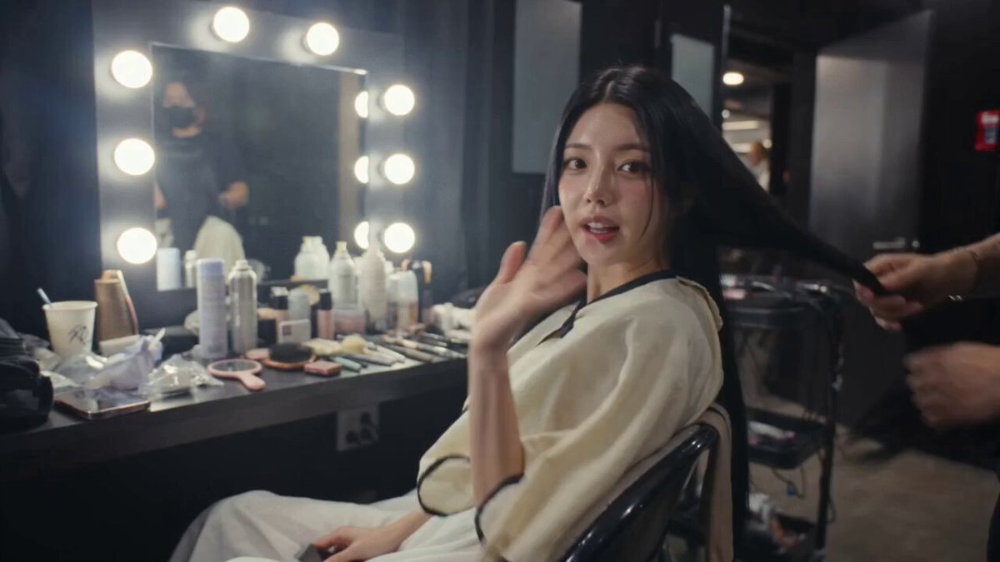
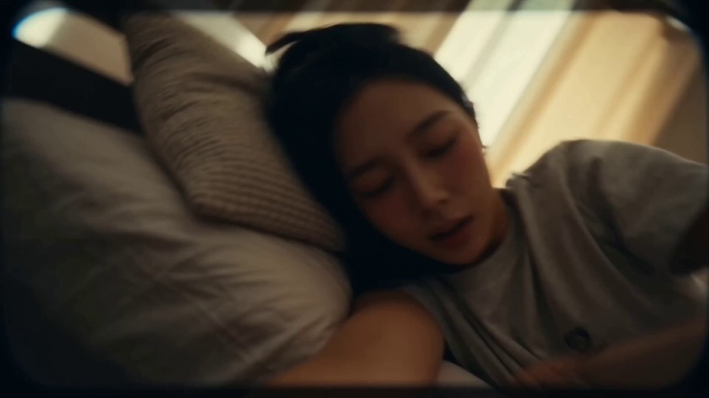
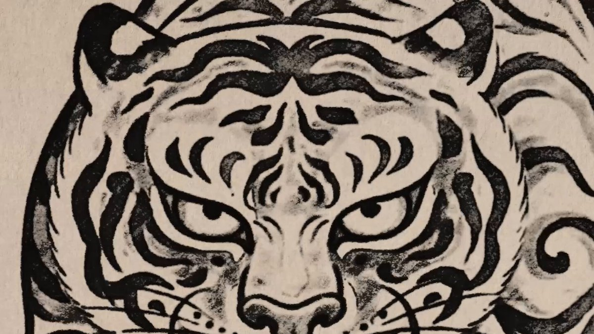

[Archivo de prompts de Seedance 2.0](../seedance-2-0_es.md)

<a id="templates-structured"></a>
# 📐 Templates & Structured Formats (28)

<a id="templates-structured-case-1"></a>
<!-- Case 1: Supercarrier Catastrophic Sinking (by @johnAGI168) -->
### Caso 1: [Hundimiento catastrófico de un superportaaviones](https://x.com/johnAGI168/status/2040432247094870343) (por [@johnAGI168](https://x.com/johnAGI168))

| Resultado |
| :----: |
| <a href="https://x.com/johnAGI168/status/2040432247094870343"></a> |

**Prompt:**

```
How does it look?

Seedance 2.0 text-to-video prompt below:

{"lang":"en","prompt":"Style and atmosphere: apocalyptic naval destruction, with low-saturation steel blue and gunmetal gray as the primary palette. Amber explosions and aviation-fuel flames tear through the gray field. Towering storm cumulonimbus clouds are lit from within by lightning. Rain lines cut across every surface. Telephoto compression layers destruction on top of destruction. Live-action brutal aesthetics--no clean CG gloss, only grit, weight, and mass. Motion description: an extreme long aerial drone pullback shows a supercarrier catastrophically listing to port in monstrous waves, with the flight deck tilted beyond forty-five degrees and seawater washing across it as a white sheet of surf. Three fighter jets break free of their tie-down chains at the same time, sliding sideways across the slick steel deck. Their landing gear scrapes metal and throws long chains of sparks, and the first jet flips over the deck edge into the churning gray sea. Hard cut to a handheld medium low-angle shot from water level looking upward--the carrier's hull towers overhead like a collapsing skyscraper. Barnacle-covered steel plates groan and bend, rivets eject one after another like automatic gunfire, and a structural crack splits open from the middle of the hull, with shockwaves rippling across the metal skin. Seawater pours through the widening rupture. Cut to a stable circling wide tracking shot--the carrier breaks in two at the fracture point, the bow plunging forward into a giant swell while the stern rises toward the sky, exposing propellers still spinning in the air. Tons of seawater cascade off the lifted stern like a cluster of waterfalls. Aviation fuel ignites on the sea surface--flames spread outward in a widening ring across the water, and twisted black smoke columns rise into the storm. An abnormal twenty-meter wave surges in from the left side of frame and slams head-on into the tilting bow. White spray explodes sixty meters into the air and swallows the entire forward structure. Static description: catastrophic structural failure of a Nimitz-class supercarrier. North Atlantic storm conditions--fifteen-meter swells, horizontal rain, and sixty-knot winds blowing the wave crests into mist. Thundercloud base at three hundred meters with internal lightning illumination. The flight deck is littered with loose aircraft, broken tie-down chains, and seawater. The hull is split open at the center, exposing interior deck layers. Aviation fuel burns on the sea surface. An abnormal giant wave approaches from port."}
```

<a id="templates-structured-case-2"></a>
<!-- Case 2: Reconstruction of Memory Shards (by @TechTalkNAVI) -->
### Caso 2: [Reconstrucción de fragmentos de memoria](https://x.com/TechTalkNAVI/status/2040327899606306840) (por [@TechTalkNAVI](https://x.com/TechTalkNAVI))

| Resultado |
| :----: |
| <a href="https://x.com/TechTalkNAVI/status/2040327899606306840"></a> |

**Prompt:**

```
{
 "effect_id": "ethereal_02",
 "title": "Reconstruction of Memory Shards",
 "visual_style": "Abstract Cinematic / Art Installation",
 "duration": "10s",
 "prompt": "A mesmerizing slow-motion shot of thousands of irregularly shaped crystal shards suspended in a void. Each shard acts as a perfect miniature prism, reflecting a different hyper-realistic sunset or starry night inside it. As if pulled by an unseen force, they begin to drift toward a central point, forming a perfect sphere. When they touch, they do not collide but merge seamlessly like liquid glass. The sphere ignites into a blindingly beautiful, soft internal pulse of pure white light, casting fractal patterns of light and shadow everywhere. Photorealistic glass rendering, intense reflection and refraction simulation, poetic atmosphere.",
 "vfx_technical_details": {
  "glass_shader": "Sub-surface scattering with complex refraction and dispersion (Abbe numbers).",
  "particle_attractor": "Force-field-based particle convergence with smooth merging simulation.",
  "lighting": "Dynamic HDR environment mapping inside each shard, with a strong internal light source upon merge."
 }
}

#capcutgenai
#capcutjapandiscord
#CapCutSeedance2
```

<a id="templates-structured-case-3"></a>
<!-- Case 3: Blueprint to Reality – Single-Story House Transformation (by @craftian_keskin) -->
### Caso 3: [Del plano a la realidad: transformación de una casa de una planta](https://x.com/craftian_keskin/status/2039053365666037902) (por [@craftian_keskin](https://x.com/craftian_keskin))

| Resultado |
| :----: |
| <a href="https://x.com/craftian_keskin/status/2039053365666037902"></a> |

**Prompt:**

```
{
 "video_prompt": {
 "duration": "15 seconds",
 "title": "Blueprint to Reality – Single-Story House Transformation",
 "style": "Architectural visualization, photoreal, modern farmhouse exterior, clean cinematic motion",

 "blueprint_reference": {
 "floors": 1,
 "footprint_shape": "Irregular L-plus-T shape",
 "layout_zones": {
 "top_left": "Master bedroom with large en-suite (double vanity, bathtub, shower, toilet)",
 "top_center": "Open lounge / sitting area with plants",
 "top_right": "Secondary bedroom + full bathroom",
 "center_left": "Walk-in closet / laundry adjacent to master bath",
 "center": "Open-plan kitchen with island, connected to dining room",
 "center_right": "Family room / playroom with colorful seating",
 "right": "Covered outdoor terrace / patio (open to sky)",
 "bottom_center": "Entry foyer leading to interior",
 "bottom_left": "Double attached garage (2-car, open indoor space, roofed)",
 "bottom_right_upper": "Bedroom 3 with shared bathroom",
 "bottom_right_lower": "Bedroom 4 with small private patio (open to sky)",
 "bottom_right_corner": "Small outdoor lounge / garden corner (open to sky)"
 }
 },

 "roof_rules": {
 "all_interior_rooms": "Fully covered with roof — master bedroom, all secondary bedrooms, bathrooms, kitchen, dining, family room, lounge, garage, foyer, hallways",
 "outdoor_spaces": "Open to sky — right-side terrace, bottom-right small patio, garden corner",
 "garage": "Roofed as part of main structure, no skylight"
 },

 "exterior_style_reference": {
 "roof_type": "Standing seam dark charcoal / black metal roof, low-to-mid pitch",
 "facade": "Light beige / warm white board-and-batten vertical siding",
 "trim": "Dark brown / black window frames and fascia",
 "garage_door": "Dark modern panel garage door, double-wide",
 "covered_porch": "Covered front entry and right-side patio with exposed wood beam columns",
 "windows": "Large black-framed rectangular windows matching each room's position"
 },

 "sequence": [
 {
 "time": "0:00–0:02",
 "action": "Clean white background. Crisp 2D top-down colored floor plan appears — exact layout with all rooms labeled, walls in bold black, rooms color-coded in warm wood tones and blue for bathrooms, gray for garage."
 },
 {
 "time": "0:02–0:05",
 "action": "Camera slowly pulls back. Floor plan glows softly. Thin white grid lines appear beneath the plan, establishing ground plane. Room walls begin to gently pulse, ready to rise."
 },
 {
 "time": "0:05–0:09",
 "action": "Walls begin extruding upward from the 2D plan — all interior walls rise simultaneously, preserving exact footprint. Garage walls, bedroom walls, k
```

<a id="templates-structured-case-4"></a>
<!-- Case 4: Martial-Arts Haute Couture Tailor (by @Adam38363368936) -->
### Caso 4: [Sastre de alta costura y artes marciales](https://x.com/Adam38363368936/status/2037359552849666514) (por [@Adam38363368936](https://x.com/Adam38363368936))

| Resultado |
| :----: |
| <a href="https://x.com/Adam38363368936/status/2037359552849666514"></a> |

**Prompt:**

```
SUBJECTS:
Character: a female haute couture tailor with an extremely lean build, arm muscles taut like steel wire, and eyes as cold and sharp as needles.
Wardrobe: a dark tactical vest incorporating qipao elements, bare arms, forearms wrapped with dark red silk bracers to increase friction, long slender fingers with metallic fingertip guards.
Movement style: a fusion of Wing Chun's short explosive power and Tai Chi's circular flow. The movement follows the rhythm of charge -> explosive strike -> instant stillness, emphasizing finger burst power and the tension of silk in the air.

ENVIRONMENT:
A dim, luxurious private studio. The background is a full wall of redwood spool racks, where thousands of color blocks create geometric beauty. In the center stands a giant black marble cutting table with a mirror-like surface. Above it hangs a single focused industrial cold light. Tiny fiber particles float in the air.

MOOD:
Extremely focused, elegant, ceremonial, and deadly. Her movements are as precise as a surgeon's, creating a highly oppressive visual sensation.

TIMELINE:
0:00-0:02: close-up / wide-angle POV. The tailor braces both hands on the black marble table and lowers her head in complete stillness. The camera rushes in at extreme speed. She suddenly raises her head and locks eyes with the lens. Her right hand snatches through empty air and catches a bolt of dark purple heavy silk that slides across the tabletop like a serpent.

0:02-0:05: rapid edit / handheld feel. The tailor throws the silk into the air. She moves like an afterimage, holding long silver shears in her right hand, performing a blind cut the instant the silk begins to fall. This is not ordinary tailoring--each cut carries the force of a martial-arts strike. The shears slice the air with a sharp tearing sound, and the fabric edge is perfectly clean and undisturbed.

0:05-0:07: moving shot. She side-steps to the far end of the worktable. With a sweep of one hand, several steel needles leap up from a pin cushion and hover in midair. She pushes with internal force, and the needles shoot like hidden weapons into distant hanging garment patterns. The needle tails tremble with a metallic ring.

0:07-0:10: continuous shot. The tailor begins controlling thread. She pulls out a gold filament and wraps it through the gaps of her fingers, manipulating the silk like puppet strings so it folds and forms itself automatically in midair. Every finger flick crackles with spark-like static electricity. She slams the table with her elbow, making the presser foot bounce upward, and catches it instantly, locking it onto the fabric.

0:10-0:12: match cut. The tailor spins sharply in place, and the hem of her outer garment spreads like a circular formation. She brings both hands together and yanks the formed suit collar tight. The final gold thread draws a perfect arc in the air and stitches itself shut. The action cuts from extreme speed into extreme slow motion.

0:12-0:15: stable POV. Dust settles. She lifts the finished gown with one hand and snaps it open in front of the camera. The lens focuses on the exquisite embroidery at the collar. She flicks a button with her nail--the button vibrates. She then turns and walks into the shadows, leaving only her back as the frame is completely covered by an expensive perfume mist that rises and fades out cleanly.
```

<a id="templates-structured-case-5"></a>
<!-- Case 5: Beat-Synced Outfit Transition Template (by @aimikoda) -->
### Caso 5: [Plantilla de cambio de atuendo sincronizado con el ritmo](https://x.com/aimikoda/status/2040200435986817039) (por [@aimikoda](https://x.com/aimikoda))

| Resultado |
| :----: |
| <a href="https://x.com/aimikoda/status/2040200435986817039"></a> |

**Prompt:**

```
FORMAT: 15s / 145 BPM / 15 SHOTS / beat-synced routine

SUBJECT: @[image1].
WARDROBE: Sleep tee and lounge shorts at home. Tailored jacket, fitted top, trousers, and lace-up shoes outside.
```

<a id="templates-structured-case-6"></a>
<!-- Case 6: Dancing Skyscraper District Template (by @TechTalkNAVI) -->
### Caso 6: [Plantilla de distrito de rascacielos danzantes](https://x.com/TechTalkNAVI/status/2039928267323658399) (por [@TechTalkNAVI](https://x.com/TechTalkNAVI))

| Resultado |
| :----: |
| <a href="https://x.com/TechTalkNAVI/status/2039928267323658399"></a> |

**Prompt:**

```
{
 "location": "Nishi-Shinjuku Skyscraper District (near Tokyo Metropolitan Government Building)",
 "duration": "10s",
 "prompt": "A wide cinematic shot of the Tokyo Metropolitan Government Building at sunset. As a deep bass sound hits, the massive twin towers begin to stretch and compress vertically like an accordion in perfect rhythm. Despite the rubber-like stretching, the glass and concrete textures remain perfectly sharp and realistic. The surrounding skyscrapers join the movement, swaying and leaning toward the center as if the entire city is dancing to a hidden beat. Reflection on the windows shifts realistically with the deformation.",
 "vfx_focus": [
 "Non-rigid body deformation (Squash and Stretch)",
 "Real-time reflection mapping during mesh warp",
 "Atmospheric depth and sunset lighting"
 ]
}
```

<a id="templates-structured-case-7"></a>
<!-- Case 7: Starlight Shadow / Stardust Silhouette (by @TechTalkNAVI) -->
### Caso 7: [Sombra estelar / silueta de polvo de estrellas](https://x.com/TechTalkNAVI/status/2039904725639037110) (por [@TechTalkNAVI](https://x.com/TechTalkNAVI))

| Resultado |
| :----: |
| <a href="https://x.com/TechTalkNAVI/status/2039904725639037110"></a> |

**Prompt:**

```
{
 "scene_id": 4,
 "title": "Starlight Shadow / Stardust Silhouette",
 "duration": "10s",
 "visual_style": "Fantasy / High-End Commercial",
 "prompt": "A person walks by a clean white wall in a bright, sunlit gallery. Their shadow follows them, but then gracefully stops and starts performing a rhythmic, elegant dance. The shadow is made of soft, shimmering dark-blue particles. As the person reaches out to high-five the wall, the shadow hand gently emerges into the 3D world as a translucent, glowing crystalline form, meeting the person's hand with a soft trail of light.",
 "vfx_technical_details": {
 "camera_work": "Smooth, cinematic tracking shot with a focus on the interaction point.",
 "shadow_FX": "Particle-based shadow simulation with soft edges and internal luminescence.",
 "transition_FX": "Seamless 2D-to-3D transition using a translucent glass shader and light trail effects.",
 "lighting": "Bright, warm afternoon sunlight to contrast with the cool-toned magical shadow."
 },
 "key_elements": [
 "Independent dancing silhouette",
 "Shimmering particle effects",
 "Translucent crystalline 3D hand",
 "Magical and inspiring atmosphere"
 ]
}
```

<a id="templates-structured-case-8"></a>
<!-- Case 8: Painterly Parkour POV Template (by @0xbisc) -->
### Caso 8: [Plantilla POV de parkour pictórico](https://x.com/0xbisc/status/2040041171460968728) (por [@0xbisc](https://x.com/0xbisc))

| Resultado |
| :----: |
| <a href="https://x.com/0xbisc/status/2040041171460968728"></a> |

**Prompt:**

```
SUBJECTS:

Main Subject: A parkour expert in POV perspective, defined by visible arms, hands, forearms, shoe tips, lower knees, grips, hand placements, wall runs, precise landings, slides, landing cushioning, and weight shifts.

Style: Painterly 3D, stylized on real human anatomy
```

<a id="templates-structured-case-9"></a>
<!-- Case 9: 360 POV Downhill Stair Run Template (by @aimikoda) -->
### Caso 9: [Plantilla POV 360 de carrera escaleras abajo](https://x.com/aimikoda/status/2039827756083540361) (por [@aimikoda](https://x.com/aimikoda))

| Resultado |
| :----: |
| <a href="https://x.com/aimikoda/status/2039827756083540361"></a> |

**Prompt:**

```
FORMAT: 15s / 180 BPM / ONE CONTINUOUS SHOT / 360 POV downhill stair run, viral energy, max chaos

SUBJECTS: First-person cyclist, handlebars and front wheel flashing low in frame during drops and hard turns. Vendors, laundry, scooters, dogs, chickens, cars, and
```

<a id="templates-structured-case-10"></a>
<!-- Case 10: Food and Character Motion Template (by @Just_sharon7) -->
### Caso 10: [Plantilla de movimiento de comida y personajes](https://web.archive.org/web/*/https://x.com/Just_sharon7/status/2039725656393875580) (por [@Just_sharon7](https://x.com/Just_sharon7))

| Resultado |
| :----: |
| <a href="https://web.archive.org/web/*/https://x.com/Just_sharon7/status/2039725656393875580"></a> |

**Prompt:**

```
{
 "prompt": "Cinematic, hyper-realistic or stylized 3D/2.5D rendering of food and characters, with strong motion and dynamic camera work. Vibrant, saturated color grading with warm food tones (reds, oranges, yellows) contrasted by dramatic shadows or neon accents. Sweeping pans, close-ups on textures, slow-motion impacts, quick cuts. High detail on food surfaces including glossy sauces, steam, crumbs, splashes, and expressive character faces. Short, loopable or 'wait-for-it' format with satisfying payoff. Ultra-realistic textures, volumetric lighting, film grain, cinematic composition.",
 "style": {
 "render_type": "3D/2.5D",
 "lighting": "volumetric, cinematic",
 "color_grading": "vibrant, warm tones with dramatic shadows",
 "camera": "dynamic, sweeping pans, close-ups, slow-motion, quick cuts",
 "detail": "hyper-realistic textures, high detail food surfaces, expressive faces",
 "format": "short, loopable, satisfying payoff"
 },
 "resolution": "2K",
 "aspect_ratio": "9:16",
 "stylize": 250,
 "version": "2.0"
}
```

<a id="templates-structured-case-11"></a>
<!-- Case 11: Impossible Camera Kitchen Rush Template (by @Dheepanratnam) -->
### Caso 11: [Plantilla de carrera por la cocina con cámara imposible](https://x.com/Dheepanratnam/status/2039568902481387645) (por [@Dheepanratnam](https://x.com/Dheepanratnam))

| Resultado |
| :----: |
| <a href="https://x.com/Dheepanratnam/status/2039568902481387645"></a> |

**Prompt:**

```
FORMAT: 15s / single continuous impossible camera move / no dialogue STYLE: High-end commercial kitchen during dinner rush, gleaming stainless steel, flying ingredients, photorealistic micro-to-macro cinematic 8K

Shot 01 (0:00–2:00): Camera starts at floor level on anti-slip
```

<a id="templates-structured-case-12"></a>
<!-- Case 12: Time-Freeze POV Burst Template (by @CharaspowerAI) -->
### Caso 12: [Plantilla de ráfaga POV con tiempo congelado](https://x.com/CharaspowerAI/status/2039704453784191201) (por [@CharaspowerAI](https://x.com/CharaspowerAI))

| Resultado |
| :----: |
| <a href="https://x.com/CharaspowerAI/status/2039704453784191201"></a> |

**Prompt:**

```
{
 "shot": {
 "composition": "POV time-freeze with hands moving through frozen environment",
 "lens": "ultra-wide cinematic lens with subtle distortion",
 "camera_movement": "slow walk, precise hand movements, sudden time release burst"
 },
 "subject": {
 "description": "person moving while everything else is frozen mid-action",
 "wardrobe": "hands visible",
 "props": "frozen people, objects mid-air, suspended debris"
 },
 "scene": {
 "location": "busy city street",
 "time_of_day": "day",
 "environment": "people frozen mid-motion, objects suspended in air"
 },
 "visual_details": {
 "action": "walk through frozen crowd, move objects, sudden time resumes explosively",
 "special_effects": "time freeze particles, motion snap release",
 "hair_clothing_motion": "fabric still then snapping with time"
 },
 "cinematography": {
 "lighting": "clean daylight with sharp shadows",
 "color_palette": "natural tones with crisp contrast",
 "tone": "mind-bending, cinematic"
 },
 "audio": {
 "music": "slow ambient then explosive drop",
 "ambient": "silence then sudden chaos",
 "sound_effects": "time snap, object movement",
 "mix_level": "contrast silence and burst"
 }
}
```

<a id="templates-structured-case-13"></a>
<!-- Case 13: Astronaut First Spacewalk Template (by @BrennanErbz) -->
### Caso 13: [Plantilla del primer paseo espacial de un astronauta](https://x.com/BrennanErbz/status/2039579736301781215) (por [@BrennanErbz](https://x.com/BrennanErbz))

| Resultado |
| :----: |
| <a href="https://x.com/BrennanErbz/status/2039579736301781215"></a> |

**Prompt:**

```
FORMAT: 15s / handheld close + slow cuts / 5 beats / sci-fi drama — astronaut's first spacewalk, orbital silence SUBJECTS: An astronaut, 40s, in a white EVA suit with a gold-visored helmet, tethered to the exterior of a space station, performing the first moments of a spacewalk.
```

<a id="templates-structured-case-14"></a>
<!-- Case 14: Golden Retriever Routine Template (by @0xbisc) -->
### Caso 14: [Plantilla de rutina de un golden retriever](https://x.com/0xbisc/status/2039673040787956123) (por [@0xbisc](https://x.com/0xbisc))

| Resultado |
| :----: |
| <a href="https://x.com/0xbisc/status/2039673040787956123"></a> |

**Prompt:**

```
SUBJECTS:
Subject 1: Adult male, Western casual everyday home and outing attire, short jacket, basic T-shirt, long pants, everyday shoes; lean build, natural and efficient movements.
Subject 2: Golden Retriever, large head, broad chest, thick, fluffy fur; overall short and round
```

<a id="templates-structured-case-15"></a>
<!-- Case 15: Stylized 3D Barbershop Transformation Sequence (by @ShamiWeb3) -->
### Caso 15: [Secuencia estilizada de transformación en una barbería 3D](https://x.com/ShamiWeb3/status/2039372124079669655) (por [@ShamiWeb3](https://x.com/ShamiWeb3))

| Resultado |
| :----: |
| <a href="https://x.com/ShamiWeb3/status/2039372124079669655"></a> |

**Prompt:**

```
{
 "title": "Stylized 3D Barbershop Transformation Sequence",
 "style": "Stylized 3D animation with exaggerated cartoon proportions, cinematic martial-arts-inspired choreography, rhythmic musical energy, ultra-smooth motion, expressive physics",

 "characters": {
 "dr_eraser": {
 "description": "Lean, almost skeletal barber-scientist with long fingers and oversized glasses that slip down his nose. Wears a bright yellow lab coat filled with strange tools (mini vacuum, magnifying glass, combs, razors, quirky gadgets).",
 "movement_style": "step → pause → spin, precise, calm, orchestral control over chaos"
 },
 "patient_plush": {
 "description": "Huge, soft, teddy-bear-like client with wild messy hair, extremely long drooping beard, and a stained oversized sweater.",
 "emotion": "nervous, trembling, comically overwhelmed, eyes tracking every movement"
 }
 },

 "environment": {
 "location": "Whimsical cartoon barbershop",
 "details": "Oversized mirrors reflecting exaggerated motion, warm golden lighting, steam curling like soft clouds, gleaming tools, hair accumulating like fluffy clouds"
 },

 "mood": "Absurd precision vs comedic fear; controlled elegance vs chaotic nervous energy",

 "timeline": [
 {
 "time": "0:00-0:02",
 "shot": "Close-up",
 "action": "Patient Plush shown with wild hair and massive beard. Dr. Eraser dramatically pulls oversized scissors, spins them on finger, snaps toward camera. Coat flares like wings. Plush reacts in exaggerated shock."
 },
 {
 "time": "0:02-0:05",
 "shot": "Mirror medium shot",
 "action": "Scissors cut rhythmically. Hair falls like confetti. Glasses magnify strands. Beard and hair begin transforming. Plush grips chair, eyes dart nervously."
 },
 {
 "time": "0:05-0:08",
 "shot": "Tracking shot",
 "action": "Scissors disappear. A giant straight razor appears like a sword. Beard shaved in stylized strips. Foam bursts like fireworks. Plush closes eyes tightly."
 },
 {
 "time": "0:08-0:11",
 "shot": "Slow motion",
 "action": "Hot towel spins through air, lands perfectly, then removed in one sharp motion revealing smooth skin. Plush touches face in disbelief."
 },
 {
 "time": "0:11-0:13",
 "shot": "Styling sequence",
 "action": "Pomade applied with theatrical precision. Hair reshaped into shiny cartoon-perfect style. Talc brush creates glowing powder cloud."
 },
 {
 "time": "0:13-0:15",
 "shot": "Final reveal",
 "action": "Chair spins to mirror. Patient Plush fully transformed. He touches face in awe. Dr. Eraser stands behind, spins scissors once, snaps them shut, nods confidently."
 }
 ],
}
```

<a id="templates-structured-case-16"></a>
<!-- Case 16: Impressionist Rowing Hands Template (by @0xbisc) -->
### Caso 16: [Plantilla impresionista de manos remando](https://x.com/0xbisc/status/2039332336643248317) (por [@0xbisc](https://x.com/0xbisc))

| Resultado |
| :----: |
| <a href="https://x.com/0xbisc/status/2039332336643248317"></a> |

**Prompt:**

```
SUBJECTS:
Subject 1: First-person perspective hands (rendered in Monet impressionist oil painting brushwork, soft skin tones with no hard edges; both hands continuously hold the oar and perform extremely slow and even rowing motions, with stretched rhythm and natural pauses)
```

<a id="templates-structured-case-17"></a>
<!-- Case 17: Female Warrior — Structured Subject Prompt (by @noman23761) -->
### Caso 17: [Guerrera: prompt de sujeto estructurado](https://x.com/noman23761/status/2041406971484815564) (por [@noman23761](https://x.com/noman23761))

| Resultado |
| :----: |
| <a href="https://x.com/noman23761/status/2041406971484815564"></a> |

**Prompt:**

```
"SUBJECTS: A female warrior with shoulder-length hair, the ends naturally flipping outward, pressed backward and slightly disheveled by air resistance during high-speed movement. She wears a dark, form-fitting tactical suit combining real fabric and worn metal elements, with visible water stains, dust, and signs of use. A dual mechanical grappling hook system mounted on her back, capable of firing steel cables that retract to generate pulling force. The hook tips are metal impact heads used for attaching to or striking solid structures. The cable only triggers when support is lost or during a fall, and must latch onto a solid object before generating tension. Movement relies on: sliding, stepping, grappling pull, swinging, contact, and displacement through reaction forces. A massive stone hand connected to a giant’s body (not severed, the arm extending upward into the clouds), descending vertically into frame from the cloud layer. Enormous in scale, with a weathered, rough surface, no glow, no regular structure. Each downward press carries clear weight, acceleration, air compression, and impact inertia. ENVIRONMENT: A high-altitude fractured bridge structure with wet, slippery concrete surfaces, showing water traces, cracks, and scattered debris. The bridge is heavily damaged, with irregular टूट sections, exposed and bent rebar, and hanging steel cables. Below the bridge is an empty abyss, swallowed by fog, with no visible ground. A distant city appears low and ruined, with r
```

<a id="templates-structured-case-18"></a>
<!-- Case 18: Loft-in-a-Box Interior Reveal (by @samaote) -->
### Caso 18: [Revelación del interior de un loft desde una caja](https://x.com/samaote/status/2077757783966183428) (por [@samaote](https://x.com/samaote))

| Resultado |
| :----: |
| <a href="https://x.com/samaote/status/2077757783966183428"></a> |

**Prompt:**

```
Image Prompt:
A modern loft living room at golden hour, concrete floors, tall windows, neutral modular sofa, glass coffee table, warm LED accents, oversized abstract art, calm and quietly luxurious.

Video Prompt:
Start with a wide, locked-off cinematic shot of the bright empty room. A single IKEA cardboard box sits in the exact center of the floor. Keep the camera completely stable and preserve the room perspective.
After a brief pause, the box begins to vibrate subtly. The lid lifts and warm golden light glows from inside. Furniture pieces and interior elements rapidly unfold, expand, and assemble outward from the box in a clean, elegant transformation sequence.
The floor smoothly transitions from pale wood into polished concrete. A large neutral modular sofa unfolds and slides into position on the left. A textured rug spreads naturally beneath it. A sleek glass coffee table assembles in the center. Two modern lounge chairs glide into place on the right. A floating wooden console appears against the back wall. Oversized abstract artwork rises and mounts itself cleanly on the walls. Decorative lamps, plants, books, and vases settle into position with realistic motion. Warm LED strips illuminate along the ceiling edge and wall corner.
As the transformation completes, the daylight gradually shifts into golden hour. Soft sunset light streams through the tall windows, casting warm shadows across the finished modern loft living room.
End on the fully furnished, calm, quietly luxurious interior. Hold the final composition for a moment.
Motion style: smooth premium interior-design reveal, realistic physics, elegant unfolding animation, clean assembly sequence, no chaotic explosions, no floating objects after placement.
Camera: fixed wide-angle shot, no zoom, no camera shake, no angle change.
Negative prompt: no people, no extra rooms, no duplicated furniture, no distorted furniture, no warped walls, no text changes, no logo distortion, no sudden cuts, no messy construction debris, no cartoon animation.
```

<a id="templates-structured-case-19"></a>
<!-- Case 19: Facial Expression Detail Test (by @ou_zhen599) -->
### Caso 19: [Prueba de detalle de expresiones faciales](https://x.com/ou_zhen599/status/2078137477425172769) (por [@ou_zhen599](https://x.com/ou_zhen599))

| Resultado |
| :----: |
| <a href="https://x.com/ou_zhen599/status/2078137477425172769"></a> |

**Prompt:**

```
0–2 seconds: Head bowed, eyes cast downward, with a subtle, faint smile playing at the corners of her lips—without showing her teeth—her expression gentle and serene.
2–4 seconds: The smile gradually fades, and the corners of her mouth return to neutral; her eyes and head slowly lift, her gaze shifting to the right side of the frame, her expression turning to one of focused attention.
4–6 seconds: She continues to look to the right, her eyes taking on a hint of mild confusion and concern; her eyes widen slightly (naturally), her lips part slightly as if she’s about to speak but holds back, and her eyebrows and eyes narrow slightly without furrowing.
6–8 seconds: Her gaze slowly drifts downward, her head tilts slightly; the smile fades completely, her expression becoming quiet and forlorn, as she suppresses her emotions inwardly—without shedding tears or crying.
8–10 seconds: Lower your head and gently close your eyes to compose yourself; a faint, self-deprecating smile—concealing your sadness—appears at the corners of your mouth. Breathe naturally, and move with the utmost subtlety.
10–12 seconds: Slowly lift your head; your eyes meet the soft light once more, gradually brightening yet remaining restrained. Turn your face forward or slightly to the right, with a hint of tenderness and slight resentment at the corners of your lips.
12–15 seconds: Look straight ahead or toward the right side of the frame, with a soft, slightly moist gaze. The lips move slightly as if on the verge of speaking but hold back; ultimately, maintain a quiet, fixed gaze, frozen in a gentle, cool, and slightly melancholic mood. The scene ends without a black screen or transition.
0-2秒：低头垂眸，嘴角噙着含蓄淡笑，不露齿，神态温柔安静。
2-4秒：笑意缓缓收敛，嘴角归平；双眼、头部慢慢抬起，视线转向画面右侧，神情转为认真留意。
4-6秒：持续望向右方，眼神添上浅淡疑惑与担忧，双眼微睁（幅度自然），嘴唇轻启呈欲言又止状，眉眼微收，不皱眉。
6-8秒：视线缓缓下沉，头部微低，笑意尽数褪去，神情安静失落，内敛压抑情绪，不流泪、不哭泣。
8-10秒：低头轻阖双眼，平复心绪，嘴角浮现一抹藏起难过的浅淡自嘲式浅笑，呼吸自然，动作极轻。
10-12秒：缓缓抬头，眼眸重新迎向柔光，眼神渐亮却依旧克制，面部转向前方/偏右，唇角带一丝温柔又委屈的淡意。
12-15秒：目视前方/画面右侧，眼神柔和微润，唇瓣轻动似欲语还休，最终保持安静凝视状态，定格在温柔清冷、略带忧郁的情绪中，结尾无黑屏、无转场。
```

<a id="templates-structured-case-20"></a>
<!-- Case 20: Flooded Ballroom Escape Storyboard (by @ChangningL29508) -->
### Caso 20: [Guion gráfico de escape en un salón de baile inundado](https://x.com/ChangningL29508/status/2078684698394636544) (por [@ChangningL29508](https://x.com/ChangningL29508))

| Resultado |
| :----: |
| <a href="https://x.com/ChangningL29508/status/2078684698394636544"></a> |

**Prompt:**

```
@Image1 storyboard is a temporal beat map only. Create one continuous full-screen 16:9 cinematic 15-second live-action sequence, never show a panel grid, black gutters, collage, captions, or text. Same young adult bride with wet black hair, ivory satin wedding dress and red rubber boots; same soaked groom in a black tuxedo; same red-dress bridesmaid; same waiter in black vest. In a flooded Art Deco ballroom at night, follow the storyboard left to right, top to bottom: the bride pulls the groom through knee-deep water toward the warm exit; the bridesmaid follows with her shoes; the waiter opens and holds the door; guests plausibly clear the path and evacuate; the couple and bridesmaid reach the doorway. Cold blue-green storm light and warm chandelier reflections, believable water physics, cinematic 35mm camera, one natural continuous progression. Stable faces and identities, anatomically correct hands, no duplicate people, no warped anatomy, no elderly bride, no police, no weapons, no random actions, no watermark, no logo, no subtitles.
```

<a id="templates-structured-case-21"></a>
<!-- Case 21: Station Platform Duel Beatmap (by @SYDxStudio) -->
### Caso 21: [Guía de duelo en andén](https://x.com/SYDxStudio/status/2079286923424575628) (por [@SYDxStudio](https://x.com/SYDxStudio))

| Resultado |
| :----: |
| <a href="https://x.com/SYDxStudio/status/2079286923424575628"></a> |

**Prompt:**

```
Use @image1 only as P01-P06 movement waypoints for one uninterrupted action, never as shots, holds, a displayed image or style source. Flow through P02-P05 without stopping; P01/P06 are boundaries. Set STEP 06 as first frame and STEP 06T as last; they alone lock boundary staging. @image2 solely controls KAI: 185 cm, face always uncovered, headphones, black tank, twin cyan blades. @image3 solely controls KIRA: 165 cm, mask always worn, RIGHT dagger reverse/LEFT forward, two rear-belt capsules. @image4 is a mixed sheet: use ONLY Zone F Old Ward platform; ignore other panels/artifacts.

Exactly 10.0 seconds, 24 fps. ZONE F ONLY: same stationary train, west platform, tiled column, bench, departure board, brake chain and closed carriage door; never reveal/enter Car 5. Start exact STEP 06, finish exact STEP 06T. During action KAI's tank right seam is sliced; floor, column, bench and board become damaged and remain so. Chain and door stay intact. No dialogue/music; only breath, shoes, cloth, blades, tile, bolts, timber, metal, debris.

LOOK: hand-drawn 2D shonen-wuxia sakuga matching boundaries; variable black ink, flat cel blocks, one hard shadow, stepped drawings, foreshortening, dry-brush smears, simplified background only in velocity bursts; never photoreal, glossy, 3D or game-cinematic.

CAMERA MODE: one continuous 20 mm master, no cuts. Launch low with KAI, dive under KIRA, inherit his eastward slide, whip around the same column, rise beside the rotating board, recoil with Sonic Strike, settle into STEP 06T. Tiles/debris prove parallax; no stable sideline or location crossing.

PHRASE 1, actions 1-5: frame one, KIRA pushes from lintel; dives down-left; KAI springs up-right; twin blades catch crossed daggers off-axis for two frames; both twist out instantly, KIRA already moving east before landing.

PHRASE 2, actions 6-10: KIRA scissor-cuts backward while retreating; KAI triangular-steps then long-slides east; her LEFT dagger slices only his tank's right seam; he rotates under her returning RIGHT; his RIGHT blade drives that dagger into the tiled column as she qinggong-steps on that same column and rebounds east.

PHRASE 3, actions 11-16: KIRA touches the bench once; runs two steps along its back; springs to the board bracket; severs both bolts in one crossing cut; KAI rolls under the falling board while the bench breaks; he rises into one compact Sonic Strike folding the board around the stripped column as KIRA lands beside the intact chain in exact STEP 06T. No generic sparring, repeated clash, guard reset or panel pause.

VISUAL EFFECTS: KAI uses only blade-edge-attached narrow cyan waveform crescents and segmented cyan body streaks. At the column, a compact cyan contact star forms exactly where his RIGHT blade meets KIRA's dagger; force passes through her dagger tip into grout, tiles cone east, bodies overshoot, cyan fragments decay, camera jolts once and recovers. At Sonic Strike, waveforms compress along KAI's forearms/blades into a black-cyan ink wedge at board contact; one cyan shock ring travels through metal, folds it and throws bolts, tile and dust into a radial debris silhouette; KAI recoils, ring fragments, camera snaps back. KIRA uses only needle-thin dagger-attached violet crescents and two path-bound violet-black afterimages, never clones. Her bolt cut creates a localized violet impact star; stress crosses both bolts, fragments lag, violet decays. Cyan never belongs to KIRA; violet-black never to KAI; no detached beam, aura cloud or constant glow.

Never show storyboard/panels/labels/borders. No cut, blackout, flash transition, smoke cover, dissolve, morph, teleport, slow motion, freeze, replay, extra body/limb/weapon, identity swap, KAI mask, unmasked KIRA, vanished damage, moving train, cut chain, breached door, Car 5, premature P06 or overshoot.
```

<a id="templates-structured-case-22"></a>
<!-- Case 22: Chibi Storm Window Blowout (by @kinovi_ai) -->
### Caso 22: [Ventanal reventado por la tormenta chibi](https://x.com/kinovi_ai/status/2079997296000033072) (por [@kinovi_ai](https://x.com/kinovi_ai))

| Resultado |
| :----: |
| <a href="https://x.com/kinovi_ai/status/2079997296000033072"></a> |

**Prompt:**

```
VISUALS:

Scene 1: Hybrid live-action photorealistic and 2.5D animation style. A dimly lit, photorealistic cozy bedroom with a large, realistic glass window. Outside, a violent, photorealistic thunderstorm is raging, with heavy sheets of water pelting the glass. Standing on her tiptoes with her face pressed near the pane is the 2.5D anime chibi character @PhoebeChibi . Her large purple eyes are sparkling with the starry-eyed, joyful expression from her reference sheet as she watches the puddles form outside.

Scene 2: Medium shot. @PhoebeChibi steps back from the glass. She performs a highly exaggerated, sneaky cartoon animation cycle, turning her head left and right, peering toward the photorealistic bedroom door to make sure her parents are nowhere in sight. Seeing the coast is clear, a mischievous, determined smile crosses her cel-shaded face.

Scene 3: Close-up on the window latch. @PhoebeChibi’s stubby 2.5D hands reach up and eagerly flip the heavy, photorealistic metal lock. She firmly pushes against the glass to crack the window open just a tiny bit.

Scene 4: Extreme visual chaos. The absolute instant the seal breaks, the pressure gives way. The photorealistic window violently blasts wide open with explosive force. A massive, torrential geyser of highly realistic rain and hurricane-force wind erupts directly into the bedroom.

Scene 5: Tight close-up on @PhoebeChibi. Her confident smile is instantly wiped away, replaced by the blank, pale, wide-eyed shocked expression from her reference sheet. Her white hat immediately blows off her head, flying away into the room. Her blonde hair whips violently in the 2.5D wind.

Scene 6: Wide shot of the bedroom. The sheer force of the storm lifts @PhoebeChibi entirely off her feet. She is violently launched backward across the length of the photorealistic room in a stiff, comical 2D pose, her arms and legs flailing. She tumbles through the air amidst a chaotic, swirling vortex of realistic rainwater, loose homework papers, and flying leaves, ultimately crashing off-screen into a pile of laundry. The camera holds on the violently flapping window curtains.

AUDIO & DIALOGUE:

The continuous, muffled baseline of heavy, rolling thunder and rain aggressively pounding against thick glass.

Scene 1 SFX: Soft, cartoonish squeak-squeak sounds as she bounces on her tiptoes.

@PhoebeChibi (voice bright, incredibly cute, and speaking English): "Wow... look at all those giant puddles! I just want to go splash in them so, so bad!"

Scene 2 SFX: A classic, sneaky tip-toe xylophone sound effect as she looks around the room.

Scene 3 SFX: A heavy, realistic kachunk of the metal window lock disengaging.

@PhoebeChibi (whispering mischievously): "Just a little bit..."

Scene 4 SFX: A deafening, concussive BOOM as the window bursts open, instantly followed by the deafening, jet-engine roar of a howling hurricane wind and the aggressive splashing of water flooding the room.

Scene 5 SFX: A sudden, hilarious record scratch cutting through the storm noise.

@PhoebeChibi (letting out a rapidly fading, high-pitched, Doppler-effect cartoon scream as she is launched across the room): "WAAAAAAHHHHHH!"

Scene 6 SFX: A loud, chaotic CRASH-BAM-THUD of her landing off-screen, knocking over several objects. The deafening roar of the wind and rain continues to howl into the open bedroom as the scene ends.
```

<a id="templates-structured-case-23"></a>
<!-- Case 23: Post-Workout Gym Vlog (by @doctorwasif) -->
### Caso 23: [Vlog de gimnasio tras el entrenamiento](https://x.com/doctorwasif/status/2080278207518126084) (por [@doctorwasif](https://x.com/doctorwasif))

| Resultado |
| :----: |
| <a href="https://x.com/doctorwasif/status/2080278207518126084"></a> |

**Prompt:**

```
**CAMERA:**
DV 16mm handheld camcorder POV. CHASE holds the camera or props it on the floor/bag. Natural hand shake, soft focus, imperfect framing, occasional clumsy zooms. Camcorder never visible.

**LOOK:**
Soft vintage tape quality, slight blur, tape noise, bloomed gym lights, flickering auto-exposure, muted contrast.

**STYLE:**
Calm post-workout gym vlog. Relaxed, slightly tired, natural pacing, genuine smiles and quiet reflections.

**CHARACTER:**
CHASE — Korean woman in her 20s. Long black hair loosely tied, light post-workout sweat, slim athletic build. Modest long-sleeve athletic top, loose joggers/leggings, socks, towel around neck.

**SETTING:**
Quiet evening gym corner with stretching mat, mirror, gym bag, protein shake, soft lighting.

**SCENES:**
1. Sits on mat, exhales. "Okay, cool-down time."
2. Hamstring stretch, laughs. "That was a lot today."
3. Shoulder stretch. "Legs are gonna be sore tomorrow."
4. Close-up grabbing protein shake.
5. Drinks. "That's actually really good."
6. Arms overhead. "I'd give today an eight out of ten."
7. Resting on knee. "Feels good to be done."
8. Waves with bag and shake. "Alright, I'm heading out—see you guys."
```

<a id="templates-structured-case-24"></a>
<!-- Case 24: Beauty Vanity Camcorder Vlog (by @doctorwasif) -->
### Caso 24: [Vlog de tocador de belleza con videocámara](https://x.com/doctorwasif/status/2080634720824807476) (por [@doctorwasif](https://x.com/doctorwasif))

| Resultado |
| :----: |
| <a href="https://x.com/doctorwasif/status/2080634720824807476"></a> |

**Prompt:**

```
CAMERA: DV 16mm tape camcorder, handheld POV by CHASE, occasionally propped on vanity. Natural shake, imperfect framing, delayed focus, clumsy zooms, face occasionally cropped. Camera never visible.

LOOK: Soft blurry tape, faint tape noise, bloomed vanity bulbs, flickering auto-exposure, muted contrast, natural skin.

STYLE: Casual beauty vlog. Relaxed, chatty, slow pacing with quiet mirror moments.

CHARACTER: CHASE, Korean idol (20s), long straight black hair, dewy skin, coral lips, robe/makeup cape. Unseen stylist's hands occasionally enter frame.

SETTING: Bulb-lit vanity, styling chair, hair tools/products on counter, handheld mirror.

STORYBOARD:
1. Propped: Waves. "Hey guys, getting my hair done."
2. Handheld CU: Hair tug. "This always takes forever."
3. Insert: Stylist clips hair. Ambient only.
4. Propped: Smiles. "We're getting to the good part."
5. Handheld CU: Watches mirror, smiles. Ambient.
6. Handheld: Checks back with mirror. "Let me see the back—"
7. Tight: Grins. "I really like this."
8. Selfie: Waves/thumbs up. "Hair's done—see you guys!"
```

<a id="templates-structured-case-25"></a>
<!-- Case 25: Neon Alley Flip-Phone Walk (by @itsPixieVerse) -->
### Caso 25: [Paseo por callejón neón con teléfono plegable](https://x.com/itsPixieVerse/status/2081539251947372587) (por [@itsPixieVerse](https://x.com/itsPixieVerse))

| Resultado |
| :----: |
| <a href="https://x.com/itsPixieVerse/status/2081539251947372587"></a> |

**Prompt:**

```
WORLD: Rain-slicked back-alley at night, palette of deep slate blue wet asphalt and warm golden-amber neon ambient light, volumetric mist, floating rain droplets caught in light, drifting cigarette smoke, layered fog depth.
CHARACTER: A tall slim man MILO [@Image] with a short dark buzzcut, narrow dark sunglasses, small fine-line tattoos on his neck and cheekbone, intricate dark tattoos covering his hands, wearing a massive oversized black leather bomber jacket, unbuttoned ivory shirt, wide charcoal trousers, and chunky loafers, with elongated stylized fashion proportions and painterly matte skin with brush-stroke shading.
ACTION (one continuous 15s moment): Opens mid-moment with him leaning casually against a classic dark vintage sedan in the rain, hands in jacket pockets. He steps forward slowly into the light, pulls one tattooed hand out to flip open a vintage flip-phone, checks a glowing amber message, flips it shut with his thumb, and looks up directly past the camera with a calm, unbothered deadpan smirk.
CAMERA: One continuous low-angle tracking shot in front of him moving backward as he walks, then smoothly speed-ramps into a tight slow push-in on his face and sunglasses as he flips the phone. No cuts.
Weighty natural character animation, heavy leather jacket and cloth reacting to momentum and wind, 24fps filmic motion, shallow depth of field. Final frame holds on a cool hero shot of him looking down the camera lens.
```

<a id="templates-structured-case-26"></a>
<!-- Case 26: Backstage Outfit Comparison Vlog (by @doctorwasif) -->
### Caso 26: [Vlog de comparación de vestuario entre bastidores](https://x.com/doctorwasif/status/2081353850779550056) (por [@doctorwasif](https://x.com/doctorwasif))

| Resultado |
| :----: |
| <a href="https://x.com/doctorwasif/status/2081353850779550056"></a> |

**Prompt:**

```
DV 16mm handheld camcorder POV, CHASE filming herself, occasionally propped against a fitting-room mirror. Natural hand shake, imperfect framing, delayed focus, clumsy zooms, tape blur/noise, bloomed vanity lights, flickering auto-exposure, muted contrast, realistic skin. Playful, energetic backstage fitting-room vlog with quick pacing. CHASE: Korean idol in her 20s, long straight black hair, dewy glass skin, coral lips, large eyes, slim. Wears two fully modest stage outfits (1: fitted long-sleeve top + tailored trousers, 2: high-neck dress over long-sleeve base layer), minimal jewelry. Backstage fitting room with mirror, garment rack, stylist off-camera, pins/fabric clips. Sequence: outfit 1 mirror turn ("Okay, first outfit—let's see."), smooths fabric ("I really like this fit."), stylist pins waist (ambient only), playful spin ("Moves pretty well!"), quick change to outfit 2 ("Now let's compare."), compares ("More elegant, but the first had better movement."), close-up thinking ("I genuinely can't decide."), selfie spin ending ("I'll let the team decide—see you on stage!"). Camcorder never visible.
```

<a id="templates-structured-case-27"></a>
<!-- Case 27: Idol Day-in-Life Montage (by @doctorwasif) -->
### Caso 27: [Montaje Diario de una Idol](https://x.com/doctorwasif/status/2081716168180809949) (por [@doctorwasif](https://x.com/doctorwasif))

| Resultado |
| :----: |
| <a href="https://x.com/doctorwasif/status/2081716168180809949"></a> |

**Prompt:**

```
**CAMERA:**
DV 16mm tape camcorder handheld feel. POV of CHASE holding the camera herself throughout each location, occasionally propped briefly for hands-free moments. Hand shake, misaligned framing, delayed focus pulls, clumsy zooms, occasional face cut-off framing, imperfect shots. Camcorder never appears on screen.

**LOOK:**
Soft, slightly blurry tape quality, faint tape noise, bloomed highlights, flickering auto-exposure, muted contrast, realistic skin tones — lighting shifts naturally per location (warm dorm light → cool van light → studio fluorescents → bright stage lights).

**STYLE:**
Fast-paced time-lapse montage feel — quick cuts stitched together across locations, sped-up transitional movement between them. Instead of synced dialogue, her voice plays as reflective voiceover narration over the visuals, tying the day together. Energy builds progressively from sleepy morning to high-adrenaline stage finish.

**Character**

CHASE — Korean idol, 20s. Long straight black hair, elegant yet lovely Korean features, dewy glass skin, coral pink lips, big eyes. Outfit changes naturally per location: cozy loungewear at the dorm, casual comfortable clothes in the van, modest athletic wear in the practice room, and a stage outfit for the final segment — each fully covering arms and torso.

**Setting Progression**

Dorm room (morning) → van interior (daytime) → practice room (afternoon) → backstage/stage (night).

**Storyboard (voiceover narration over visuals)**

1. *(~2s, dorm, propped camera, sleepy morning light)* She stretches, rubbing her eyes, hair messy. VOICEOVER (CHASE): "Every day starts the same way — way too early."

2. *(~2s, dorm, handheld, quick motion)* She moves through her morning routine in fast, sped-up cuts — brushing hair, grabbing a bag. VOICEOVER (CHASE): "Get ready, grab everything, and go."

3. *(~2s, van interior, handheld, window light)* She sits by the window, phone in hand, soft daylight passing over her face. VOICEOVER (CHASE): "The van's basically my second home at this point."

4. *(~1.5s, van, macro insert)* Close-up on her hand adjusting a playlist on her phone, light flickering through the window. No narration — ambient road sound only.

5. *(~2s, practice room, handheld, energetic)* She's mid-movement rehearsing choreography, camera catching quick glimpses of the mirror wall. VOICEOVER (CHASE): "Then it's hours of practice till my legs give out."

6. *(~2s, practice room, propped camera, water break)* She wipes sweat, drinks water, breathless but smiling. VOICEOVER (CHASE): "But somehow I never get tired of this part."

7. *(~2s, backstage, handheld, quick transition)* Hair and makeup blur past in quick cuts, staff moving around her, adrenaline building. VOICEOVER (CHASE): "And then suddenly, it's showtime."

8. *(~2s, stage, wide-to-close, high energy finish)* Bright stage lights, her silhouette stepping out as the camera catches a final glimpse before cutting to black. VOICEOVER (CHASE): "This is the part that makes all of it worth it."
```

<a id="templates-structured-case-28"></a>
<!-- Case 28: Tiger-Eye Logo Reveal (by @second_bassoon) -->
### Caso 28: [Revelación del Logo Ojo de Tigre](https://x.com/second_bassoon/status/2082926707871244566) (por [@second_bassoon](https://x.com/second_bassoon))

| Resultado |
| :----: |
| <a href="https://x.com/second_bassoon/status/2082926707871244566"></a> |

**Prompt:**

```
The frame begins completely black and empty.

FIRST 70 PERCENT OF THE SHOT — THE WRITING
Ink brushstrokes appear and grow across the frame, drawing the lettering into existence stroke by stroke, left to right, as if written by an invisible calligraphy brush. Each stroke starts at one end and extends rapidly to the other, the ink spreading outward along the path of the stroke with dry bristle texture trailing behind it. The letters build in reading order, one after another, never all at once, never fading in.

Throughout this entire writing phase, the enclosed interior of the letter G contains a tiger eye that is completely closed. Its lids are shut tight, forming a thin dark seam that is solid black and indistinguishable from the background. No amber, no orange, no gold, and no color of any kind is visible anywhere in the frame during the writing. The inside of the G reads as empty black.

FINAL 30 PERCENT OF THE SHOT — THE UNDERLINE AND THE EYE, SIMULTANEOUSLY
Only once every letter is complete and the lettering is holding still do the final two events begin, and they begin at the same moment.

A single long horizontal brushstroke sweeps rapidly left to right beneath the lettering, extending in one continuous confident motion and tapering to a fine dry point at its right end.

At that same instant, the closed tiger eye inside the G opens. Its lids part vertically from the thin dark seam, the aperture widening upward and downward until the amber-gold iris and its black vertical slit pupil fill the entire interior of the G, edge to edge, meeting the brush strokes on every side. The eye opens quickly and settles. This is the first and only moment any color appears in the shot.

THROUGHOUT
The lettering never moves, never drifts, never changes shape or position once drawn. Letters only extend and complete — they never warp, morph, wobble, or reshape themselves. The camera is completely locked and static. No camera movement of any kind, no zoom, no push, no drift, no shake.

No visible hand, no visible brush, no arm, no person. No ink splatter, no drips, no smoke, no particles. No fade-in, no dissolve, no glow, no light rays. The background stays solid pure black and completely empty for the entire shot.

NEGATIVE
The eye must not be open, visible, or colored at any point during the writing phase. No amber, orange, or gold anywhere in the frame until the underline begins. The eye does not fade in, brighten, or grow — it opens by parting its lids. The eye never appears before the lettering is finished.
```
