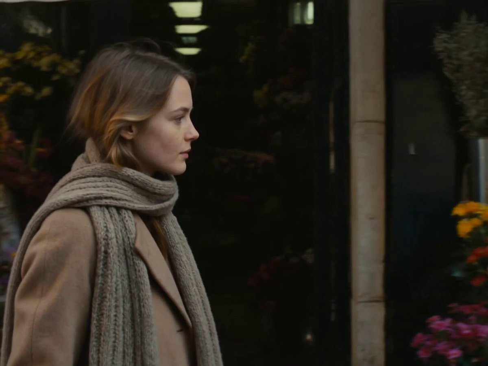

[Archives de prompts Seedance 2.0](../seedance-2-0_fr.md)

<a id="cinematic-realism"></a>
# 🎞️ Cinematic Realism (13)

<a id="cinematic-realism-case-1"></a>
<!-- Case 1: Modern Japan Documentary Sequence (by @kuranoayashi) -->
### Cas 1: [Séquence documentaire sur le Japon moderne](https://x.com/kuranoayashi/status/2040055299835650266) (par [@kuranoayashi](https://x.com/kuranoayashi))

| Résultat |
| :----: |
| <a href="https://x.com/kuranoayashi/status/2040055299835650266"></a> |

**Prompt:**

```
Modern Japan. A 15-second live-action documentary-style video set during a high-rise building fire in Tokyo Bay.
No BGM. No subtitles. Only environmental sounds, radio, wind, fire, and people's voices from the scene.
---
```

<a id="cinematic-realism-case-2"></a>
<!-- Case 2: Shadow-Tracking Longboard Descent (by @Dheepanratnam) -->
### Cas 2: [Descente en longboard à la poursuite d’une ombre](https://x.com/Dheepanratnam/status/2039982273076810119) (par [@Dheepanratnam](https://x.com/Dheepanratnam))

| Résultat |
| :----: |
| <a href="https://x.com/Dheepanratnam/status/2039982273076810119"></a> |

**Prompt:**

```
[0-5s] Dynamic low-angle tracking shot pacing a female downhill longboarder in a deep aerodynamic tuck speeding down a steep mountain pass. Blinding, intense directional sunlight hits her profile, generating stark, elongated, pitch-black shadows onto the sheer, rough-hewn ancient stone cliff walls to her right. The atmosphere is adrenaline-fueled with high-contrast, dramatic lighting.

[5-10s] The camera smoothly tilts up and racks focus entirely to the cliff face, filling the frame with her razor-sharp shadow mimicking her fluid slalom carves across the weathered, pitted limestone architecture, creating a mesmerizing optical illusion of a dark silhouette dancing along the ancient masonry.

[10-15s] A rapid whip-pan and macro snap-zoom abruptly shifts the camera down to street level for an ultra-realistic extreme close-up of the longboard's vibrant polyurethane wheels executing a heavy sideways drift. Thick, volumetric white friction smoke billows from the wheels as they violently grind against the highly textured, sun-baked granular black asphalt, highlighting raw kinetic energy and photorealistic surface materiality.
```

<a id="cinematic-realism-case-3"></a>
<!-- Case 3: Meteor Awakening War Heroine (by @ChrisTheNerv) -->
### Cas 3: [Héroïne de guerre réveillée par un météore](https://x.com/ChrisTheNerv/status/2040043939109953944) (par [@ChrisTheNerv](https://x.com/ChrisTheNerv))

| Résultat |
| :----: |
| <a href="https://x.com/ChrisTheNerv/status/2040043939109953944"></a> |

**Prompt:**

```
100% real-life shooting texture, Hollywood IMAX blockbuster quality, natural light and shadow, cold documentary style, natural light on a cloudy day, handheld one-shot throughout, breathing shake, random focus shift, 16:9 widescreen.
【Scene Environment】
A destroyed city street extending into the distance. On both sides are ruined concrete buildings, exposed rebar, shattered windows, and some buildings are still burning, with orange flames and black smoke rising. Abandoned cars are scattered on the cracked asphalt road, several of which are burning. The sky is gloomy gray, with smoke and dust suspended in the air. Multiple meteorites streak across the sky with long trails of fire and dense smoke. In the background, terrified civilians scatter among the ruins, some falling, others dragging the injured.
【Main Character】
Chinese beauty, deep red hair tied in a loose, messy bun, with a few strands hanging by her face. Fair skin, sharp features, defined jawline, natural makeup, detailed eye makeup. Attire: Black long leather trench coat over a black vest, black denim mini skirt, black flat combat boots, no belt, wearing black futuristic gauntlets on both hands. Expression is tense and restrained, slightly painful, with slightly furrowed brows—eyes filled with despair and strong will.
【15-Second One-Shot · Awakening Strike Version】
0-2 seconds · Awakening
Low-angle shot, framing her upper body and face, looking up at her standing alone in the center of the destroyed street. The wind blows her black leather trench coat. She opens her lips and screams in Japanese: "Kakusei shiro!" She suddenly opens her right hand, and the black futuristic gauntlet crackles. Purple crystal-textured electric arcs burst from her arm and gauntlet. Air compresses inward, and space warps and distorts. The shockwave emits a low sonic boom. Purple rune lines appear and circulate around her body.
2-5 seconds · Eruption
The camera begins to orbit around her. Dark gold cracks burst from her chest, and thick golden liquid oozes out like blood. She screams in pain. Purple mist and fine electric arcs shoot outward. All her clothing tears open and explodes from the inside, burning into ash—leaving nothing. Organic armor fragments shoot outward, then retract unnaturally to reattach to her body. Purple patterns symmetrically spread across her face. A crack opens on her cheek, revealing pulsating purple light underneath. Simultaneously, multiple mechanical arm-like appendages violently burst from her back—dark metallic texture, blade-shaped, spreading outward like devil's wings. Sparks, blue electric arcs, and golden energy particles explode from the eruption point. The camera captures the complete unfolding from behind—her silhouette outlined against the gray sky, mechanical appendages spread like a fan. The eruption sound is like tearing metal mixed with arc discharge.
5-8 seconds · Growth
Organic matter seeps from her body, the surface shimmering with iridescent light. White armor plates collide and fuse, leaving burn marks. The armor extends downward, completely engulfing and replacing her flat combat boots, forming white and dark purple interwoven armored boots, locking into place with tiny sparks. She grits her teeth and lets out a painful roar. The core in her chest flickers like embers. Purple-black metal spreads over her face, forming an uneven mask, the left eye covered before the right. Compound eyes begin to form, irregularly flashing with liquid light medium. The camera continues to orbit around her.
8-12 seconds · Completion
The camera continues to slowly orbit her. The mask completely seals. Horn-like structures grow upward from the top of her head, burning with purple-gold flames. One compound eye glows steadily, the other flickers with unstable current. The armor is interwoven with white and dark purple, uneven and covered in battle damage, with glowing purple cracks oozing light fluid. Mechanical appendages sway slightly behind her. Each armor plate emits a crisp metallic click when locked, followed by distinct mechanical reset sounds. She slowly lowers her head to examine her hands—the knuckles of the white and dark purple interwoven armored gauntlets seep purple light. She slowly raises her head to look straight ahead, and the compound eyes suddenly glow fully.
12-15 seconds · Supersonic Charge
The camera rapidly retreats. She pushes off the ground with her feet, and the asphalt instantly explodes into a deep crater. A violent purple energy explosion spreads outward from the takeoff point, sending gravel and asphalt fragments flying into the air. She shoots into the air at supersonic speed, charging directly towards the camera—a conical sonic boom cloud forms behind her, the mechanical appendages are flattened backward by the airflow, and the image generates strong dynamic blur. Her figure grows larger and closer, filling the entire frame. A purple energy trail drags behind her. In the final frame, her armored faceplate almost hits the lens, the compound eyes glow scarlet red, and the screen suddenly cuts to black.
【Ambient Sound】
Low sonic boom during awakening, tearing metal and arc discharge sounds, painful screams, crisp metallic clicks, heavy metal sounds of mechanical appendages unfolding, crackling sounds of burning in the background and distant explosions, the final supersonic charge accompanied by the sound of the takeoff explosion, sonic boom impact, and rapidly approaching wind pressure. Everything falls silent the moment the screen cuts to black.
【Physical Texture Enhancement】
Real light and shadow, visible skin texture on the face before transformation, visible real wear and tear on the leather trench coat before transformation. Mechanical appendages possess physical weight and inertia—they sway slightly after unfolding, not rigidly fixed. The armor plates are interwoven with white and dark purple, with visible scratches, welding marks, and uneven edges—not clean and smooth. All movements are steady and powerful, full of pain but resolute—she awakens while enduring. Occasional slight camera shake, pure handheld follow-shot feel.
【Sound Design】
Layered progression from the scream activation to the explosive mechanical eruption, escalating to the takeoff point explosion and the sonic boom of the supersonic charge, finally cutting abruptly to silence. The entire sequence exudes absolute power. Generate sound effects only, no music.
```

<a id="cinematic-realism-case-4"></a>
<!-- Case 4: Misty Capsule Island Drama (by @umesh_ai) -->
### Cas 4: [Drame sur une île à maison capsule dans la brume](https://x.com/umesh_ai/status/2075847160353181852) (par [@umesh_ai](https://x.com/umesh_ai))

| Résultat |
| :----: |
| <a href="https://x.com/umesh_ai/status/2075847160353181852"></a> |

**Prompt:**

```
Use the uploaded image as the exact visual reference for the environment: a dreamy yellow capsule house on a tiny lush island, mossy green terrain, rocky edges, still reflective water, misty forest backdrop, warm glowing interior, and a peaceful cinematic atmosphere. Create a 15 second slow-paced cinematic short with two subjects: a young woman and a young man in simple elegant neutral-toned clothing. Focus on ambience, silence, and emotional subtlety.

Scene 1, beginning: Wide misty establishing shot from across the water at dawn. The tiny island home glows softly. Slow push in as both subjects stand outside near the water’s edge, quietly taking in the view. The woman softly says, “It feels hidden from the world.”

Scene 2: Low angle glide across the reflective water, then tilt up to reveal the grass-covered roof, trees, and the capsule architecture. The man looks worried and says, “Maybe not hidden enough.”

Scene 3, conflict: Interior side shot through the glass wall. They sit across from each other in the two chairs, warm light around them, tension quiet but visible. A distant rumble, light wind in the trees, gentle ripples in the water. The woman whispers, “Do we stay?” He pauses.

Scene 4: Slow orbit outside the house, circling from the rocky shore to the panoramic glass, savouring the full landscape. The man steps closer to the glass, watching the mist clear.

Scene 5, climax: Close intimate shot. He turns to her and says, “We stay. Together.” She smiles with relief.

Scene 6, resolution: Final wide pullback from above and across the lake. Both subjects now stand side by side inside the glowing capsule home, calm and reunited, framed by the serene island, soft fog, still water, and quiet forest. The mood ends peaceful, intimate, and healing.
```

<a id="cinematic-realism-case-5"></a>
<!-- Case 5: Storm Cliff Samurai Reveal (by @umesh_ai) -->
### Cas 5: [Révélation d’un samouraï sur une falaise en tempête](https://x.com/umesh_ai/status/2076604605937688791) (par [@umesh_ai](https://x.com/umesh_ai))

| Résultat |
| :----: |
| <a href="https://x.com/umesh_ai/status/2076604605937688791"></a> |

**Prompt:**

```
From a low angle, the camera rockets up past razor-edged cliffs, riding the wind to a breathtaking height, then tilts down to reveal a violent ocean smashing itself into stone. At the very edge, a lone samurai warrior stands perfectly still, silhouetted against spray and thunder, looking down into the chaos.
```

<a id="cinematic-realism-case-6"></a>
<!-- Case 6: VHS Pool Cannonball Judge (by @Ankit_patel211) -->
### Cas 6: [Juge de cannonball à la piscine VHS](https://x.com/Ankit_patel211/status/2077121431339725240) (par [@Ankit_patel211](https://x.com/Ankit_patel211))

| Résultat |
| :----: |
| <a href="https://x.com/Ankit_patel211/status/2077121431339725240"></a> |

Variante du modèle : Seedance 2 Mini

**Prompt:**

```
This is real 1990s home video footage shot on a VHS camcorder at a crowded public swimming pool. The video has the typical faded colors, analog grain, soft image quality, slight tracking distortion, and subtle tape noise characteristic of consumer VHS recordings from that era.
The camera is handheld and very shaky, filming from a distance across the pool. In the background, a woman wearing a colorful floral one-piece swimsuit stands nervously at the top of the diving board. A large crowd around the pool begins cheering rhythmically with loud "eh-eh-eh" chants, encouraging her to jump.
After several seconds she finally runs forward and performs a surprisingly perfect cannonball. She hits the water with tremendous force, creating an enormous splash that reaches several meters into the air and completely drenches nearby spectators.
For a brief moment everything becomes silent. Then an elderly man wearing sandals, white tube socks, sunglasses, and a sun visor slowly walks into frame carrying a homemade cardboard sign with a large handwritten "10.0." Without saying anything he raises it high above his head exactly like an Olympic diving judge.
The entire crowd immediately erupts into loud cheering, applause, laughter, whistles, and celebration. Several strangers begin chanting her name while children clap excitedly. The woman climbs out of the pool laughing as spectators congratulate her like she has just won an international championship. People gather around asking to take photos with her while the elderly judge proudly continues displaying the scorecard.
The camera movement remains extremely handheld and shaky throughout, with natural motion blur, imperfect zooming, accidental reframing, and several unplanned cuts as the person filming struggles to follow the celebration.
Natural sound only. Crowd chanting, loud applause, laughter, splashing water, echoing pool ambience, and authentic VHS microphone audio. No background music or narration.
The result must feel like authentic raw 1990s home video footage capturing a completely ordinary pool jump that somehow turned into an Olympic-level celebration.
```

<a id="cinematic-realism-case-7"></a>
<!-- Case 7: Vintage Black Car Storm Run (by @LudovicCreator) -->
### Cas 7: [Course sous l’orage en voiture noire vintage](https://x.com/LudovicCreator/status/2078057220512629018) (par [@LudovicCreator](https://x.com/LudovicCreator))

| Résultat |
| :----: |
| <a href="https://x.com/LudovicCreator/status/2078057220512629018"></a> |

**Prompt:**

```
A vintage black car speeds along a winding mountain road in heavy rain at dusk, its headlights slicing through fog and wet air. Pine forests blur past on one side while a steep cliff drops into darkness on the other. Inside the car, a sharply dressed driver grips the steering wheel in silence, illuminated by passing flashes of lightning and the soft amber glow of the dashboard. The camera begins with sweeping aerial shots of the serpentine road and the lonely car threading through the storm, then cuts to low exterior angles capturing tires cutting through water, reflections streaking across chrome, and the car’s body gleaming under rain. The windshield wipers beat rhythmically as the road becomes more treacherous, and at one point the car skids slightly around a tight bend near the cliff edge. The whole sequence feels moody, elegant, and suspenseful, like a neo-noir road film with classic cinematic style.
```

<a id="cinematic-realism-case-8"></a>
<!-- Case 8: Storm Coast Lighthouse Sequence (by @LudovicCreator) -->
### Cas 8: [Séquence du phare sur la côte en tempête](https://x.com/LudovicCreator/status/2078540378387415126) (par [@LudovicCreator](https://x.com/LudovicCreator))

| Résultat |
| :----: |
| <a href="https://x.com/LudovicCreator/status/2078540378387415126"></a> |

**Prompt:**

```
A solitary lighthouse stands on a jagged black cliff as a monstrous storm crashes against the coast at night. Waves explode against the rocks far below, sending white spray into the air like smoke, while the lighthouse beam cuts through sheets of rain and drifting sea mist. Inside, an old keeper climbs the narrow spiral staircase with a lantern in hand, his coat soaked, the light flickering with every thunderclap. The camera moves between wide shots of the lighthouse dwarfed by the fury of the ocean and intimate interior close-ups of wet stone walls, rattling glass, trembling hands, and the golden lantern glow in the darkness. As the storm intensifies, lightning reveals a ghostly ship in the distance, barely visible between walls of rain. The sequence feels haunting, dramatic, and timeless, with crashing waves, thunder, and a powerful sense of isolation.
```

<a id="cinematic-realism-case-9"></a>
<!-- Case 9: Sandstorm Buggy Escape (by @umesh_ai) -->
### Cas 9: [Évasion en buggy dans une tempête de sable](https://x.com/umesh_ai/status/2078781951377555966) (par [@umesh_ai](https://x.com/umesh_ai))

| Résultat |
| :----: |
| <a href="https://x.com/umesh_ai/status/2078781951377555966"></a> |

**Prompt:**

```
Towering sandstone cliffs crack under the pressure of a violent sandstorm. From a sweeping aerial over a vast desert basin, the camera dives aggressively toward a high-speed off-road buggy tearing through collapsing dunes. It slingshots past the front grill, whips around the roll cage, then drops tight to the spinning tires as sand blasts outward in golden waves. Chunks of rock tumble from above, dust spirals across the route, and the driver threads through narrow canyon gaps as entire ridgelines slump into avalanches of sand. The buggy surges through a curtain of blowing grit, bursts free, and races onto a surreal salt flat glowing in sunset orange. The camera rockets upward into a giant reveal as the storm fades behind. The engine cuts. Silence swallows the desert.
```

<a id="cinematic-realism-case-10"></a>
<!-- Case 10: Argentina Spain Broadcast Brawl (by @Ankit_patel211) -->
### Cas 10: [Bagarre télévisée Argentine-Espagne](https://x.com/Ankit_patel211/status/2079286938373419028) (par [@Ankit_patel211](https://x.com/Ankit_patel211))

| Résultat |
| :----: |
| <a href="https://x.com/Ankit_patel211/status/2079286938373419028"></a> |

**Prompt:**

```
Live sports television broadcast, authentic real-time football match retransmission. Natural stadium daylight, slight haze, packed crowd, official scoreboard ARG 0-0 ESP. Pure professional sports TV camera language with authentic broadcast zooms, natural handheld lens shake, genuine live-feed texture, realistic TV graphics, no cinematic polish.

A modern football stadium during an Argentina vs Spain international match. Argentina players wear sky-blue and white striped kits, Spain players wear red kits. The atmosphere feels exactly like a live FIFA television broadcast with thousands of cheering fans, realistic commentators, stadium ambience, and professional sports camera work.

0-4s: [High Wide Broadcast Shot]
Normal gameplay suddenly stops when one Argentina player humorously pulls on oversized blue boxing gloves. Nearby Spain players stare in total disbelief before everyone begins a playful, exaggerated football brawl filled with harmless pushing, dodging, jersey grabbing, dramatic reactions, and cartoonishly over-the-top movements. The crowd erupts with laughter.

4-8s: [Pitch-Level Tracking Shot]
The broadcast camera tracks beside the action. The Argentina player throws exaggerated air punches while Spain players comically dodge and stumble. Players from both teams harmlessly wrestle, trip over each other, and dramatically roll across the grass. Coaches leap from the benches and sprint onto the pitch trying to separate everyone while assistant coaches wave their arms frantically.

8-12s: [Classic Live TV Close-Up]
The referee repeatedly blows the whistle as assistant referees, security staff, coaches, substitutes, and medical staff rush into the middle of the hilarious chaos. Everyone tries to pull players apart. The boxing-glove player is dragged backward by teammates while Spain players continue pointing, arguing, and making exaggerated facial expressions. The crowd chants and laughs loudly.

12-15s: [Wide Stadium Broadcast]
Camera pulls back to reveal the entire pitch. Coaches, referees, substitutes, and security form a large human barrier between both teams. Players gradually calm down but continue dramatically arguing and pointing. The referee theatrically flashes yellow cards in every direction while looking completely overwhelmed. The Argentina player raises his oversized boxing gloves to the cheering crowd as the stadium bursts into laughter, creating the feeling of an unforgettable viral football broadcast.

Ultra-realistic live sports broadcast quality, authentic TV camera movement, realistic sports-lens motion blur, genuine crowd reactions, coherent body physics, stable character consistency, natural stadium audio, live television retransmission texture, unscripted sports broadcast energy, no cinematic color grading, no artificial enhancement, looks exactly like authentic live football coverage with lighthearted slapstick comedy.
```

<a id="cinematic-realism-case-11"></a>
<!-- Case 11: Muddy Forest Rally Drift (by @LudovicCreator) -->
### Cas 11: [Dérapage de rallye boueux en forêt](https://x.com/LudovicCreator/status/2080005053461487791) (par [@LudovicCreator](https://x.com/LudovicCreator))

| Résultat |
| :----: |
| <a href="https://x.com/LudovicCreator/status/2080005053461487791"></a> |

**Prompt:**

```
A rally car races through a muddy forest road during overcast daylight. The camera is positioned low near the track, lens splashed with mud, trees close to the road, engine echoing between trunks.
At the 2-second mark, the car enters a tight corner too fast, slides sideways, wheels spinning, mud spraying violently behind. The suspension compresses over ruts, the driver corrects, and the car powers out of the bend without losing control. The movement stays grounded, fast, dirty, and believable.
Final moment: the car disappears into the forest, leaving mud and exhaust hanging in the air.
Hyper-real motorsport realism, practical mud physics, natural camera shake, 4K.

Made in @dreamina_ai

#DreaminaCPP #DreaminaAI
```

<a id="cinematic-realism-case-12"></a>
<!-- Case 12: Paris Monster Mask Prank (by @Ankit_patel211) -->
### Cas 12: [Farce au masque de monstre a Paris](https://x.com/Ankit_patel211/status/2081353932849520997) (par [@Ankit_patel211](https://x.com/Ankit_patel211))

| Résultat |
| :----: |
| <a href="https://x.com/Ankit_patel211/status/2081353932849520997"></a> |

**Prompt:**

```
Gritty 16mm cinéma vérité, authentic 1970s Paris documentary footage, organic film grain, pure natural daylight, heavy shoulder-mounted handheld shake, no stabilization, soft focus falls, subtle light leaks, raw and elegant, lived-in realism. Photorealistic 16mm film emulation, heavy organic grain, authentic period Paris details, natural skin texture, imperfect handheld physics, subtle film weave, coherent motion, pure cinéma vérité texture, no artifacts, 4:3 aspect ratio.

0-3s: [Close Handheld Tracking]
A young woman in her mid-20s with a completely natural face, no makeup, soft features, wind-tousled hair, wearing a simple 1970s wool coat and scarf, walks past a tiny Paris flower shop. The camera stays close to her profile, shaking naturally with each step. She slows briefly to admire the flowers before looking toward the camera with a quiet, genuine smile.

3-6s: [Fast Unsteady Following Shot]
She continues through a lively Paris plaza. The handheld camera becomes more energetic, weaving through pedestrians, bouncing with every stride. Children sprint across the square chasing each other, pigeons explode into flight, cyclists pass close, conversations overlap, creating an authentic, chaotic street atmosphere.

6-9s: [Handheld Chase Movement]
She enters a narrow stone tunnel beneath an old Paris building. The light suddenly becomes dimmer. The camera follows closely behind, footsteps echoing naturally. She hears quick footsteps somewhere ahead and instinctively slows, glancing over her shoulder.

9-12s: [Sudden Reveal]
As she exits the tunnel, two teenage boys suddenly pop out from behind a stone pillar wearing exaggerated vintage monster masks. She startles instinctively, taking a quick step backward with a surprised gasp. The handheld camera jolts naturally with her movement. The boys immediately remove the masks and burst into laughter, clearly revealing it was an innocent prank. She exhales, laughs at herself, and shakes her head with relief.

12-15s: [Raw Tracking Finale]
Still smiling, she continues walking across the lively square while the boys laugh in the background before running off. The camera stays close, capturing her genuine laughter, shifting afternoon sunlight across her face, bustling pedestrians, fluttering pigeons, and the vibrant rhythm of everyday 1970s Paris life. The imperfect handheld movement and authentic documentary feel remain uninterrupted until the final frame.
```

<a id="cinematic-realism-case-13"></a>
<!-- Case 13: 1970s Paris Street Walk (by @hakimieiqbal) -->
### Cas 13: [Promenade de rue dans le Paris des années 1970](https://x.com/hakimieiqbal/status/2082097269055070572) (par [@hakimieiqbal](https://x.com/hakimieiqbal))

| Résultat |
| :----: |
| <a href="https://x.com/hakimieiqbal/status/2082097269055070572"></a> |

**Prompt:**

```
Gritty 16mm cinéma vérité, authentic 1970s Paris documentary footage, organic film grain, pure natural daylight, heavy shoulder-mounted handheld shake, no stabilization, soft focus falls, subtle light leaks, raw and elegant, lived-in realism.

0-3s: [Close Handheld Tracking] Young woman in her mid-20s, completely natural face with no makeup, soft features, wind-tousled hair, simple 1970s coat and scarf. She walks past a small floristería on a Paris side street. Camera stays tight on her profile and upper body as she slows for half a second, glances at the flowers, then looks toward camera with a quiet, unguarded expression. Instant natural beauty and presence.
3-7s: [Unsteady Following Shot] She continues into a lively sunlit plaza. Camera stays behind and slightly to the side, bouncing with every step. Children run and play all around her, pigeons scatter, people cross paths, soft Paris light and movement everywhere. Pure dynamism and street energy.
7-11s: [Handheld Medium] A group of kids chasing a ball suddenly cut right in front of her. One almost collides with her; she steps aside gracefully, laughs under her breath, and briefly exchanges a look with the child. The plaza stays alive and chaotic around them.
11-15s: [Raw Tracking] She keeps walking through the square, camera following close and imperfect, catching the residual energy of the kids, the light shifting across her face, and the natural rhythm of 1970s Paris street life without ever settling.
Photorealistic 16mm film emulation, heavy organic grain, authentic period Paris details, natural skin texture, imperfect handheld physics, subtle film weave, coherent motion, pure cinéma vérité texture, no artifacts, 4:3 aspect ratio.
```
