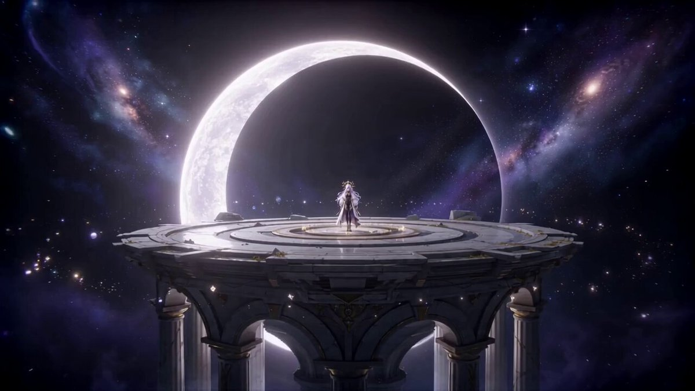
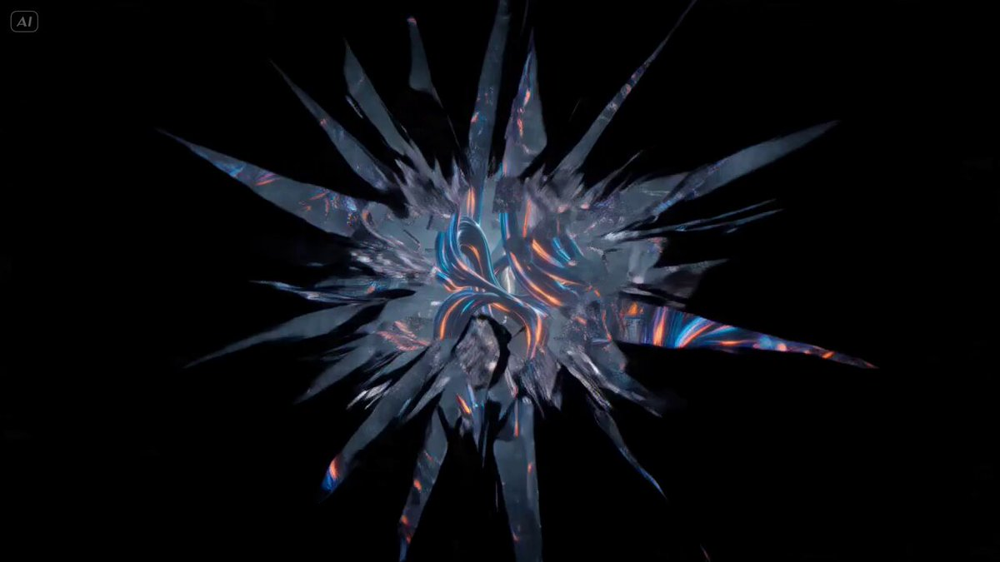
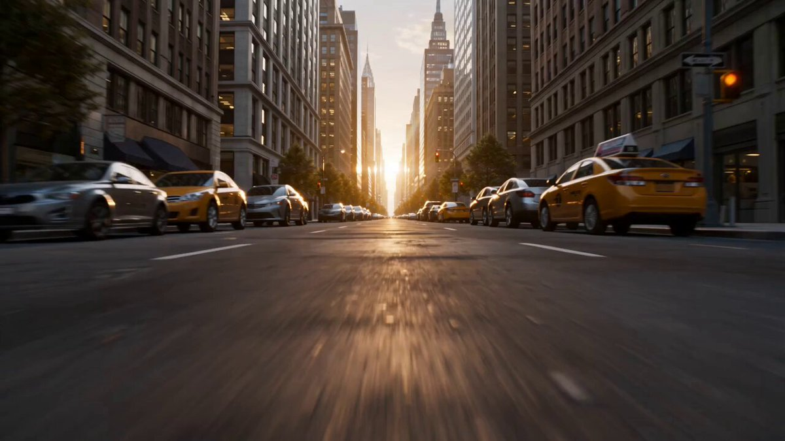

[Seedance 2.0 プロンプトアーカイブ](../seedance-2-0_ja.md)

<a id="surreal-vfx"></a>
# 🌀 Surreal / VFX (19)

<a id="surreal-vfx-case-1"></a>
<!-- Case 1: Zero-Gravity Katana Combat (by @MiraMusic_AI) -->
### ケース 1: [無重力の刀剣戦](https://x.com/MiraMusic_AI/status/2040584525781364874) (投稿者 [@MiraMusic_AI](https://x.com/MiraMusic_AI))

| 出力 |
| :----: |
| <a href="https://x.com/MiraMusic_AI/status/2040584525781364874"></a> |

**プロンプト:**

```
Seedance 2.0

Zero-gravity combat scene.
If you also reference music, it can follow the beat surprisingly well.

prompt:

A continuous 15-second single-shot action sequence with no cuts or transitions.

Japanese-inspired anime action aesthetics, featuring a cool-toned palette of icy whites and soft blue illumination, with fragments drifting weightlessly in space. Dynamic movement, cinematic framing, and a dramatic atmosphere.

Scene:
A pristine, ethereal white environment where gravity has collapsed. The space feels surreal and dreamlike, filled with soft glowing light and floating debris suspended in midair, creating an otherworldly cinematic mood.

0-3s -- rising tension
The camera glides slowly through the space.
A lone character floats calmly, poised with a katana.

3-6s -- sudden motion
Opponents propel themselves off surfaces, closing in from multiple directions in zero gravity.

6-10s -- fluid combat
Movement unfolds in all directions.
She rotates gracefully midair, delivering precise, flowing strikes.
The camera follows her in a smooth, tumbling motion.

10-13s -- acceleration
She catches a surface briefly, then launches forward with force.
A rapid sequence of strikes disperses the surrounding opponents.

13-15s -- stillness
Figures drift slowly in silence.
She regains balance, floating motionless as the scene holds on a final frame.
```

<a id="surreal-vfx-case-2"></a>
<!-- Case 2: Whale in the Clouds Surreal Epic (by @chaosdotjpg) -->
### ケース 2: [雲を泳ぐクジラのシュールな叙事詩](https://x.com/chaosdotjpg/status/2040203827249398086) (投稿者 [@chaosdotjpg](https://x.com/chaosdotjpg))

| 出力 |
| :----: |
| <a href="https://x.com/chaosdotjpg/status/2040203827249398086"></a> |

**プロンプト:**

```
Whale in the Clouds — A cinematic surreal epic short film, ultra-realistic magical realism. Late afternoon, a coastal city. Warm sunlight, sea mist swirling, towering cumulus clouds. Everything is calm… until the sky suddenly grows heavy.
Aerial shot: skyline,
```

<a id="surreal-vfx-case-3"></a>
<!-- Case 3: Abyss Diver Sea Creature Metamorphosis (by @AIARTGALLARY) -->
### ケース 3: [深海ダイバーが海洋生物へ変貌](https://x.com/AIARTGALLARY/status/2039964736419479576) (投稿者 [@AIARTGALLARY](https://x.com/AIARTGALLARY))

| 出力 |
| :----: |
| <a href="https://x.com/AIARTGALLARY/status/2039964736419479576"></a> |

**プロンプト:**

```
A diver floats motionless in pitch-black ocean depth, a single beam of light cutting through the dark. Bioluminescent veins begin threading across their body in accelerated time, skin shifting to iridescent obsidian scales, limbs fusing into massive finned appendages. The figure swells to monstrous proportions, displacing water in shockwave pulses. Final shot: a colossal sea creature dissolving into the abyss. WETA-level underwater VFX, deep teal and void-black tones.
```

<a id="surreal-vfx-case-4"></a>
<!-- Case 4: Interdimensional Megacity Rift Collapse (by @LudovicCreator) -->
### ケース 4: [異次元メガシティの裂け目崩壊](https://x.com/LudovicCreator/status/2039768597241725132) (投稿者 [@LudovicCreator](https://x.com/LudovicCreator))

| 出力 |
| :----: |
| <a href="https://x.com/LudovicCreator/status/2039768597241725132"></a> |

**プロンプト:**

```
A towering humanoid entity made of shifting translucent geometry appears above a megacity skyline, its body composed of overlapping dimensional planes reflecting alternate realities — hook at second two: the entity opens both hands and a vertical dimensional tear slices through the city.

Reality splits.

Two versions of the city begin occupying the same space.

Buildings phase through each other as competing timelines collide.

The destruction is dimensional and structural: streets fold into mirrored corridors, cars fall sideways into parallel gravity planes, and skyscrapers fragment into geometric shards as their alternate versions misalign.

Every movement of the entity widens the rift.

Entire districts slide into adjacent dimensions.

The gauntlet unfolds through a skyline progressively divided between worlds: street level where pedestrians phase between realities → mid-rise districts where buildings overlap in transparent duplicates → rooftop where entire towers rotate into perpendicular universes.

Aircraft vanish into dimensional folds.

Bridges twist into impossible angles.

Chase-cam flying through intersecting city layers as gravity shifts between realities.

Velocity ramp when the dimensional rift expands wide enough to swallow an entire city block.

Cut to aerial: the megacity now exists as two overlapping worlds drifting apart.

The dimensional entity stands between them.

Diegetic prismatic dimensional light reflecting through fractured architecture and overlapping skylines, cinematic multiverse distortion effects, particle fragments of shattered reality, 4K.
```

<a id="surreal-vfx-case-5"></a>
<!-- Case 5: Rainy Underground Alley Merge (by @Dheepanratnam) -->
### ケース 5: [雨の地下路地での融合](https://x.com/Dheepanratnam/status/2039796932562838010) (投稿者 [@Dheepanratnam](https://x.com/Dheepanratnam))

| 出力 |
| :----: |
| <a href="https://x.com/Dheepanratnam/status/2039796932562838010"></a> |

**プロンプト:**

```
Rainy Underground Alley Merge
15-second surreal horror in a narrow rainy underground service alley, neon signs reflecting on puddles, steam rising from grates.
[0-1.5s] Shot 1: Wide tracking shot, young woman in black leather jacket walks cautiously through rain, breath visible,
```

<a id="surreal-vfx-case-6"></a>
<!-- Case 6: Quantum Reality Fracture Street Rift (by @Dheepanratnam) -->
### ケース 6: [量子現実の破砕による街路の裂け目](https://x.com/Dheepanratnam/status/2039651240909435242) (投稿者 [@Dheepanratnam](https://x.com/Dheepanratnam))

| 出力 |
| :----: |
| <a href="https://x.com/Dheepanratnam/status/2039651240909435242"></a> |

**プロンプト:**

```
Video prompt

Quantum Reality Fracture on City Street (Interdimensional Rift VFX)

Cinematic 15-second high-budget sci-fi horror sequence on a rain-slicked downtown city street at blue hour, towering skyscrapers and frozen traffic, epic scale

[0-1.5s] Shot 1: Epic wide crane
```

<a id="surreal-vfx-case-7"></a>
<!-- Case 7: the eye suddenly opens (by @roco_kn_roco) -->
### ケース 7: [目が突然開く](https://x.com/roco_kn_roco/status/2039323186127630710) (投稿者 [@roco_kn_roco](https://x.com/roco_kn_roco))

| 出力 |
| :----: |
| <a href="https://x.com/roco_kn_roco/status/2039323186127630710"></a> |

**プロンプト:**

```
cinematic anime close-up shot of a character's eye, extreme macro, eyelashes and skin texture visible, soft breathing motion, eye slowly closing, calm and silent atmosphere, subtle ambient light reflection on eyelid

the eye is fully closed, slight twitch, micro camera push-in, tension building, no effects yet, natural realism

the eye suddenly opens

inside the iris: completely unknown abstract pattern, non-human geometry, fractal layers, asymmetric rotating structures, liquid-metal texture mixed with glowing particles, colors shifting between deep violet, cyan, and iridescent hues

energy distortion spreads from the pupil outward, like reality bending, subtle glitch + fluid simulation fusion (not digital glitch, more organic distortion), light leaking from inside the eye

thin energy veins extend across the sclera (white of the eye), faint luminescent cracks

camera continues slow push-in, reflections in the eye show impossible space (like another dimension or abstract void)

ultra detailed anime style, cinematic lighting, high contrast, no cartoon exaggeration, elegant and mysterious, no text
```

<a id="surreal-vfx-case-8"></a>
<!-- Case 8: They clash mid-air above a floating lava river (by @LudovicCreator) -->
### ケース 8: [浮遊する溶岩川の上空で激突](https://x.com/LudovicCreator/status/2039258991809773666) (投稿者 [@LudovicCreator](https://x.com/LudovicCreator))

| 出力 |
| :----: |
| <a href="https://x.com/LudovicCreator/status/2039258991809773666"></a> |

**プロンプト:**

```
A surreal volcanic sky realm where islands of black rock float above rivers of molten lava flowing through the air like suspended waterfalls. The sky burns with deep crimson clouds illuminated by lightning storms.

**Action:**

15.0s sequence. A blazing phoenix composed of flowing flame and glowing embers spirals upward through the volcanic sky. Opposing it is a massive storm griffin whose wings generate violent wind currents and lightning arcs.

They clash mid-air above a floating lava river. The phoenix dives through the griffin’s storm vortex while fire and lightning collide violently.

Velocity Ramp choreography: a lightning claw strike freezes in ultra-slow motion as sparks and embers scatter through the air before snapping back to real time as both creatures spiral downward.

**Camera:**

Fast aerial tracking through lava-lit clouds, briefly passing behind a floating rock formation before revealing the full aerial duel.

**Style & Constraints:**

Photorealistic fire simulation, volumetric storm clouds, ray-traced lava glow, cinematic lightning illumination, stable geometry, 8K.
```

<a id="surreal-vfx-case-9"></a>
<!-- Case 9: Creative Director Dimension Walk (by @lukasersil) -->
### ケース 9: [クリエイティブディレクターの次元歩行](https://x.com/lukasersil/status/2045070342553493833) (投稿者 [@lukasersil](https://x.com/lukasersil))

| 出力 |
| :----: |
| <a href="https://x.com/lukasersil/status/2045070342553493833"></a> |

**プロンプト:**

```
CHARACTER: attached image — confident creative director, late 30s, slim build,
short dark hair, natural wide smile; walks with calm executive energy;
outfit morphs each jump to reflect the creative era
CAMERA: frontal tracking, eye-level, full-body, dolly backward with character,
never cuts away from him
COLOR GRADE: B&W flicker → warm gold → smoke grey → neon saturation →
VHS bleed → CRT glow → ring-light pop → hypersaturated chaos →
prompt-blue ambient → holographic cyan → code-green rain → pure white
TRIGGER: finger snap mid-stride → instant dimension jump
RULE: Era-appropriate outfit with each jump. Steady calm walk throughout — pace never changes, never runs, never slows.

JUMP_MODE: creative dimension hopping
SEQUENCE:
START: white photography infinity studio, already mid-stride, looks directly into camera — casual snap → trigger
1: 1920s silent film set — B&W grain, frozen actors around him, film reel flicker → trigger
2: baroque theater stage — candlelit gold, velvet curtains, powdered wig extras scatter → trigger
3: 1960s Madison Avenue agency — cigarette haze, Helvetica posters, typewriters clacking → trigger
4: 1970s disco inferno — mirror ball overhead, polyester crowd parts, bass in the air → trigger
5: 1980s MTV studio — neon grid floor, fog machines, VHS glitch at frame edges → trigger
6: 1990s startup office — CRT glow, dial-up chaos, developers spin in chairs → trigger
7: 2010s YouTube studio — ring light forest, green screens, vlogger mid-take loses his mind → trigger
8: TikTok hyperreality — split screens multiply, emoji swarm, comments scroll the air → trigger
9: AI generation space — prompt text rains vertically, landscapes bloom and dissolve around him → trigger
10: holographic metaverse — glitching NPC crowds, architecture stutters, reality framerate drops → trigger
11: data singularity — code waterfall, neurons fire, his outline becomes wireframe → trigger
12: white void — silence, only footstep echo, wide smile, still walking forward

FINAL: one last snap → seamless loop back to white studio, identical opening shot
```

<a id="surreal-vfx-case-10"></a>
<!-- Case 10: Abyssal Entity Altar Inscription — Dark Fantasy (by @Adam38363368936) -->
### ケース 10: [深淵の存在を刻む祭壇碑文 — ダークファンタジー](https://x.com/Adam38363368936/status/2041050710721339521) (投稿者 [@Adam38363368936](https://x.com/Adam38363368936))

| 出力 |
| :----: |
| <a href="https://x.com/Adam38363368936/status/2041050710721339521"></a> |

**プロンプト:**

```
提示词 (Prompt)： 0-3s · 异界铭刻 低角度仰拍。深渊实体右手嵌入（Embedded）祭坛，暗黑脉络呈分形几何状（Fractal Geometry）在石板上疯狂寄生。裂缝喷涌出粘稠血肉触须，地面如肺部般大幅度搏动。背景宗门古建筑随之发生视觉上的横向位移震颤。 3-6s · 骨质畸变 环绕升降镜头。实体的脊椎如连锁反应般炸裂扭曲，黑曜石角冠从颅骨深处穿出。双臂缠绕液态黑烟，所经之处空气产生高温电弧感，悬挂灯笼因能量过载瞬间发生视觉坍塌式爆裂。 6-9s · 物质解构 拉远镜头。实体表皮呈现瓷器般的碎裂纹路，内部是蠕动的暗物质核心。指尖异化为长达半米的影刃，触碰木柱瞬间引发超速风化（Accelerated Decay），建筑结构化为黑烟升腾。 9-12s · 影潮吞噬 高空俯拍。实体振臂，身后黑暗塌缩后猛然爆发，形成千米级的黑红浪潮（Corrupted Tsunami）。阴影洪流所过之处，青石板路、石狮、楼阁全部被像素化撕裂并吞噬。 12-15s · 虚空终焉 脸部特写。背景中巨大的山门在黑洞引力下向中心拧麻花状折断。实体在死寂中缓步走近，瞳孔内是旋转的星云（Void Nebula）。它凝视镜头，画面产生强烈的胶片烧灼感与信号故障感（Glitch），最终归于绝对黑暗。
```

<a id="surreal-vfx-case-11"></a>
<!-- Case 11: Floating UI Color Wheel Scene Transformation (by @johnAGI168) -->
### ケース 11: [浮遊 UI カラーホイールによる場面変換](https://x.com/johnAGI168/status/2041001869435158629) (投稿者 [@johnAGI168](https://x.com/johnAGI168))

| 出力 |
| :----: |
| <a href="https://x.com/johnAGI168/status/2041001869435158629"></a> |

**プロンプト:**

```
即可得到同款视频！

Seedance 2.0 prompt 👇

生成一段15秒的高质量实拍风格特效短片，核心展示一位年轻女性通过滑动悬浮UI色环，实现场景与服装的无缝丝滑切换。注意分镜编排与转场节奏，画面需具备极佳的景深效果（Depth of field），人物面部始终保持清晰且光影立体。 【人物特征锁定】 全程锁定核心人物特征：年轻女性，标志性的金黄色短发，佩戴圆形金属边框眼镜。 【分镜与动作设计】 00:00-00:05：室内卧室夜景，背景有暖黄色的星星形状散景氛围灯串。人物头发微微扎起，穿浅米色长袖家居睡衣坐在床上。画面正前方悬浮着完整的半透明渐变彩色色环（UI交互元素）。人物微笑着看向镜头，伸出手自然地触碰并向右滑动发光的色环。 00:05-00:07：随着色环转动，无缝转场至明亮的室内窗边日景，阳光温暖。人物短发自然散落，瞬间换上鲜艳的亮橙色无袖紧身上衣和白色休闲裤，单手托腮，笑容灿烂。色环悬浮在画面右侧，光标高亮显示黄橙色区域。 00:07-00:09：无缝转场至户外公园日景，背景是高曝光的明亮绿树。人物靠在粗壮树干旁，换上薄荷绿色方领泡泡袖露脐短上衣和浅色高腰短裤，右手戴黑色半截皮手套，对着镜头俏皮眨眼，手指轻触嘴唇。色环悬浮右侧，光标高亮亮绿色。 00:09-00:11：无缝转场至户外开阔草地，背景蓝天白云。人物靠在灰白水泥矮墙上，穿简约深蓝紫色细吊带上衣，单手托下巴，表情慵懒清冷。色环移至画面左侧，光标高亮深紫色。 00:11-00:13：无缝转场至阳光明媚的户外樱花林，背景满是盛开的粉色樱花。人物换粉色细吊带上衣，单手轻轻撩动头顶头发，展现甜美治愈微笑。色环悬浮左侧，光标高亮粉红色。 00:13-00:15：无缝转场至户外传统中式建筑前，背景有虚化的红色柱子和古建飞檐。人物穿深红色偏焦糖色的露肩改良版中式旗袍上衣（带传统盘扣），姿态端庄优雅，单手放于锁骨处，眼神微垂看向镜头。色环悬浮左侧，光标高亮红色。 【特殊控制指令】 必须保证场景与服装的每次切换平滑无跳切感（丝滑转场），保持人物动作的延续性。每次切换时，人物的情绪微表情必须与当前的服装色彩氛围完美契合。配合画面色彩切换，可自动生成带有轻巧科技感UI音效及动感节奏的BGM。
```

<a id="surreal-vfx-case-12"></a>
<!-- Case 12: Fire Empress Transformation Sequence (by @LudovicCreator) -->
### ケース 12: [炎の女帝の変身シーケンス](https://x.com/LudovicCreator/status/2076365999100616875) (投稿者 [@LudovicCreator](https://x.com/LudovicCreator))

| 出力 |
| :----: |
| <a href="https://x.com/LudovicCreator/status/2076365999100616875"></a> |

**プロンプト:**

```
Full magical transformation sequence: a fire empress suspended in an abstract volcanic void as ribbons of molten orange light orbit and wrap around her hair lifting like flame, black-and-gold armor forming in glowing ember panels, lava cracks igniting across the floor as a sun sigil blooms underfoot  the camera orbiting opposite the ribbons’ spin, each beat synced to a rising heroic chord, ending in a powerful hand-forward signature pose held against a blazing starburst. Stock-footage grandeur, played sincere.
```

<a id="surreal-vfx-case-13"></a>
<!-- Case 13: Sand Titan Desert Transformation (by @LudovicCreator) -->
### ケース 13: [砂の巨人への砂漠変身](https://x.com/LudovicCreator/status/2076970003404865992) (投稿者 [@LudovicCreator](https://x.com/LudovicCreator))

| 出力 |
| :----: |
| <a href="https://x.com/LudovicCreator/status/2076970003404865992"></a> |

**プロンプト:**

```
15-second ultra-cinematic elemental transformation sequence in an endless desert during a colossal sandstorm at sunset.

A lone desert wanderer stands atop a towering dune beneath a crimson-orange sky. Powerful winds drive endless waves of sand across the landscape while ancient ruined temples emerge and disappear through the storm.

The atmosphere is vast, ancient, and awe-inspiring.

The camera slowly circles around the wanderer as the desert suddenly falls unnaturally silent. The wind stops for a single moment.

Then the sand begins moving.

Tiny grains rise from the dunes and spiral around the figure in elegant vortexes. The ground beneath their feet fractures as ancient symbols briefly emerge from beneath the desert.

The transformation begins.

Golden sandstone patterns spread across the skin. The body becomes increasingly mineral, muscles turning into sculpted layers of weathered stone while streams of flowing sand circulate beneath the surface like living veins.

The camera pushes closer as fingers become enormous sandstone claws. Cracks appear across the body, glowing softly with golden desert light while fine sand continuously pours through them.

The transformation accelerates.

The body grows dramatically larger with every heartbeat. Massive shoulders form from layered rock and compacted dunes. Flowing sand replaces hair, continuously blowing in the wind like an endless desert storm.

Entire dunes collapse and rise around the transformation. Ancient pillars, broken statues, and fragments of forgotten civilizations become embedded within the giant's body as if the desert itself is rebuilding an ancient guardian.

The surrounding sandstorm intensifies into a colossal rotating vortex. Lightning flashes inside the dust clouds while gigantic walls of sand spiral around the growing titan.

At the climax, the wanderer becomes an immense Sand Titan towering above the desert. The body is formed from sandstone, flowing dunes, ancient ruins, and living rivers of sand. Every movement releases avalanches cascading from its colossal limbs.

Final cinematic moment: the Sand Titan raises one enormous arm. The entire desert responds as gigantic dunes rise like ocean waves, creating a continent-sized sandstorm beneath a blazing sunset while the camera pulls back to reveal the titan dominating the endless horizon.

Style: ultra cinematic elemental realism, photoreal sand simulation, realistic sandstone formation, colossal environmental scale, desert storm physics, volumetric dust, ancient civilization aesthetic, monumental cinematography, AAA visual effects quality, no text, no overlays.

Audio: epic cinematic orchestral score, deep desert winds, shifting dunes, rock cracking, cascading sand, distant thunder within the sandstorm, ancient low-frequency resonance, massive elemental power.
```

<a id="surreal-vfx-case-14"></a>
<!-- Case 14: Escape Car Garbage Morph (by @LavrionX) -->
### ケース 14: [逃走車のごみ収集車変形](https://x.com/LavrionX/status/2077500080932671639) (投稿者 [@LavrionX](https://x.com/LavrionX))

| 出力 |
| :----: |
| <a href="https://x.com/LavrionX/status/2077500080932671639"></a> |

**プロンプト:**

```
A hyper-real cinematic action sequence on a bright urban road in daytime. Clean streets, light traffic, buildings on either side. Sound design: distant sirens approaching, sharp metallic impacts, city ambience.

The video opens with a tight close-up of a sleek, angular metallic vehicle (Tesla-like design). Sudden gunfire—bullets hit the surface and ricochet cleanly, sparking off the body with sharp metallic pings. No visible shooters, only the sound of chaos and pursuit building.

Camera quickly pulls back to reveal the full car speeding forward.

Loud police sirens grow closer.

Without slowing down, the vehicle begins transforming—its clean metallic panels shift, split, and reconfigure. The smooth exterior degrades into a rough, boxy structure. Angles soften. Surfaces become dented, rusted, uneven.

Within seconds, the futuristic car becomes a grimy dumpster-style garbage truck, perfectly blending into the environment.

The vehicle immediately hard brakes and performs a sharp 180-degree skid turn, tires screeching, dust kicking up. It settles seamlessly into a roadside parking position like it belongs there.

Cut.

Police vehicles rush past the same road at high speed, sirens blaring, continuing the chase forward—completely missing it.

Foreground: a woman casually loading garbage into the back of the truck. She has braided hair, tattooed arms, long manicured nails, dressed like a regular worker but with subtle attitude.

She pauses, watches the police pass… then slowly turns toward camera and winks.

Ambient city sound returns. No hard cut.
```

<a id="surreal-vfx-case-15"></a>
<!-- Case 15: Forest Guardian Calligraphy Transformation (by @LudovicCreator) -->
### ケース 15: [森の守護者の書道変身](https://x.com/LudovicCreator/status/2078346662699798878) (投稿者 [@LudovicCreator](https://x.com/LudovicCreator))

| 出力 |
| :----: |
| <a href="https://x.com/LudovicCreator/status/2078346662699798878"></a> |

**プロンプト:**

```
Full magical transformation sequence: a forest guardian floating in an aged moss-green parchment void as deep emerald ink spreads through the air like liquid leaves blooming in water ,calligraphy strokes whip around the body, staining the hair into soft jade green, sketching layered nature armor, glowing vine markings across the face, and a long spear silhouette in sweeping green brushwork. A circular ancient seal script sigil blooms underfoot with splashes of pearl-white light, the camera pushing in through drifting ink veils like torn leaves in a storm, each brush impact synced to a rising drumbeat, ending in a spear-planted signature pose locked inside an emerald-and-pearl calligraphy burst. Stock-footage grandeur, played sincere.
```

<a id="surreal-vfx-case-16"></a>
<!-- Case 16: Haunted Tea Ceremony Apparition (by @LudovicCreator) -->
### ケース 16: [呪われた茶会の亡霊](https://x.com/LudovicCreator/status/2078902823656226891) (投稿者 [@LudovicCreator](https://x.com/LudovicCreator))

| 出力 |
| :----: |
| <a href="https://x.com/LudovicCreator/status/2078902823656226891"></a> |

**プロンプト:**

```
Stylized anime haunted tea ceremony beat: an elderly woman pours tea inside an abandoned tatami room, steam rising from the cup and slowly forming the shape of a long-lost guest. Dust floats in golden afternoon light, paper doors rattling gently though no wind enters the house. Slow push-in across the floor, tea reflections rippling with impossible memories, the woman’s calm face mirrored in the porcelain cup. The ghostly figure leans closer and the silence holds one beat past comfort.
```

<a id="surreal-vfx-case-17"></a>
<!-- Case 17: Cosmic Eclipse Oracle (by @itsPixieVerse) -->
### ケース 17: [宇宙蝕の神託者](https://x.com/itsPixieVerse/status/2080801355908931602) (投稿者 [@itsPixieVerse](https://x.com/itsPixieVerse))

| 出力 |
| :----: |
| <a href="https://x.com/itsPixieVerse/status/2080801355908931602"></a> |

**プロンプト:**

```
Ultra cinematic cosmic fantasy sequence, endless celestial observatory floating above the universe, gigantic ancient marble platforms suspended in space, rotating golden astrolabes, enormous eclipsed sun in the distance, galaxies, nebulae and constellations slowly drifting, billions of glowing stars, soft divine volumetric light, white and gold architecture, premium Hollywood fantasy atmosphere.

Aureleth, an ethereal cosmic goddess with extremely long flowing lavender hair, luminous golden eyes, elegant white ceremonial coat with intricate gold embroidery over a dark celestial bodysuit decorated with glowing runic constellations, floating geometric halo behind her head, calm, untouchable, divine presence.

Sequence (15 seconds):

0–3s
Extreme wide establishing shot. Aureleth stands alone at the center of an enormous celestial platform suspended above an infinite cosmos. Her hair and robes drift gracefully in zero gravity. The camera slowly pushes toward her while countless tiny stars orbit around her feet.

3–6s
Medium cinematic shot. Aureleth slowly raises one hand with effortless elegance. Golden runic circles begin rotating around her fingers while luminous geometric symbols appear in the surrounding space. Her halo slowly expands into multiple rotating celestial rings.

6–9s
Reality begins bending around her. Marble fragments, glowing crystals and golden particles levitate into the air. Space itself ripples like water. Entire constellations rearrange into sacred geometric patterns while ribbons of stardust spiral around her body. Her expression remains perfectly calm and emotionless.

9–12s
The camera performs a dramatic orbit around Aureleth. Behind her, an immense cosmic eclipse opens, revealing a radiant celestial eye formed from galaxies and light. Thousands of glowing runes and star fragments rotate around her in synchronized motion while her robes and hair flow majestically.

12–15s
Final divine reveal. Aureleth extends her hand toward the camera. The universe freezes in complete silence as every floating object stops instantly. A brilliant pulse of white and gold cosmic energy radiates outward, illuminating galaxies before slowly fading. She remains completely motionless, gazing directly into the camera while stars continue orbiting around her like loyal satellites.

Camera:
Epic anamorphic IMAX composition, extremely slow cinematic push-ins, smooth orbital camera movement, elegant crane motion, dramatic wide-to-close transitions, shallow depth of field, subtle lens breathing, premium cinematic framing.

Rendering:
Ultra photorealistic CGI, ray tracing, global illumination, volumetric god rays, physically accurate cloth simulation, flowing hair physics, marble and gold material realism, celestial particle systems, floating dust, shimmering stardust, realistic atmospheric bloom, premium Hollywood VFX.

Motion:
Slow, elegant, regal, effortless. Every gesture feels deliberate. Reality responds to her presence rather than the other way around. No exaggerated anime movement.

Style:
AAA cinematic fantasy blockbuster, Dune × Elden Ring × Final Fantasy XVI × Arcane × Love Death + Robots, divine celestial aesthetic, museum-quality composition, emotionally overwhelming scale, premium visual effects, pure visual storytelling, no dialogue.
```

<a id="surreal-vfx-case-18"></a>
<!-- Case 18: Psychedelic Reality Fracture (by @Ankit_patel211) -->
### ケース 18: [サイケデリックな現実崩壊](https://x.com/Ankit_patel211/status/2081643072178557070) (投稿者 [@Ankit_patel211](https://x.com/Ankit_patel211))

| 出力 |
| :----: |
| <a href="https://x.com/Ankit_patel211/status/2081643072178557070"></a> |

**プロンプト:**

```
Theme: Reality fragmentation, abstract cosmic nightmare with elegant beauty Prompt: Reality fractures into thousands of floating dimensions connected by enormous twisting ribbons of light. Infinite mirrors reflect alternate universes where gravity, time, and perspective constantly transform. Gigantic human statues dissolve into flocks of birds before reassembling as celestial architecture. Floating clocks leak galaxies instead of sand while black holes bloom like flowers. Endless stairways spiral around shattered moons suspended inside transparent oceans. Massive abstract sculptures made from liquid chrome continuously morph into impossible forms. The camera performs dynamic cinematic movements with seamless drone dives, rotating orbit shots, impossible dolly zooms, and slow-motion transitions between collapsing realities. Rich monochromatic shadows contrast with bursts of electric blue, neon orange, emerald green, and cosmic purple. Dense volumetric atmosphere, cinematic haze, distorted reflections, chaotic textures, dreamlike visual effects, avant-garde surreal design language, hyper-realistic rendering, award-winning experimental cinema aesthetic, emotionally mysterious, visually overwhelming, ultra-detailed IMAX quality.
```

<a id="surreal-vfx-case-19"></a>
<!-- Case 19: Glass City Crystallization (by @LudovicCreator) -->
### ケース 19: [ガラス都市の結晶化](https://x.com/LudovicCreator/status/2082073946355081576) (投稿者 [@LudovicCreator](https://x.com/LudovicCreator))

| 出力 |
| :----: |
| <a href="https://x.com/LudovicCreator/status/2082073946355081576"></a> |

**プロンプト:**

```
A modern city begins crystallizing from the ground upward. Streets, cars, trees, and skyscrapers transform into transparent glass structures as sunlight refracts into rainbow beams. The camera flies through the transformation as buildings crack and shimmer. High-end glass VFX, refraction, particle shards, 4K.
```
