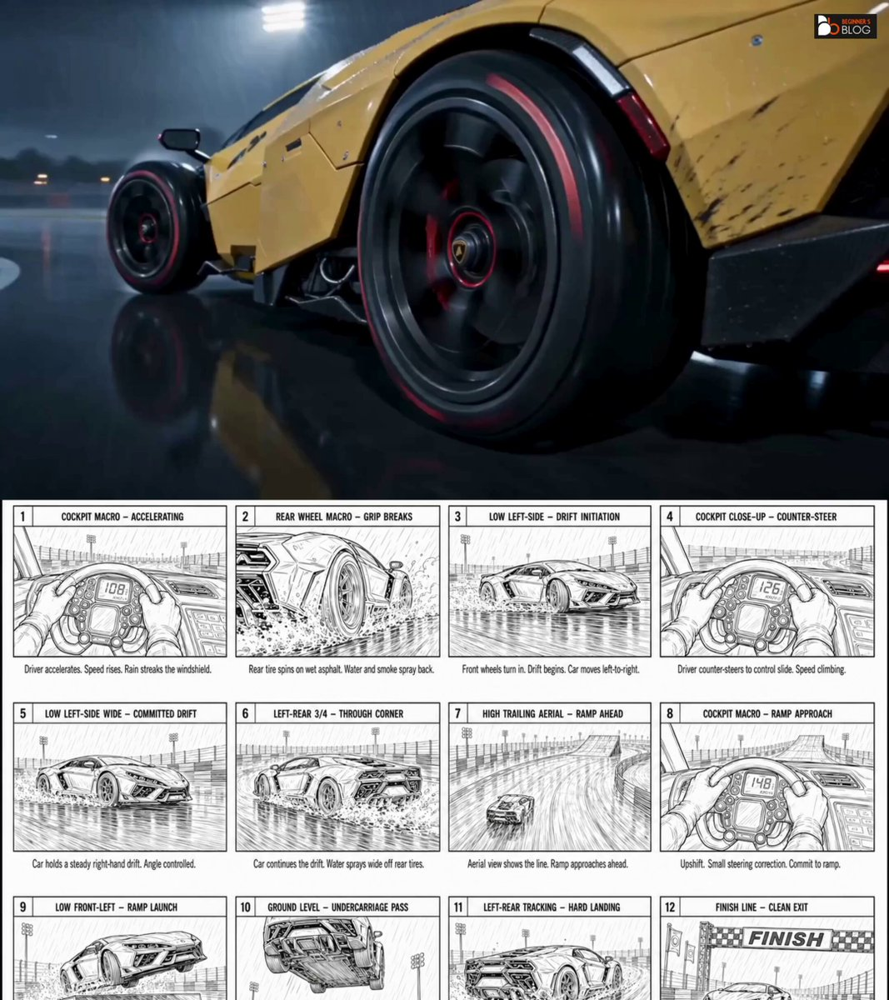
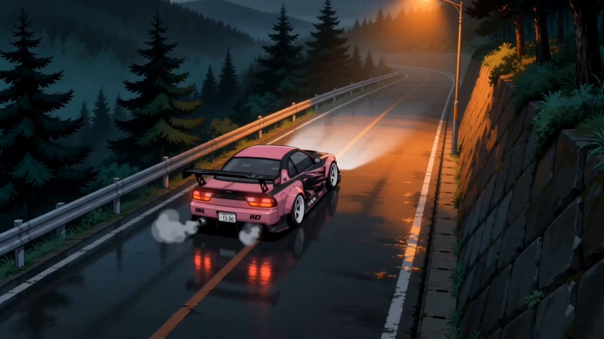
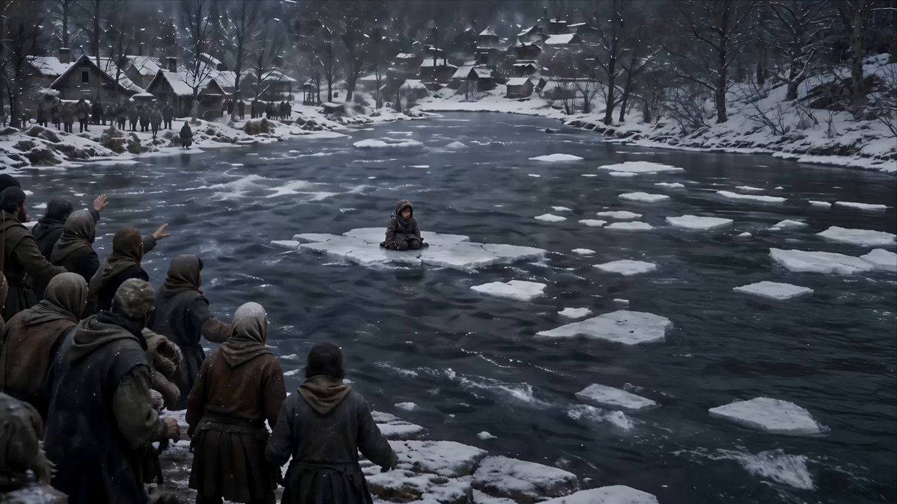

[Seedance 2.0 프롬프트 아카이브](../seedance-2-0_ko.md)

<a id="reference-driven"></a>
# 🖼️ Reference-Driven (26)

<a id="reference-driven-case-1"></a>
<!-- Case 1: Skeleton Pianist Miniature Diorama Performance (by @tea_story_hoshi) -->
### 사례 1: [해골 피아니스트의 미니어처 디오라마 공연](https://x.com/tea_story_hoshi/status/2040614786933887043) (작성자 [@tea_story_hoshi](https://x.com/tea_story_hoshi))

| 결과 |
| :----: |
| <a href="https://x.com/tea_story_hoshi/status/2040614786933887043"></a> |

**프롬프트:**

```
I tried adapting it. The details still need more tuning, but the fact that it produced a good result in one pass is impressive.

<prompt>
Subject:
Subject 1: A cute and stylish skeleton girl. She wears a navy sailor-style jacket, a pink pleated skirt, and a wide-brimmed hat adorned with a small skull. Her skeleton fingers are highly flexible, delicate, and expressive. For consistency in appearance and character, please refer to the reference image.
Environment:
A high-quality 3D miniature diorama with a whimsical clay-animation style. A small white grand piano sits on a stage with a stone-like texture. Several friendly glowing white ghosts with simple black eyes, shaped like draped fabric, surround her. The setting is a dreamlike blue architectural space. Warm, fantastical light emanates from the ghosts and small lanterns. Toy-like texture.
Mood:
Eccentric, elegant, cozy, and slightly eerie. The performance is deliberate rather than chaotic, creating a magical and graceful impression.
Timeline:
[00:00-00:02] Shot 1: Wide-angle POV, slow push-in. A skeletal girl sits elegantly at the white grand piano on the stone stage. She raises her skeletal hands, slightly tucks her posture, snaps her head up to look straight ahead, and begins playing smoothly. Audio: a beautiful, elegant classical piano intro.
[00:02-00:03] Shot 2: Hard cut to a medium shot. Stable gimbal movement. She is fully in control of the melody. Her skeletal fingers press the keys with clear, readable motion in a smooth flowing cycle. Friendly glowing white ghosts sway and bounce gently in time with the rhythm. Audio: a fast-paced rhythmic classical piano melody perfectly synchronized with her finger movement.
[00:03-00:07] Shot 3: Slight tracking close-up focused on her face and the piano keys. She ends the performance with a dramatic finale and lifts her hands from the keys as the ghosts glow more brightly in the warm light. She turns toward the camera and gives a gentle nod. Audio: the final elegant piano chord re
```

<a id="reference-driven-case-2"></a>
<!-- Case 2: Storm Ship Princess vs Kraken (by @applete77191758) -->
### 사례 2: [폭풍 속 배의 공주 대 크라켄](https://x.com/applete77191758/status/2040450526819807277) (작성자 [@applete77191758](https://x.com/applete77191758))

| 결과 |
| :----: |
| <a href="https://x.com/applete77191758/status/2040450526819807277"></a> |

**프롬프트:**

```
This might not be perfect, but I thought it could still be useful, so I'm sharing it.
(Feel free to modify it.)

I turned internet search on for the first half.
It felt like the camera work got better with it on.

#TopviewAI #Seedance2
-----------------------------------
A cinematic, high-intensity anime sequence set on a pirate ship in a violent storm at night. Strong emphasis on physical realism, dramatic lighting, and dynamic camera control.

Environment & Physics
Heavy rain, strong wind, turbulent ocean <<<Image4>>>

Visible whitecaps continuously forming and breaking.
Ship motion:
Pitching (forward/back tilt)
Rolling (side tilt)
Deck instability affects all character movement (staggering, slipping)
Water spray, wet reflective surfaces, rope tension reacting to motion
Lighting (lightning effects)
Lightning functions as:
Rim light
Strobe effect
Creates sharp shadows, silhouettes, and dramatic reveals
Princess Setup <<<Image2>>>

Princess starts near the mast
Visibly anxious, struggling to balance due to pitching
Subtle stagger and unstable footing
Kraken Emergence & First Impact
<<<Image3>>>
Ocean splits, tentacles erupt through crest waves
Tentacles wrap the ship and slam the deck
Reaction:
Princess staggers
Crew panics: shouting, slipping, colliding
Destruction
Tentacle breaches the hull
Wood splinters, debris bursts
Interior partially floods
Movement to Attack Position
Princess regains footing
Grabs fallen knight's sword
Moves toward the bow only during the attack phase
Camera: aggressive tracking with ship pitching
Heroic Attack Sequence (insert slow motion)
Pre-Attack Build
Lightning flash -> freeze-like tension
Camera begins a slow zoom-in with easing toward the princess
Leap (slow motion starts)
Princess jumps
IMPORTANT:
Enter slow motion (about 0.3-0.5 seconds)
Rain droplets, hair tips, and cloth edges become visible in detail
Lightning acts as a strobe, freezing micro-movements
Slash (maximum zoom)
At the peak of motion:
Camera:
Ease-in zoom -> accelerate into a fast zoom
Action:
Sword swings
Effect:
Bright sword trail / afterimage
Clean, sharp "slash" feeling / impact frame
Motion blur + light streaks
```

<a id="reference-driven-case-3"></a>
<!-- Case 3: Maid Blade Dance: Mei vs Coco (by @MiraMusic_AI) -->
### 사례 3: [메이드 검무: 메이 대 코코](https://x.com/MiraMusic_AI/status/2040281710957666770) (작성자 [@MiraMusic_AI](https://x.com/MiraMusic_AI))

| 결과 |
| :----: |
| <a href="https://x.com/MiraMusic_AI/status/2040281710957666770"></a> |

**프롬프트:**

```
Title: "Maid Blade Dance - Mei vs. Coco"
Duration: "15 seconds"
Input:
A: "<<<Image1>>>"
B: "<<<Image2>>>"
Characters:
A:
Name: "Kirishima Mei"
Weapon: "Blade of Bewilderment (black-purple)"
B:
Name: "Sakuraba Coco"
Weapon: "Ribbon Spear (silver + red ribbon)"
Movement Core:
A: ["high-speed multi-hit slashes", "black-purple aura", "multiple blur afterimages"]
B: ["high-speed spear rotation", "silver-white aura", "spiral ribbon motion"]
Environment:
Location: "Japanese-style mansion corridor (moonlit, shoji-screen background)"
Lighting: "moonlight blue + shoji orange"
Atmosphere: "black and white dust"
Camera: "24mm to 70mm. High-speed tracking + sudden stops. Slow motion at impact (0.3x speed)."
Cuts:
- Cut: 1
Duration: "1.5 seconds"
Action: "Mei (left) and Coco (right) face each other from 10 meters apart. Mei half-draws her sword."
Camera: "slow horizontal pan (24mm)"
- Cut: 2
Duration: "1.5 seconds"
Action: "Mei fully draws the sword. A black-purple aura flashes for an instant. Mei moves straight toward Coco with afterimages."
Camera: "ultra-fast dolly-in toward Mei (50mm)"
- Cut: 3
Duration: "2 seconds"
Action: "Coco spins at high speed around the spear shaft. Mei's consecutive slashes strike the spear. White-blue sparks burst out. The ribbon spreads outward with centrifugal force."
Camera: "rotation centered on Coco (45mm)"
- Cut: 4
Duration: "1.5 seconds"
Action: "Mei holds her sword at chest height. Coco holds her spear horizontally. They read each other's next move."
Camera: "lateral tracking with anticipation (35mm)"
- Cut: 5
Duration: "2 seconds"
Action: "Mei unleashes seven consecutive slashes. Each slash leaves a trail of black light. Coco sweeps the ribbon to intercept, and the ribbon wipes away the black trails in white arcs."
Camera: "high-speed tracking pan toward Mei (50mm)"
- Cut: 6
Duration: "1.5 seconds"
Action: "Mei delivers a huge diagonal slash. The black-purple aura sweeps across half the screen. Coco braces her spear diagonally to receive it."
Camera: "track Mei's arc from a diagonal angle (50mm)"
- Cut: 7
Duration: "2 seconds"
Action: "Coco rotates her body while changing her spear stance. She thrusts three times at high speed in succession. Mei knocks them away with her blade."
Camera: "flash dolly-in plus rotation toward Coco (40mm)"
- Cut: 8
Duration: "2.5 seconds"
Action: "Sword and spear collide head-on. Sparks explode violently (black-purple vs. white-blue). Their hair ripples. Dust spreads outward in a radial burst."
Camera: "static, centered on the point of impact (70mm)"
Effect: "slow motion 0.3x"
- Cut: 9
Duration: "1.5 seconds"
Action: "Mei and Coco are blown several meters backward, drop to one knee, and glare at each other."
Camera: "pull backward away from both at the same time (35mm)"
- Cut: 10
Duration: "1 second"
Action: "Mei swings her sword once more. Coco resets her spear. They enter the starting stance for the next round."
Camera: "slow pull-back (24mm)"
Loop: "black and white dust separates and spirals. The battle continues forever."
Notes:
- "Mei: straight, sharp motion. Coco: curved, flowing motion."
- "Black-purple vs. white-blue sparks define their personalities."
- "Moonlight and shoji screens reinforce the Japanese duel atmosphere."
```

<a id="reference-driven-case-4"></a>
<!-- Case 4: Apocalyptic Rooftop Piano Farewell (by @liyue_ai) -->
### 사례 4: [종말의 옥상에서 펼쳐지는 피아노 작별](https://x.com/liyue_ai/status/2040062803076341872) (작성자 [@liyue_ai](https://x.com/liyue_ai))

| 결과 |
| :----: |
| <a href="https://x.com/liyue_ai/status/2040062803076341872"></a> |

**프롬프트:**

```
Core theme: realism | grand epic scale | apocalyptic aesthetics | live-action performance
[Character and basic setup]
Character: use [@Image 1] as the reference. Reproduce the facial features, face shape, and hairstyle 100 percent. No beautification. Height: 1.75 meters.
Base outfit: black thin turtleneck sweater.
Scene: create an apocalyptic music video about a girl playing piano on a rooftop in the ruins of a city under a meteor shower. The background city is being struck by meteors. She plays and sings a farewell song to the world, and in the end disappears in the firelight of a meteor hitting her exact position.
Core content:
- The girl quietly plays piano and sings in the city ruins.
- Massive meteor-shower destruction, with many meteors falling one after another, all trailing long flames.
- Destruction effects must be shocking and realistic.
- Strong contrast between the girl's performance and the catastrophic background.
- A tragic yet beautiful ending of destruction, but it should not look painful.

Lyrics: "The wind is burning, the clouds are fleeing, the clock of the end times rings softly. Dust returns to earth, wind returns afar. My heart is calm as I go toward the end." (end on a high note)
Special requirements:
- Grand scale with shocking destruction effects.
- Strong contrast between the girl's singing performance and the background impact.
- A tragic, beautiful ending filled with apocalyptic aesthetics.
- The song's emotion should rise continuously from weak to strong, with a slow lyrical rhythm.
[Atmosphere and image quality]
Simulated equipment: IMAX film camera with Panavision C-series lenses, including simulated motion blur.
Color and tonality: Hollywood teal-and-orange tone, low saturation. Generate the footage in a realistic visual style.
```

<a id="reference-driven-case-5"></a>
<!-- Case 5: CINEMATIC 8mm Fisheye lens, FPV racing drone camera, hyper-fluid motion (by @itsPixieVerse) -->
### 사례 5: [영화형 8mm 어안 렌즈, FPV 레이싱 드론, 초유동 모션](https://x.com/itsPixieVerse/status/2040030453298811099) (작성자 [@itsPixieVerse](https://x.com/itsPixieVerse))

| 결과 |
| :----: |
| <a href="https://x.com/itsPixieVerse/status/2040030453298811099"></a> |

**프롬프트:**

```
[CINEMATIC] 8mm Fisheye lens, FPV racing drone camera, hyper-fluid motion. [@Image 1] (Lanky Knight, red coat) on a longboard. [@Image 2] (Steep coastal mountain road).
0-3s: [Extreme high-speed follow] [@Image 1] carves down the steep asphalt. The camera mimics an FPV drone, flying inches from the ground at blinding speed. The red coat whips violently in the wind.
3-6s: [360-degree barrel roll] [@Image 1] hits a hairpin turn, leaning horizontally. The camera executes a dizzying, hyper-fluid 360-degree roll over his head, maintaining focus on his armor reflecting the bright sky.
6-10s: [Under-board swoop & launch] [@Image 1] hits a ramp, launching into the air. The camera aggressively swoops underneath the board, capturing the massive ocean drop, before tilting up as [@Image 1] backflips.
10-15s: [Impact & rapid pull-back] [@Image 1] lands flawlessly, wheels smoking. The camera snaps backward in a rapid reverse-dolly motion, showcasing the majestic landscape as [@Image 1] speeds away.
```

<a id="reference-driven-case-6"></a>
<!-- Case 6: Reference-Driven Kung Fu Stunt Sequence (by @YaReYaRu30Life) -->
### 사례 6: [참조 이미지 기반 쿵푸 스턴트 시퀀스](https://x.com/YaReYaRu30Life/status/2039971048305930643) (작성자 [@YaReYaRu30Life](https://x.com/YaReYaRu30Life))

| 결과 |
| :----: |
| <a href="https://x.com/YaReYaRu30Life/status/2039971048305930643"></a> |

**프롬프트:**

```
Subject:@Image 1 Photorealistic
Image reference. A professional stuntman and kung-fu master performing full-body, high-speed, functional kung-fu.

Movement Rule:

Constant full-speed forward
```

<a id="reference-driven-case-7"></a>
<!-- Case 7: Ray tracing, Unreal Engine render, small town in heavy rain (by @Gwsubsa) -->
### 사례 7: [레이 트레이싱, 언리얼 엔진 렌더링, 폭우 속 작은 마을](https://x.com/Gwsubsa/status/2040193631341174792) (작성자 [@Gwsubsa](https://x.com/Gwsubsa))

| 결과 |
| :----: |
| <a href="https://x.com/Gwsubsa/status/2040193631341174792"></a> |

**프롬프트:**

```
Ray tracing, Unreal Engine render, small town in heavy rain. @image1 character with identical hairstyle, outfit, realistic skin, dim lighting, IMAX cinematic, 35mm lens, 4:3 ratio, grey-blue low saturation, film grain, soft god-rays, cold expression, smooth motion, glowing sword trail. 1–3s: Camera tilts up from feet to full body; rain splashes burst under steps. 3–6s: Close-up feet stepping forward, blue shockwave spreads; world desaturates, rain freezes mid-air; camera pulls back, blue aura flows from body. 6–9s: Upper-body close-up; hands gather at chest, suspended rain forms water sword; blue light converges, droplets create massive sphere. 9–12s: Side face close-up; faint blue glow, slash upward; sword dissolves, arc energy explodes with rain; camera follows sky cut, clouds split; golden dragon and fire dragon emerge flying.
```

<a id="reference-driven-case-8"></a>
<!-- Case 8: Moon Convenience Store Night Shift (by @zasuko_michiksa) -->
### 사례 8: [달 편의점 야간 근무](https://x.com/zasuko_michiksa/status/2039650311212872036) (작성자 [@zasuko_michiksa](https://x.com/zasuko_michiksa))

| 결과 |
| :----: |
| <a href="https://x.com/zasuko_michiksa/status/2039650311212872036"></a> |

**프롬프트:**

```
Use `real-zasuko-2.0-character-sheet-dx.png` as the character reference. Start with a wide cinematic shot of the lonely convenience store on the moon before cutting inside. Create a photorealistic 15-second surreal live-action video of Michikusa Zasuko working a night shift at a convenience store.
```

<a id="reference-driven-case-9"></a>
<!-- Case 9: Rooftop Awakening to F-14 Transformation (by @john87445528) -->
### 사례 9: [옥상에서 각성해 F-14로 변신](https://x.com/john87445528/status/2039496153641660508) (작성자 [@john87445528](https://x.com/john87445528))

| 결과 |
| :----: |
| <a href="https://x.com/john87445528/status/2039496153641660508"></a> |

**프롬프트:**

```
Chapter 1 (0-15 seconds): Rooftop Awakening · Running and Leaping Down (Front to Back View). Style: rugged primitive realism using a 35mm handheld film camera, with natural grain and subtle shake. The dazzling direct sunlight of Chongqing noon creates high-contrast shadows and lens flares. Camera: a single continuous third-person handheld follow shot with no cuts, starting from a low front angle and smoothly transitioning to an over-the-shoulder / back view, following the protagonist Image 1 throughout. Atmosphere: high-altitude winds howl, dust and mist fly, and cloth, hair, and mechanical parts all show realistic physical motion. Sound effects: metallic echoes of mechanical high heels striking concrete, heavy rhythmic breathing, howling wind, operating mechanical joints, violent fabric flapping, sudden silence at the instant of the leap, followed by a high-speed wind-cutting shriek during descent. [Visual Reference / Description]: fully preserve the elegant female character from the reference image, wearing a white suit, silver mechanical chest plate and neck collar, silver mechanical hands, and silver high-heeled boots, with long straight black ponytail, delicate facial features, and large earrings. Physical features and clothing details must remain fully consistent. The scene takes place on the rooftop of Raffles City Chongqing, surrounded by skyscrapers, with the broad Yangtze River visible in the distance. [Timeline per Second] 0-4s: [Front Start] The handheld camera captures her full body from a low front angle. She stands at the rooftop edge, looking directly into the camera with a calm, determined expression. The mechanical cervical spine catches the noon sunlight, and her ponytail lifts in the high wind. She slowly turns around. 4-9s: [Over-the-Shoulder Follow · Full Sprint] The camera switches to an over-the-shoulder perspective and follows closely. She sprints across the concrete platform. Her mechanical high heels spark against metal with each step. The hem of the suit and the mechanical spine exoskeleton whip violently in the airflow. Dust kicks up from the roof, and the cloth simulation stays highly realistic. 9-12s: [Leaping Down] She suddenly jumps off. The instant her feet leave the ground, the camera dips slightly and switches to a fast downward tracking view. Her suit billows violently in the extreme airflow. The glass curtain walls of Raffles City streak upward on both sides, and motion blur erupts intensely. [Style and Quality Enhancement] Realistic 8K quality, ultra-fine mechanical texture and cloth physics, cinematic lighting and contrast, perfect motion blur, high dynamic range, no artifacts, coherent multimodal physical effects, stable cinematic image.

Chapter 2 (0-15 seconds): Freefall · Purple AITO M7 Enters the Frame. Style: rugged realism, 35mm handheld camera, natural grain, subtle organic shake. Camera: primarily handheld follow shots, with quick cuts between the protagonist's falling perspective and the ground car-chase perspective to create extreme tension. Maintain full real-time speed, with no slow motion. Lighting: dazzling high-contrast sunlight at Chongqing noon, strong reflections on the glass curtain walls of Raffles City, and heat haze rising from the road. Sound effects: wind-cutting shriek intensifies continuously -> engine roar approaching from a distance -> sharp tire friction on asphalt -> cyber-energy hum -> metallic thud at the moment of impact -> dull compression as four wheels land -> engine roar continues and grows stronger. [Visual Reference / Description] The protagonist remains the same female character from the reference image, preserving all details. Scene: on the Chongqing ramp road below Raffles City, a purple AITO M7 drives at high speed. It uses the upward slope of the ramp to launch naturally and precisely catch the protagonist as she falls from the rooftop. No slow-motion close-ups at any point; keep the rhythm realistic, high-speed, and cinematic. [Timeline per Second] Continuing from Video 1 and extending by 15 seconds. 0-4s: [Extreme Speed Fall · Overlooking the Ground] Protagonist Image 1 falls at high speed while maintaining a balanced gliding posture with both arms spread. The camera locks onto her back. The curtain walls of Raffles City streak upward on both sides, the ground rapidly expands, and motion blur becomes extreme. The frame quickly inserts a ground view: a purple AITO M7 races along the ramp road below Raffles City. The car emits a cyber blue-purple glow, the engine roars, and the tires leave two black marks on the asphalt. 4-9s: [Ramp Launch · Trajectory Intersection] The purple AITO M7 charges to the top of the ramp. Using the ramp's inertia, the front of the car lifts into the air and the sunroof slides open instantly. The camera alternates rapidly between the falling protagonist and the climbing AITO M7. She keeps a high-speed falling posture with arms spread, and the AITO M7 keeps accelerating up the ramp. The two trajectories converge rapidly, compressing time to the limit and maximizing tension. 9-11s: [Last Second · Posture Change · Precise Entry] With only one second left before the sunroof, the protagonist instantly pulls in her outstretched arms and sharply changes from a horizontal gliding posture to a vertical upright posture. Her legs point straight down toward the open sunroof of the airborne purple AITO M7. The action is swift, decisive, and completely without hesitation. In the next instant, she drops vertically into the open sunroof and lands in the driver's seat at extremely high speed. No slow motion at any point; the impact is realistic and violent. 11-13s: [Four Wheels Landing · Maintaining Drive] The body of the car compresses slightly under the force of catching her. All four wheels slam back to the asphalt. The suspension violently absorbs the double impact. Immediately after landing, the engine roar rises further. Without slowing or stopping, all four tires scrape the asphalt, leaving new black marks, and continue driving at full speed. 13-15s: [Stable Inside Car · Energy Accumulation] The AITO M7 continues high-speed driving. The camera tracks close to the side from a low angle as blue-purple energy patterns spread from the four wheels across the body. The sound of mechanical transmission rises subtly from the underside and keeps strengthening. The body vibrates slightly during the high-speed run. The precursor energy of the coming transformation surges and churns beneath the paint. [Style and Quality Enhancement] Realistic 8K quality, ultra-fine mechanical details and energy-light textures, cinematic volumetric light and heat haze, perfect speed blur, HDR glow, no artifacts, full real-time speed, no slow motion.

Chapter 3 (0-15 seconds): AITO M7 Transforms -> Becomes an F-14 -> Protagonist Stands on the Aircraft Back and Takes Off. Style: rugged realism, 35mm handheld film aesthetic, natural grain, subtle shake. Camera: multi-angle follow coverage including ground tracking, low angle close to the ground, aircraft side view, and protagonist first-person view, all following the aircraft tightly throughout the transformation. Transformation details must remain clearly visible. Atmosphere: light smoke and heat haze drift across the Chongqing road. Cyber blue-purple light refracts between buildings. Noon sunlight produces dazzling reflections and strong shadows across the metal surfaces. Sound effects: engine roar surges -> metal skin bursts and folds -> deep hydraulic tremor as the wings unfold -> metallic gripping sound as the protagonist climbs the exterior -> cockpit seal pops and is immediately drowned by wind noise -> explosive ignition of twin engines -> piercing shriek as the F-14 takes off and breaks the air -> powerful high-altitude wind overtakes the entire soundscape. [Visual Reference / Description] The purple AITO M7 completes a full transformation while driving on the Chongqing road, changing from a car into an F-14 fighter jet, as shown in Image 2. During the transformation, the protagonist clings to and climbs along the aircraft exterior in a dangerous and exposed position. She finally stands centered on the back of the F-14, legs slightly apart to stabilize her balance. Her white suit and ponytail whip violently in the extreme airflow. The F-14 takes off directly from the Chongqing road, and the protagonist remains standing firmly on its back. [Timeline per Second] 0-4s: [Road Acceleration · Transformation Start] The AITO M7 accelerates rapidly along the Chongqing road. Body panels burst open one after another and unfold. The hood rolls upward and becomes mechanical structure. The doors fold outward. The metal skin cracks along structural lines, revealing the cold mechanical interior. The protagonist climbs dangerously toward the top of the aircraft while gripping the transforming metal skeleton. She jumps and shifts position in sync with the aircraft's changing shape. The camera tracks every detail from close to the side of the aircraft. 4-6s: [Wings Unfold · Engines Fully Reassemble] The F-14's iconic swept wings snap open from the folded state and lock into place. The camera captures a low-angle near-ground full view of the wing deployment. Heat haze and dust are blasted up by the airflow from the wings. The twin engine nacelles violently reassemble into jet structures, emitting blue-purple thrust flames. The exhaust scorches the road surface. By now, the protagonist has climbed to the center of the aircraft's back, feet planted firmly, standing upright as the transformation completes. 6-8s: [Protagonist Stands on Aircraft Back · Takes Off] The instant the transformation completes, the protagonist stands fully upright on the back of the F-14. The hem of her white suit flies up in the strong airflow, and her ponytail extends horizontally. The silver mechanical parts reflect the noon sun intensely. The F-14's twin engines ignite at full power. The aircraft surges forward, the front wheel lifts, and the rear wheels leave the asphalt at the last possible moment. The nose pitches upward, carrying the protagonist into the Chongqing sky while she remains standing on its back. 8-15s: [Takeoff and Low City Skim · Protagonist Holds Position] The F-14 climbs vertically, then abruptly lowers its nose and skims over Chongqing at ultra-low altitude.
```

<a id="reference-driven-case-10"></a>
<!-- Case 10: Armor Assembly Street Counterattack (by @egeberkina) -->
### 사례 10: [갑옷 조립과 거리의 반격](https://x.com/egeberkina/status/2044809303878693242) (작성자 [@egeberkina](https://x.com/egeberkina))

| 결과 |
| :----: |
| <a href="https://x.com/egeberkina/status/2044809303878693242"></a> |

**프롬프트:**

```
100% real-life filmed texture, iPhone cinematic realism, handheld aggressive tracking, natural daylight with harsh shadows, motion blur on fast movement, micro camera shake from impacts, subtle lens dirt, grounded physics, no stylization, no fantasy glow everything must feel physically real.
Character Reference
Use @ image1 as exact human reference.
Face, body, proportions, clothing must remain identical.
No stylization drift.
Armor System
A modular high-tech combat suit (fictional, original design) assembles onto the body in real-time.
Design language:
industrial, mechanical, exposed joints, titanium + carbon fiber textures
subtle internal energy lines (amber/orange, NOT glowing like sci-fi magic)
all parts are PHYSICAL modules (no teleporting, no nanotech fantasy)
Environment
Destroyed urban street
cracked asphalt, burning cars, smoke, sparks, debris
cars abandoned, bus in background
dust particles reacting to movement
realistic chaos, no cinematic exaggeration
Enemies
Pack of 4–6 creatures
grey-black skin, rough organic texture
long limbs, aggressive animalistic movement
no fantasy glow, no stylized design
pure physical threat
TIMELINE 15s ONE TAKE
0–1s HOOK
Hero sprinting toward camera.
Monsters chasing from behind.
Suddenly
four armor modules fly in at extreme speed from off-screen.
SFX metallic WHOOSH + air displacement
1–2.5s FOOT ASSEMBLY
Boot modules SLAM onto feet mid-run.
He stomps a creature’s head and launches forward ~8 meters.
Camera shakes on impact.
2.5–4s LEG ASSEMBLY
Leg armor locks around thighs and hips while running.
He jumps onto a wall, runs 2 steps, pushes off.
4–5.5s WAIST CORE
Hip + core modules snap in.
He pivots mid-air, dodging a claw strike.
5.5–7s TORSO
Chest + spine plates LOCK together.
Heavy metallic clicks.
He slides under a truck while armor completes.
7–8s BACK IMPACT MOMENT
A creature attacks
He blocks with newly formed armor.
Impact feels HEAVY.
SFX metal hit + bone crack
8–9s ARMS
Arm + shoulder modules slam on.
He clenches fist.
Camera pushes in slightly.
9–10s HELMET
Helmet assembles in pieces over face.
Seals tight.
Eyes activate with subtle amber glow (NOT neon, NOT stylized)
10–12s COUNTERATTACK
Creatures leap.
He spins, blocks, grabs one
throws it ~20 meters into a burning car.
Explosion reacts physically.
12–15s FINAL STRIKE
He dashes forward.
Grabs creature’s limb.
Delivers a brutal palm strike
Creature crashes hard to ground.
No exaggerated blood keep it grounded.
ENDING SHOT
Hero slides into half-kneeling pose
Fire + smoke rising behind him.
Camera settles.
Breathing sound.
Cut to black.
Audio Direction
SFX
metal impacts, air displacement, footsteps, debris
no sci-fi sounds all grounded
Music
low cinematic pulse builds cuts abruptly at end
```

<a id="reference-driven-case-11"></a>
<!-- Case 11: Character reference @Image 1, convert to real-person live-action style (by @Adam38363368936) -->
### 사례 11: [이미지 1의 캐릭터를 실사 인물로 변환](https://x.com/Adam38363368936/status/2039646077230698743) (작성자 [@Adam38363368936](https://x.com/Adam38363368936))

| 결과 |
| :----: |
| <a href="https://x.com/Adam38363368936/status/2039646077230698743"></a> |

**프롬프트:**

```
Character reference @[Image 1], convert to real-person live-action style. Model figure, cool white skin, slender arms, prominent bust and hips.
15-second handheld video with a sense of breathing, Japanese film style, warm orange backlight at dusk, slight film grain, low saturation color tone, no subtitles, no dialogue.
Environment: Sunset, under a concrete overpass, occasional vehicles passing on the road, pedestrian overpass, elevated road, main road traffic, warm orange backlight at dusk, flowing light and shadow from traffic.
Camera Movement: Handheld slight shaking throughout, sense of breathing, natural follow-up, no stabilizer, realistic cinematic feel.
Shot Breakdown (15 shots in 15 seconds):
00:00 | Shot 1: Handheld full body fixed, girl leaning sideways against a concrete railing, one hand on the railing; foreground is the leaning full-body posture, background is blurred traffic and warm yellow dusk, relaxed atmosphere.
00:01 | Shot 2: Handheld full body slight push-in, girl stands up and stretches her arms upwards, a shallow smile on her lips but emptiness in her eyes; foreground is backlit hair and stretching motion, background is blurred steel structure and flowing light spots, light and yet melancholic.
00:02 | Shot 3: Handheld full body follow shot, girl lightly jumps forward; foreground is the jumping dynamic, background is the bridge deck and blurred traffic, youthful and easygoing.
00:03 | Shot 4: Handheld close-up shot, girl brushes her bangs in side backlight, eyelashes dyed gold; foreground is the side face and hand, background is blurred railing and traffic, lazy and gentle.
00:04 | Shot 5: Handheld close-up of hands, fingertips lightly tracing the rough railing; foreground is fingertips and texture, background is dense traffic and warm orange dusk, delicate action.
00:05 | Shot 6: Handheld full body horizontal move, girl sits on the ground looking down at the traffic, eyes vacant; foreground is the sitting full body, background is moving car lights and steel structure, slightly heavy emotion.
00:06 | Shot 7: Handheld close-up slow push-in, girl looks up at the sky, the smile fades, showing sadness; foreground is the quiet face, background is the twilight clouds and buildings, restrained emotion.
00:07 | Shot 8: Handheld full body fixed, girl stands up and stretches her back, backlight outlines her silhouette; foreground is the stretching posture, background is concrete structure and traffic, lonely and clean.
00:08 | Shot 9: Handheld close-up shot; foreground is the tie and hands, background is blurred railing, gentle and fragile.
00:09 | Shot 10: Handheld close-up of eyes, eyelashes clearly defined in backlight, eyes hiding secrets; foreground is the light and shadow on the eyes, background is blurred dusk, delicate emotion.
00:10 | Shot 11: Handheld full body follow shot, girl turns and runs lightly; foreground is the running posture, background is the bridge corner, returning to easygoing.
00:11 | Shot 12: Handheld full body side move, girl runs past the corner, her figure cut by light and shadow; foreground is the light and dark silhouette, background is flowing light spots, realistic handheld feel.
00:12 | Shot 13: Handheld close-up shot, girl briefly smiles while looking down; foreground is the light and shadow on the lips, background is blurred railing, bright emotion.
00:13 | Shot 14: Handheld full body slow push-in, girl walks towards the end of the bridge and stretches her arms pointing into the distance; foreground is the backlit full body, background is the city dusk, quiet and healing.
00:14 | Shot 15: Handheld full body freeze frame, girl turns her back to the camera looking at the city, mixing ease and sadness; foreground is the back view of the flowing skirt, background is the vast dusk and river of cars, ending with negative space.
```

<a id="reference-driven-case-12"></a>
<!-- Case 12: Polar Bear Match-Cut Sword Duel Template (by @aimikoda) -->
### 사례 12: [북극곰 매치컷 검술 대결 템플릿](https://x.com/aimikoda/status/2039380910278115454) (작성자 [@aimikoda](https://x.com/aimikoda))

| 결과 |
| :----: |
| <a href="https://x.com/aimikoda/status/2039380910278115454"></a> |

**프롬프트:**

```
FORMAT: 15s / free rhythm / 1 MATCH CUT / CONTINUOUS MOVE UNTIL MATCH CUT + IMMEDIATE ACTION FROM FIRST FRAME

SUBJECTS: A lone sword-bearing woman in weathered fur and leather fights a massive polar bear with desperate,
```

<a id="reference-driven-case-13"></a>
<!-- Case 13: Seven-Image Seamless Morphing Sequence (by @YaReYaRu30Life) -->
### 사례 13: [7개 이미지의 매끄러운 모핑 시퀀스](https://x.com/YaReYaRu30Life/status/2039474680235741681) (작성자 [@YaReYaRu30Life](https://x.com/YaReYaRu30Life))

| 결과 |
| :----: |
| <a href="https://x.com/YaReYaRu30Life/status/2039474680235741681"></a> |

**프롬프트:**

```
[Basic Settings]
structure: Single continuous shot (no cuts)
progression: Morphing 7 images sequentially
visibility: Each image is clearly recognizable for only an instant (no stopping required)
transition: Always smooth and continuous
style: Cinematic, high-definition, dynamic, no flicker
[Prompt Body]
Start from <<<Image1>>>.
The footage proceeds in a completely seamless single shot, continuously transforming in the order of <<<Image1>>> -> <<<Image2>>> -> <<<Image3>>> -> <<<Image4>>> -> <<<Image5>>> -> <<<Image6>>> -> <<<Image7>>>.
The overall scene is not static; morphing occurs within a dynamic video where the camera is constantly moving.
However, the recognizability of the subject is maintained, and the composition is controlled to prevent collapse.
Each image has a peak state where it is clearly visible for an instant within the flow, but there is no stopping or holding.
Everything is expressed as a continuous "evolution within motion."
[Transformation Logic (Fixed order, no duplication)]
<<<Image1>>> -> <<<Image2>>>:
The camera begins transformation while smoothly pushing in forward
Gradual change in the order of outline -> parts -> color -> texture
Fine particle decomposition -> reconstruction
<<<Image2>>> -> <<<Image3>>>:
Tracking movement where the camera flows horizontally
The structure is rewritten by light scanning
Emitting lines flow, and the shape continuously changes
* Particle expression is prohibited
<<<Image3>>> -> <<<Image4>>>:
Orbit movement where the camera circles around the subject
The shape is stretched and transformed by spatial distortion and lens warp
<<<Image4>>> -> <<<Image5>>>:
The camera slightly pulls back and changes perspective (light dolly out + angle change)
The subject melts like liquid and is reformed while flowing
<<<Image5>>> -> <<<Image6>>>:
The camera accelerates momentarily, adding momentum to the movement
The subject fragments, scatters in space, and then reassembles into a new form
<<<Image6>>> -> <<<Image7>>>:
The camera stabilizes while converging back toward the center
Energy converges at the center and integrates into the final form through light and waves
[Camera Behavior (Important)]
- Always moving but controlled movement
- Allowed:
  - Push-in / Pull-out
  - Horizontal tracking
  - Orbit (circling)
  - Light perspective change
- Prohibited:
  - Sudden blur
  - Loss of subject
  - Unnatural jumps
[Constraints (Important)]
- Cut editing prohibited (complete single shot)
- Reuse of the same effect prohibited
- Flicker, noise, and breakdown prohibited
- Subject position / scale should not be significantly disrupted
- Each image must achieve a clearly visible state at least once
- All changes must be continuous and meaningful structural transformations
[Enhancement Keywords]
dynamic camera movement
cinematic motion flow
smooth continuous morphing
temporal coherence
high detail preservation
consistent subject identity
seamless transformation flow
```

<a id="reference-driven-case-14"></a>
<!-- Case 14: Stridex Sneaker Commercial (by @ShamsAmin56) -->
### 사례 14: [Stridex 운동화 광고](https://x.com/ShamsAmin56/status/2045084636695650511) (작성자 [@ShamsAmin56](https://x.com/ShamsAmin56))

| 결과 |
| :----: |
| <a href="https://x.com/ShamsAmin56/status/2045084636695650511"></a> |

**프롬프트:**

```
Create a 15-second ultra-premium cinematic commercial for futuristic sneakers branded ‘Stridex’, using the provided reference image. Maintain exact design fidelity (materials, structure, colors).

Style: high-end sportswear campaign, cinematic, sharp, luxury-grade production, no motion blur, speed expressed through design only.

00:00 – 00:03
Extreme macro close-up of the sneaker surface (mesh, stitching, sculpted lines).
Lighting: dramatic studio highlights, soft shadows on pure white seamless background.
Camera: slow, controlled glide across textures.
00:03 – 00:06
Close-up tracking shot along the side profile, revealing aerodynamic curves and layered panels.
Focus on sharp lines and directional design elements that imply speed through form.
Camera: smooth lateral dolly, shallow depth of field.
00:06 – 00:09
Mid-shot rotation of the sneaker (angled 45°), showcasing sole engineering and silhouette.
Highlight structured geometry and streamlined outsole.
Lighting remains clean, premium, no visual effects.
00:09 – 00:12
Full product reveal. Sneaker centered on a white reflective surface.
Subtle reflection beneath enhances depth.
Camera: slow cinematic push-in toward the shoe.

00:12 – 00:15
Final hero frame:
Sneaker perfectly centered, sharp and still
Introduce bold ‘STRIDEX’ logo (modern sans-serif, slightly italicized)
Add minimal tagline below (optional): “Engineered for Speed”

Logo appears cleanly (fade or subtle scale-in, no flashy effects)
Lighting: balanced, high-end studio look, crisp shadows, premium finish.
```

<a id="reference-driven-case-15"></a>
<!-- Case 15: Image-Driven Prompt with Singing Cat (by @pan_soramame_da) -->
### 사례 15: [노래하는 고양이를 활용한 이미지 기반 프롬프트](https://x.com/pan_soramame_da/status/2040921171059752988) (작성자 [@pan_soramame_da](https://x.com/pan_soramame_da))

| 결과 |
| :----: |
| <a href="https://x.com/pan_soramame_da/status/2040921171059752988"></a> |

**프롬프트:**

```
に記述じゃなくて
画像で成功確率上がるかも🐈

ちなみに……
プロンプトに
反映させる文字を書かなくてOK！
画像から読み取ってくれる👍
歌も画像見て歌ってくれる😸

――――――――――
🤖確率が上がるコツ📝

・映像に反映したい日本語の画像を用意
・字幕系は1行ずつ反映してくれる
・字幕系以外は、1行＝1カットが無難
∟だけど1カットに複数表示したい場合は
複数行指定でOK！
※『蕎麦屋、コメ旨』のように
『、』を入れるとそれも反映されちゃう
――――――――――
🤖プロンプト例📝

＠図1はシーン内に登場する店の看板の文字参照。＠図1に書かれている文字の字形をそのまま忠実に再現して看板に使用すること。1行目の文字は1軒目の看板、2行目の文字は2軒目の看板、3行目の文字は3軒目の看板、4行目の文字は4軒目の看板に使用する。
～
～
通りの左右に1軒目と2軒目の店がある。左の店の看板に＠図1の1行目の文字、右の店の看板に＠図1の2行目の文字がそのまま書かれている。
――――――――――
```

<a id="reference-driven-case-16"></a>
<!-- Case 16: Character Reference Anime Prompt (by @Reiria123) -->
### 사례 16: [캐릭터 참조 애니메이션 프롬프트](https://x.com/Reiria123/status/2041118339393826933) (작성자 [@Reiria123](https://x.com/Reiria123))

| 결과 |
| :----: |
| <a href="https://x.com/Reiria123/status/2041118339393826933"></a> |

**프롬프트:**

```
は↓

Use @Image1 as the character reference. Keep character design, hairstyle, ears, tail, outfit, and colors perfectly consistent.

【主体 / Subject】

A blue-haired fox girl with long flowing hair, large fluffy fox ears, and a huge fluffy tail.
She wears a shrine-maiden inspired outfit with loose sleeves and a short skirt.
She stands in a Japanese shrine setting with a red torii gate, autumn leaves falling around her.
Her expression is playful, energetic, slightly teasing.

【アクション / Action】

She performs an energetic, bouncy dance with frequent jumping motions.

Repeated light jumps in rhythm (ぴょんぴょん)
Knees bend deeply before each jump for natural motion
Hair, sleeves, and tail bounce dynamically with physics
Tail sways with exaggerated follow-through motion
Spins mid-jump once (360° quick spin)
Lands softly and immediately transitions into next jump
Arms swing wide, then pull inward for momentum
Ends with a high jump and playful pose on landing

👉 重要安定化指示

Clear leg bending and landing weight control
Natural gravity and smooth jump arcs
No body distortion during airtime
Tail follows delayed secondary motion
【カメラ / Camera】
Landscape 16:9, 15 seconds
Start: full-body wide shot (全身見せてジャンプ確認)
Slight low-angle to emphasize jump height
Gentle tracking to follow vertical movement
Subtle handheld bounce synced with jumps
Mid-section zoom during spin jump
End: slight push-in as she lands final pose
【スタイル / Style】
High quality 2D anime animation
Smooth, high frame consistency
Bright autu
```

<a id="reference-driven-case-17"></a>
<!-- Case 17: Cartoon to Live-Action Animals (by @MustafyOf) -->
### 사례 17: [만화 동물의 실사화](https://x.com/MustafyOf/status/2075913453416456407) (작성자 [@MustafyOf](https://x.com/MustafyOf))

| 결과 |
| :----: |
| <a href="https://x.com/MustafyOf/status/2075913453416456407"></a> |

**프롬프트:**

```
Use the uploaded reference video as the master reference. Recreate the entire scene in ultra-photorealistic live action while preserving the original video frame-by-frame.
Maintain the EXACT camera movement, lens, framing, composition, timing, pacing, shot transitions, lighting direction, environment, props, object placement, character blocking, and every action from the reference video. ONLY replace the cartoon characters with realistic live-action animals while keeping everything else unchanged.
CHARACTER CONSISTENCY
Tom is a realistic British Shorthair cat with:
• blue-gray plush fur
• white chest, muzzle and paws
• large amber eyes
• pink nose
• rounded face
• thick tail
• expressive eyebrows
• identical appearance in every frame
• identical fur pattern, facial proportions, eye color and body size throughout the video
Jerry is a realistic golden Syrian hamster with:
• soft golden-brown fur
• cream belly
• large rounded ears
• black shiny eyes
• tiny pink paws
• small pink nose
• realistic whiskers
• consistent body proportions in every frame
• identical appearance throughout the entire video
If other Tom & Jerry characters appear, replace them with realistic animals that preserve their personality, colors, proportions and expressions while remaining identical throughout the clip.
MOTION
Preserve every movement exactly.
The realistic animals must perform the exact same actions, walking cycle, head movement, eye movement, paw placement, facial expressions, timing and interactions as in the reference animation.
No new actions.
No altered timing.
No changed poses.
ENVIRONMENT
Keep the original environment exactly the same.
Do not modify:
• furniture
• decorations
• room layout
• colors
• props
• shadows
• reflections
• camera angle
• camera path
Everything except the characters must remain unchanged.
QUALITY
Hollywood-quality CGI.
Photorealistic animals.
Natural muscle movement.
Physically accurate fur simulation.
Realistic whiskers.
Subsurface scattering.
Realistic eye reflections.
Natural breathing.
Micro facial expressions.
Ultra detailed textures.
Soft cinematic lighting.
Shallow depth of field.
Global illumination.
Ray-traced reflections.
Macro photography realism.
4K HDR.
Disney-level VFX quality.
Live-action realism.
Extremely stable temporal consistency.
Perfect character identity consistency across all frames.
Do not redesign the characters.
Do not change the environment.
Do not change the camera.
Do not change the timing.
Do not add new objects.
Do not crop or zoom differently.
No flickering.
No morphing.
No identity drift.
No fur color changes.
No eye color changes.
No size changes.
No anatomy deformation.
No extra limbs.
No duplicate animals.
No cartoon textures.
No low-quality CGI.
No inconsistent lighting.
No frame-to-frame variation.
Maintain perfect temporal consistency and character consistency throughout the entire video.
```

<a id="reference-driven-case-18"></a>
<!-- Case 18: Locked Storyboard Reference Hierarchy (by @startracker) -->
### 사례 18: [고정 스토리보드 참조 계층](https://x.com/startracker/status/2075645228271497462) (작성자 [@startracker](https://x.com/startracker))

| 결과 |
| :----: |
| <a href="https://x.com/startracker/status/2075645228271497462"></a> |

**프롬프트:**

```
REFERENCE HIERARCHY:
Use the storyboard sheet as the exact guide for camera angles, blocking, composition, and shot order. Follow all nine panels in sequence without rearranging or omitting shots.
Use the canonical face reference as the locked facial design. Her face must remain consistent in every shot, especially close-ups: oval East Asian face shape, small scar on the left cheek, faint freckles, dark eyes, and one white/silver strand of hair at the left temple.

ENVIRONMENT:
A natural volcanic cavern with the established stone altar and ember-lit dais at one end. The altar is canonical and must remain unchanged.

All other areas of the cavern must consist entirely of raw, unshaped volcanic rock. No additional masonry, carved pillars, bridges, constructed platforms, ruins, architecture, or ornamental stonework elsewhere in the chamber.
The cavern functions as a natural arena with jagged rock walls, ledges at multiple elevations, glowing magma fissures across the floor, drifting embers, dust, and volcanic haze.

COLOR LOCK:
Warm, high-contrast volcanic color grade with obsidian blacks, ember orange, molten gold, and deep red highlights. Avoid cool, blue, cyan, or blue-grey tones.

STYLE LOCK:
Hyperreal photoreal 3D CGI cinematography with visible skin pores, realistic fabric fibers, raw stone texture, natural light falloff, volumetric dust, physically accurate firelight, and crisp surface detail. No painterly rendering, stylized illustration, artificial plastic skin, or flat game-like shading.

CAMERA:
Large-format 65mm cinematic sensor, extreme sharpness, high dynamic range, natural medium-format color rendering, 28mm lens, f/5.6. Use aggressive kinetic tracking, dramatic low angles, worm’s-eye framing, aerial scale shots, and controlled Dutch angles matching the storyboard rhythm exactly.
PRIMARY CHARACTER:
A hooded East Asian woman whose face exactly matches the canonical face reference.

She wears a heavy charcoal-black hooded cloak made from coarse, tattered woven fabric. The hood remains up. The cloak has frayed edges and small worn holes near the hem.
Underneath, she wears a cream or off-white dress with gold filigree embroidery. A thin strip of blue lining is visible only at the leg slit. She also wears a dark leather corset-style waist cinch and dark leather boots.

Her forearms and wrists must remain completely unarmored in every shot. Show only bare skin or plain dress-sleeve fabric.
ABSOLUTELY NO:
Bracers, vambraces, wrist wraps, gauntlets, leather guards, metal guards, decorative cuffs, or armor of any kind on her arms. This restriction also applies to the close-up of her hand gripping the sword hilt.

She carries exactly one sword with a plain, simple crossguard. It begins sheathed at her hip and remains sheathed throughout this sequence.
MAGMA CREATURE:
A hulking brute formed entirely from raw, cracked black obsidian rock, with bright orange-red magma glowing through deep fractures across its body.

Its skin must consist only of natural broken rock and molten magma.

ABSOLUTELY NO:
Metallic swirl patterns, engraved lines, ornamental designs, decorative etching, armor plating, artificial panels, crafted shoulder pieces, gauntlets, or manufactured surfaces anywhere on its body, shoulders, hands, or forearms.

Its mane and spinal crest are formed from a consistent liquid-fire texture. Its large clawed hands are bare cracked rock, glowing internally with magma.

SCALE LOCK:
At equal camera distance, the magma creature must remain approximately three times the woman’s height. Maintain this scale relationship consistently in every shot.
SCENE SETUP:
The sequence begins on the open cavern floor near the altar. Both figures start on the same ground level with no initial height advantage. Magma fissures glow beneath them while dust, embers, and volcanic haze move through the chamber.

Shot Sequence

1. Ground-Level Wide Two-Shot
Both figures face each other on level ground near the altar. The woman stands ready with her sword still sheathed. The magma creature towers over her. Glowing fissures spread beneath their feet.
2. Worm’s-Eye Creature Shot
From an extreme low angle, the magma creature roars and drives its bare rock claws into the cavern floor. It tears a massive natural boulder free and raises it overhead. Stone fractures, debris falls, and dust bursts around its hands.

The creature’s arms and shoulders must remain raw cracked rock with glowing magma veins—no armor, engravings, or artificial patterns.

3. Tight Hand Insert
Close-up of the woman’s bare hand crushing tightly around the sword hilt as she braces to spring.
Her wrist and forearm must show only bare skin or plain fabric. No bracers, wraps, cuffs, leather, or metal guards.

4. Dynamic Wide Throw
The magma creature hurls the boulder directly at her. The rock travels in a fast, streaking arc just above the cavern floor, scattering sparks, dust, and fragments in its wake.

5. Low Tracking Leap
Track from behind the woman at a low angle as she launches away from the camera and leaps vertically past the boulder’s path. The camera tilts upward with her movement.
Her cloak snaps violently in the air as she rises toward a jagged natural ledge high above. The sword remains sheathed at her hip.

6. Boulder Impact Detail
The boulder crashes into the exact location where she had been standing. The impact tears open a crater and sends rock shrapnel, dust, sparks, and glowing fragments outward.
7. Silhouette Landing Wide
The woman lands lightly on the high jagged ledge in silhouette against the magma glow. Her cloak settles around her. Her sword remains sheathed.

The ledge must be raw natural volcanic rock, not carved or constructed.

8. Extreme-Wide Aerial Establishing Shot
Reveal the full scale of the cavern. The woman appears small on the high ledge while the magma creature stands far below near the fresh crater.
Clearly establish the new vertical separation between them. Keep the altar, ember dais, magma fissures, jagged walls, and natural ledges visible.

Do not introduce additional architecture or ruins.
9. Smash Cut to Wide Low Angle
The magma creature begins climbing the raw volcanic wall toward her. Its bare rock claws gouge deep grooves into the stone as embers and fragments fall beneath it.

Its hands, forearms, shoulders, and body remain entirely raw cracked obsidian and magma, with no armor or decorative markings.

ACTING AND MOVEMENT:
The woman moves with controlled urgency, precise balance, and restrained fear. Her hand tightens around the sword hilt before she commits to the leap.
The magma creature moves with overwhelming weight and brute force. Every action should displace dust, stone, embers, and loose debris.

AUDIO:
Deep sub-bass magma rumble, ember hiss, thunderous creature roar, rock splitting and tearing free, heavy boulder movement, fast air-whoosh during the throw, cloak snap during the leap, explosive stone impact, shrapnel clatter, rushing dust, falling debris, and claws scraping violently against raw rock.

FINAL CONTINUITY LOCKS:
Maintain the exact facial identity from the canonical face reference. Preserve the cheek scar, faint freckles, single silver-white temple strand, hooded cloak, embroidered cream dress, narrow blue lining strip, dark waist cinch, dark boots, bare forearms, and single sheathed sword.
Maintain the creature’s three-to-one scale, raw obsidian-and-magma anatomy, liquid-fire mane and spinal crest, warm volcanic grade, natural cavern geometry, and established altar.
```

<a id="reference-driven-case-19"></a>
<!-- Case 19: VOLTIA Power-Drain Montage (by @itsPixieVerse) -->
### 사례 19: [VOLTIA 전력 흡수 몽타주](https://x.com/itsPixieVerse/status/2077526641207881830) (작성자 [@itsPixieVerse](https://x.com/itsPixieVerse))

| 결과 |
| :----: |
| <a href="https://x.com/itsPixieVerse/status/2077526641207881830"></a> |

**프롬프트:**

```
Seedance 2 Prompt:

VOLTIA @Image1 — "World Goes Quiet" | Opening Titles. 15-second montage, 30 beats @ 0.5s each, dreamlike overcranked slow motion.

Treat each beat as a standalone frame of premium key art — every frame poster-worthy, clean and legible at a glance. One unified visual language across all 30 beats: high-end stylized anime-realism render, sharp graphic linework fused with cinematic 3D lighting, moody rain-slicked urban night-world of dead streetlamps and humming substations.

Color discipline: a suppressed core palette of ink black, deep asphalt gray, muted navy and cold off-white — broken only by three deliberate accents: her royal-blue jacket, coiling neon-magenta energy ribbons, and jagged yellow geometric lightning. Heavy chiaroscuro; when she drains a light source, the frame visibly dims and she becomes the only luminous thing in it. Atmosphere layers: drifting rain haze, floating dust motes caught in dying lamplight, faint electrical sparks, ozone shimmer; anamorphic streaks off every light source, fine grain, razor-thin focal planes.

The character — locked design, identical in every beat (match reference image): VOLTIA, an atmospheric drainer who absorbs electricity and light from the world. Sleek dark bob with blunt bangs, calm intense eyes that ignite electric-yellow when she pulls a charge. Royal-blue zippered jacket with high collar and chest pocket, high-waisted black wide-leg trousers pooling over her shoes, neon-magenta cuffs at her wrists. Neon-pink energy ribbons orbit and coil around her body; yellow angular lightning fractures off her fingertips. Her demeanor never breaks: quiet, controlled, unshakable — she brings stillness to everything she touches.

Shot design: no two beats framed alike. Rotate the full grammar — macro details (a fingertip meeting a lamppost, a magenta ribbon tightening around her wrist, one eye flaring yellow, the jacket zipper catching the last light) up to god's-eye views of a city grid going dark block by block around a single standing figure. Centered symmetry, hard diagonals, foreground occlusion through chain-link and rain, vast negative space of pure darkness, low-angle untouchable-presence hero frames, top-down shots of light draining toward her like water to a drain. Lighting shifts between rim-lit silhouette against one surviving neon sign, single hard key from a flickering streetlamp, magenta-and-yellow two-tone splits across her face, and near-total low key where only her ribbons draw her outline. Include 3–4 uninhabited world-building frames: a streetlamp dying, a blacked-out skyline, a substation gone silent, sparks settling on wet asphalt.

Story arc: open on the city's light and hum — then omens: lamps flicker, signs stutter. Introduce her in fragments — silhouette, ribbons, hands, eyes — before ever revealing her full face. Escalate through the drain: she walks and darkness follows, she raises a bolt and commands the charge, she stands mid-street as every window behind her goes black in sequence. Resolve on one climactic frame: VOLTIA alone in an absolutely lightless city, facing camera, eyes burning yellow, magenta ribbons spiraling around her, her power the only light left in the world. Micro drift or slow push-in only within each beat; no fast cuts inside a shot; silence as a weapon.
```

<a id="reference-driven-case-20"></a>
<!-- Case 20: Cleopatra Chamber Confession (by @kinovi_ai) -->
### 사례 20: [클레오파트라의 궁전 고백](https://x.com/kinovi_ai/status/2077432255157604598) (작성자 [@kinovi_ai](https://x.com/kinovi_ai))

| 결과 |
| :----: |
| <a href="https://x.com/kinovi_ai/status/2077432255157604598"></a> |

**프롬프트:**

```
3⃣

This is the final step, the Seedance2 prompt! Use the entire prompt below and you can alter it to your liking! Use the image you generated as the first frame be @Image1  . Be sure to upload the character sheet as
@Image2 and @Image3 .

"The first frame begins at @image1 .  VISUALS:

Scene 1: Classic 90s 2D hand-drawn animation style, set within the lavish interior of the royal barge. Cleopatra @image2  lounges gracefully on a plush, teal-blue velvet chaise longue. She is leaning softly against a massive, sand-colored stone column adorned with highly stylized, painted Egyptian lotus flower motifs. Behind her, rich, sweeping purple silk curtains are tied back with golden ropes, revealing warm, painterly walls etched with ancient hieroglyphs. She is dressed immaculately in a flowing, form-fitting white gown accented with translucent, sheer blue fabric that cascades beautifully over her arms. She wears heavy gold hoop earrings, a magnificent gold and lapis lazuli jeweled collar, and a gleaming golden cobra crown resting atop her sleek, chin-length black hair. Her posture is utterly relaxed yet completely commanding. She tilts her head back slightly, her striking face and heavy, purple-shadowed eyes turning toward the camera with a look of supreme confidence, aloofness, and undeniable, magnetic allure.

Scene 2: Cut to a medium-wide shot of Mark Antony @image3 standing near the entryway of the pavilion, his broad, heroic frame backlit by the warm, golden-hour Egyptian sunlight filtering in from the river. His deep red Roman cape drapes elegantly over his meticulously detailed, golden chest armor and white pleated tunic. He crosses his muscular, leather-braced arms over his chest. A confident, highly charming, and slightly arrogant smirk spreads across his face. One thick, dark eyebrow raises in a classic, perfectly animated expression of intrigued amusement as he takes in the sight of the Egyptian queen.

Scene 3: Close-up on Cleopatra. With a slow, deliberate, and buttery-smooth 2D animation cycle, she reaches toward a golden platter resting on a small table beside her. Her delicate, manicured fingers pluck a single, vibrant purple grape. She holds it up to the light, twirling it playfully, her large, expressive anime-influenced eyes sparkling with sharp intelligence and mischievous intent. She offers a soft, highly theatrical animated smile, her flawless, cel-shaded features glowing warmly in the ambient light.

Scene 4: Dynamic two-shot. Antony closes the distance between them with slow, purposeful, swaggering steps. The animation captures the weight and power of his movement. He stops beside her chaise and leans forward, resting one sturdy hand lightly on the carved wooden edge of her seat. The framing emphasizes the dynamic tension and chemistry between their contrasting designs—the rigid, metallic structure of the Roman general against the soft, flowing elegance of the Egyptian queen. Cleopatra looks up at him from beneath her dark lashes, her gaze coy and challenging, tilting her chin up to meet his eyes.

Scene 5: Tight, intensely romantic close-up, the quintessential 90s animation "chemistry" shot. The camera slowly pushes in as their faces draw closer. Antony’s initial arrogant smirk softens into a genuine, deeply captivated, and breathless smile, his dark eyes completely lost in hers. Cleopatra’s expression shifts from playful teasing to genuine, mutual fascination. The lighting design shifts to cast a soft, magical, and romantic glow across their faces, perfectly highlighting the intricate cel-shaded shadows. A gentle, perfectly animated breeze sweeps through the pavilion, lightly tossing Antony's wavy dark hair and lifting the sheer blue fabric of Cleopatra's dress in a graceful, sweeping motion.

AUDIO & DIALOGUE:

The sweeping, grand orchestral score from the previous scene seamlessly transitions into a playful, seductive, and rhythmic melody. Plucked pizzicato strings, a sultry, winding oboe, and the gentle, rhythmic chime of a tambourine create a classic, sophisticated animated "flirtation" motif.

Scene 1 SFX: The soft, luxurious rustling of heavy silk and sheer fabrics sliding against velvet. The subtle, distant, and peaceful lapping of the Nile river water against the wooden hull of the barge.

Scene 2 SFX: The heavy, metallic creak of leather straps and the soft clink of gold armor as Mark Antony shifts his weight, emphasizing his imposing physical presence.

Cleopatra (Voice incredibly smooth, rich, and dripping with playful, aristocratic sarcasm): "Tell me, General... do all Romans march onto foreign vessels looking quite so... dramatically brooding?"

Scene 4 SFX: The heavy, purposeful thud of Antony's leather sandals stepping onto the richly woven carpets, followed by the soft sound of his hand gripping the wood of the chaise.

Mark Antony (Voice deep, confident, and smooth, laced with a warm, rumbling chuckle): "Your Highness. I must admit, the reports of Egypt's treasures were severely understated."

Scene 5 SFX: A soft, melodic, and incredibly charming animated giggle from Cleopatra, syncing perfectly with the music as the string section swells into a lush, romantic, and soaring crescendo, holding on a beautiful, sustained chord as the scene gently fades."
```

<a id="reference-driven-case-21"></a>
<!-- Case 21: Rainy Reunion Under Lantern (by @umesh_ai) -->
### 사례 21: [가로등 아래 빗속 재회](https://x.com/umesh_ai/status/2077419339264016619) (작성자 [@umesh_ai](https://x.com/umesh_ai))

| 결과 |
| :----: |
| <a href="https://x.com/umesh_ai/status/2077419339264016619"></a> |

**프롬프트:**

```
Prompt : Use the uploaded image as the exact visual reference: a peaceful forest clearing during steady evening rain, with a huge leafy tree, deep green cushioned bench, small wooden side table, wet grass, reflective puddles, drifting mist, and a vintage streetlamp casting warm golden light.

Create a gentle 15-second cinematic story featuring two old friends meeting after several years. Élodie, a quiet French landscape painter in a cream raincoat, sits on the bench with a closed sketchbook. Matteo, an Italian nature writer wearing an olive jacket, walks slowly through the rain carrying two cups of tea. Keep their faces, clothing, and appearance consistent throughout.

Scene 1: Wide aerial glide through rain-covered branches, gradually revealing the immense tree, glowing lamp, bench, and emerald clearing.

Scene 2: Ground-level macro shot moving through wet grass, tiny flowers, falling droplets, rippling puddles, and golden reflections.

Scene 3: Long side shot of Matteo walking toward the bench while Élodie watches quietly beneath the tree.

Matteo smiles: “Still painting the rain?”

Élodie replies softly: “Still trying.”

Scene 4: Close-up of Matteo placing the steaming cups on the table as Élodie opens her sketchbook.

Scene 5: Slow orbit around them sitting together, watching the mist drift through the clearing.

Scene 6: Distant pullback across a reflective puddle, framing them beneath the enormous tree as they quietly share tea and savour the rain.
```

<a id="reference-driven-case-22"></a>
<!-- Case 22: Kunqu Backstage One-Take Transformation (by @ou_zhen599) -->
### 사례 22: [곤극 분장실 원테이크 변신](https://x.com/ou_zhen599/status/2078394020741673439) (작성자 [@ou_zhen599](https://x.com/ou_zhen599))

**프롬프트:**

```
- 15秒电影短片《粉墨》，一镜到底，Steadicam跟拍，微距起幅，焦点丝滑转换；参考图1统一人物，年轻昆剧女演员，粉色刺绣戏服，白粉色长水袖，蓝银点翠头面，古典戏曲妆容；场景是简陋戏曲后台化妆间，旧木妆台、胭脂盒、红木梳、珠钗散落，远处红幕低垂，背景隐约人影走动和后台低语，暖黄偏红低照度光，复古东方电影质感，浅景深。0-4秒微距缓推妆台，停在她搭在桌沿的手上，无名指极轻收拢，手腕缓慢转动，水袖泛起波纹；4-8秒镜头顺手向上弧线抬起到半身，她微偏头，低垂眼睑，右手轻轻摩挲下巴，左肩微塌，整个人被心事压住；第5秒开始滑入极空灵悠长的昆曲竹笛，后台杂音逐渐退远；8-11秒动作增强，指腹忽然停住，右手沿下颌和锁骨缓慢滑落到心口，五指轻压胸前衣料，呼吸一滞，头一点点抬正，肩线收起，脊背被缓缓提直，颈线拉长；11-13秒镜头微环绕，她按心口的手顺势带着水袖划出一道柔而有力的弧线，整个人慢慢起身，不猛，极稳，腰肩颈背一寸寸立住；13-15秒她半转身朝向上场门或强光方向，水袖落下，珠串轻晃，目光先看向远处再一点点凝回，眼神里有旧伤、认命、不甘、成全和决绝，不哭不喊，只是彻底立住，完成从人到戏中人的转化，定格半秒后极轻淡出；不要古风写真感，不要夸张甩袖，不要舞台化过重，不要镜头乱晃。
```

<a id="reference-driven-case-23"></a>
<!-- Case 23: Mountain Summit Dragon Takeoff (by @minuitIA) -->
### 사례 23: [산 정상의 드래곤 이륙](https://x.com/minuitIA/status/2080029449169584395) (작성자 [@minuitIA](https://x.com/minuitIA))

| 결과 |
| :----: |
| <a href="https://x.com/minuitIA/status/2080029449169584395"></a> |

**프롬프트:**

```
Create a 15-second hyper-realistic live-action multi-shot cinematic video in 16:9. Fast-paced, spectacular, emotionally warm, visually original, with strong viral short-form impact.

REFERENCE ASSIGNMENT:

Use @Image1 only as the main visual reference for the relationship, relative scale and physical proximity between the young man and the dragon.

Use @Image2 only to preserve the young man’s exact identity, youthful face, age, haircut, body proportions, red-brown tunic, trousers, boots, leather straps, bracers, satchel, sword and accessories. Do not reproduce the design-sheet layout, labels, panels or studio background.

Use @Image3 only to preserve the dragon’s exact identity, pink-red coloration, reptilian head, amber eyes, horn placement, neck spines, scale patterns, claws, body proportions, tail, wing anatomy and translucent wing membranes. Do not reproduce the design-sheet layout, labels, panels or studio presentation.

Use @Image4 as the exclusive environment reference for every shot. Preserve the same exposed rocky mountain summit, jagged gray metamorphic rocks, layered stone formations, loose gravel, rocky soil, isolated tufts of dry golden alpine grass, treeless terrain, distant brown mountain ranges, deep blue sky, thin cirrus clouds and low white cumulus clouds along the horizon. Use the late-morning daylight study from @Image4: crisp natural sunlight, cool blue sky, warm dry grass, detailed gray rocks and clear atmospheric visibility.

Do not reproduce the environment design-sheet layout, text, labels, color swatches, scale diagram or separate panels. Reconstruct the location as one continuous real mountain summit.

ENVIRONMENT CONTINUITY:
All shots take place within the same compact area of the summit. Preserve the exact geographic relationship between the prominent central rock formation, the narrow ridge, the cliff edge, the gravel clearing and the distant mountain horizon.
The dragon and the young man must remain correctly positioned within this continuous geography. Camera changes must reveal new sides of the same location rather than generating unrelated mountain landscapes.
No forests, no trees, no green meadow, no snow, no buildings, no ruins, no castles, no artificial paths and no additional scenery absent from @Image4.

WIND DIRECTION AND PHYSICAL BEHAVIOR:
The wind is a major visual force and acts as a third character throughout the sequence.
A powerful alpine crosswind travels consistently in one fixed world-space direction along the ridge. Its apparent screen direction must change naturally according to each camera angle, while remaining geographically coherent.
The wind continuously affects:
the young man’s hair, tunic, trouser fabric, leather straps, loose cords and satchel;
the dragon’s thin wing membranes, neck spines, loose skin, nostrils and breathing;
the dry alpine grass, suspended dust, small gravel, clouds and airborne debris.
Wind intensity evolves dramatically:
strong irregular gusts during the opening;
violent turbulence caused by the dragon’s approach;
a brief protected calm when their foreheads touch;
a sudden playful gust during the dragon’s snort;
an explosive radial pressure wave during takeoff.
Every gust must have believable physical consequences. Dust and gravel follow the terrain. Grass bends from its base. Clothing reacts with weight and delayed secondary motion. Wing membranes ripple under aerodynamic tension without deforming unnaturally.

DRAGON REALISM:
Treat the dragon as a genuine previously undiscovered biological animal filmed in the real world. It has irregular reptilian scales, subtle scars, dust embedded between scales, moist reflective eyes, moving nostrils, visible breathing, heavy muscles shifting beneath the skin and realistic weight.
Its feet compress soil and displace gravel. Its claws grip rock surfaces. Its wing membranes react to sunlight and wind like real thin organic tissue. Never present it as a visual effect or rendered creature.

SHOT 1 — 0.0 TO 1.6 SECONDS
GROUND-LEVEL WIND TUNNEL HOOK
Extreme ground-level camera hidden between dry grass and sharp foreground stones, 14mm ultra-wide lens.
The frame begins almost completely obstructed by violently bending grass. Wind drives dust and tiny gravel directly over the lens. Through the moving grass, the young man is visible standing alone on the exposed ridge.
A gigantic dragon shadow races across the terrain. One pink wing suddenly crosses the entire sky above him, causing an abrupt exposure drop and a violent pressure gust.
The camera remains dangerously close to the ground, creating enormous scale, aggressive foreground movement and an immediate scroll-stopping opening.

SHOT 2 — 1.6 TO 3.5 SECONDS
DRAGON-SCALE POV BETWEEN THE HORNS
Hard cut to a fast forward-moving perspective framed organically between the dragon’s horns and facial spines.
The camera travels low and rapidly toward the young man as if physically attached near the dragon’s head. The summit rocks rush past on both sides with strong parallax.
The young man turns calmly toward the approaching animal. His hair and tunic whip sideways in the crosswind. The dragon’s breathing causes subtle vertical camera movement.
Avoid a perfectly centered composition. Keep the young man slightly off-axis while the rocks create diagonal leading lines toward him.

SHOT 3 — 3.5 TO 5.7 SECONDS
HIGH-SPEED LATERAL ROCK SLALOM
Cut to a lateral tracking camera moving rapidly parallel to the ridge, 28mm lens.
The camera passes extremely close behind several foreground boulders, repeatedly revealing and hiding the action. The dragon runs beside the young man with massive but controlled momentum.
Its claws strike loose gravel. Real stones bounce toward the lens. Dry grass is flattened sequentially by the wind pressure following the dragon’s body.
The dragon suddenly brakes and rotates its body beside the young man. Its claws carve visible tracks into the rocky soil. A thick horizontal sheet of dust sweeps across the composition.
Use a foreground boulder as a natural wipe into the next shot.

SHOT 4 — 5.7 TO 8.1 SECONDS
INTIMATE REVERSE ORBIT INSIDE THE WIND SHADOW
Emerge from behind the rock into a close reverse-direction circular orbit around the two subjects, 40mm lens.
The dragon lowers its head until its eye is level with the young man. The young man steps forward and places one hand against the dragon’s snout.
As their foreheads gently touch, the dragon’s enormous body and partially folded wing create a temporary wind shadow. For one brief emotional moment, the young man’s clothing settles and nearby dust floats softly instead of racing sideways.
The camera moves from behind the translucent edge of the wing, passes close to the hand touching the scales, then racks focus from the young man’s fingers to the dragon’s amber eye and finally to the young man’s subtle smile.
Natural intimacy, physical weight and restrained emotion. No posing.

SHOT 5 — 8.1 TO 10.5 SECONDS
SNOUT-MOUNTED PLAYFUL REACTION SHOT
Cut to an unusual camera position extremely close beside the dragon’s muzzle, looking diagonally toward the young man with slight wide-angle distortion.
The dragon gives a short playful snort. The concentrated gust instantly blows the young man’s hair, tunic, straps and satchel backward. Dust bursts from the rocks behind him.
He closes his eyes, laughs naturally, loses one step of balance, then pushes the dragon’s muzzle away affectionately with both hands.
The dragon gently resists, tilts its head and nudges him again. The camera receives a subtle physical bump from the interaction, creating a spontaneous documentary feeling.

SHOT 6 — 10.5 TO 12.6 SECONDS
VERTICAL TOP-DOWN PRESSURE RING
Smash cut to a perfectly vertical top-down camera directly above the gravel clearing.
The jagged rocks and golden grass from @Image4 create a natural radial composition around the young man.
The dragon unfolds both wings around him. The wings nearly fill the frame without changing anatomy or scale.
One extremely powerful downward wingbeat produces a visible expanding pressure ring across the terrain. Dust, grass, fabric and small gravel move outward from the dragon in physically correct concentric motion.
The young man crouches and shields his face while still laughing. The dragon takes two heavy running steps toward the cliff edge.

SHOT 7 — 12.6 TO 15.0 SECONDS
CLIFF-DIVE CAMERA AND UNDER-WING FLY-BY
Cut to a camera positioned just beyond the cliff edge, looking slightly upward toward the summit.
The dragon launches directly over the camera. Its claws leave the ground, loose stones fall past the lens, and one translucent wing passes extremely close overhead. Sunlight reveals veins, scars and tension inside the membrane.
The camera rapidly rolls beneath the dragon, dives backward along the cliff face, then stabilizes into a sweeping wide reveal of the same mountain summit and distant ranges from @Image4.
The dragon immediately banks around the prominent rock formation and performs one fast low fly-by above the young man. The residual wake violently bends the grass and clothing a final time.
A wing crosses the lens as a natural wipe, revealing the final wide composition: the young man standing on the exposed ridge while the dragon glides over the vast real mountain valley.
End with the young man small in frame, the dragon crossing the open sky and wind-driven dust catching the sunlight.

CAMERA LANGUAGE:
Every shot must have a clearly different viewpoint and movement:
extreme ground-level hidden camera;
creature-scale horn-framed point of view;
high-speed lateral rock slalom;
close reverse circular orbit;
snout-level reaction camera;
perfect vertical top-down shot;
cliff-edge under-wing aerial reveal.
Use bold perspective changes while preserving clear spatial continuity.
Use practical-feeling camera inertia, natural handheld micro-movement, realistic acceleration, controlled motion blur, organic lens breathing and brief exposure changes when the wings block the sun.
Transitions must be motivated by physical objects:
moving grass;
dragon shadow;
foreground boulder;
dust sheet;
wing membrane;
falling gravel.

VISUAL REALISM:
Absolute live-action photographic realism, indistinguishable from footage captured on a remote mountain location with real cinema cameras.
Natural late-morning sunlight, physically accurate shadows, realistic atmospheric perspective, authentic rock textures, restrained film grain, subtle optical imperfections, realistic skin tones, natural highlight roll-off and detailed motion in bright daylight.
Maintain detail in the dragon’s dark scales and the bright sky without artificial HDR.
Keep the essential interaction within the central 60 percent of the 16:9 frame while using rocks, wings, grass and dust to create strong motion near the edges.

CONSISTENCY:
Preserve exactly the same young man, face, haircut, costume, accessories and body proportions in every shot.
Preserve exactly the same dragon, scale, coloration, horn placement, wing structure, claws, tail and anatomy in every shot.
The dragon remains vastly larger than the young man.
Maintain consistent sunlight direction, cloud arrangement, wind direction, terrain geography, cliff position, rock formations and distant mountain horizon across the full sequence.

NEGATIVE CONSTRAINTS:
No fantasy aesthetic, no magical atmosphere, no fire breathing, no glowing eyes, no supernatural particles, no spells, no castles, no ruins, no enchanted landscape, no artificial fog, no heroic posing.
No 3D-render appearance, no CGI aesthetic, no VFX look, no animation, no video-game graphics, no synthetic skin, no plastic scales, no weightless creature movement, no impossible hovering.
No anatomy changes, no extra limbs, no duplicated subjects, no changing horns, no changing wings, no deformed membrane, no inconsistent scale, no morphing, no teleportation and no disconnected geography.
No random changes to weather, daylight, terrain, rocks, vegetation or mountain background.
No text, no title, no caption, no logo, no interface and no watermark, no music, no subtitle
```

<a id="reference-driven-case-24"></a>
<!-- Case 24: Black Rain Drift Continuity (by @beginnersblog1) -->
### 사례 24: [JDM 토게 드리프트 스토리보드](https://x.com/beginnersblog1/status/2081954062216601861) (작성자 [@beginnersblog1](https://x.com/beginnersblog1))

| 결과 |
| :----: |
| <a href="https://x.com/beginnersblog1/status/2081954062216601861"></a> |

**프롬프트:**

```
Create a 15-second high-budget cinematic drift sequence using the supplied 12-frame storyboard, established Black Rain circuit, driver reference, and futuristic race-car design exactly.

Maintain identical vehicle proportions, cockpit, digital speedometer, wheels, heavy rain, wet reflective asphalt, barriers, floodlights, ramp, landing zone, and finish gantry throughout. The car must travel continuously left-to-right and forward along one connected track. It may rotate sideways during drifting, but its momentum and destination must always remain forward. Keep every camera on the car’s left side or directly behind it. No mirrored angles, reversed direction, teleportation, or disconnected locations.

Frame 1: Begin inside the already accelerating car. Tight cockpit macro on both hands gripping the wheel. Rain streaks across the windshield. The speedometer rises smoothly from about 108 km/h. Steering remains nearly centered.

Frame 2: Cut to the left rear-wheel macro. The tire spins rapidly on wet asphalt, deforms under load, and begins losing grip. Water and light smoke spray backward while the car continues forward.

Frame 3: Cut to a low left-side tracking shot. The car enters a right-hand drift while moving left-to-right. The rear rotates outward progressively, the front wheels turn into a controlled counter-steer, and the outside suspension compresses.

Frame 4: Return inside the cockpit during the same slide. The driver completes one deliberate counter-steer and holds it, using only small grip-related corrections. The speedometer changes naturally to approximately 126 km/h. No random steering-wheel movement.

Frame 5: Cut back to a low left-side wide tracking shot. The car sustains the same right-hand drift with a controlled angle. Water sprays behind the rear tires while the camera matches its forward speed.

Frame 6: Move naturally into a left-rear three-quarter tracking view. Continue following the car through the same corner without changing sides. The drift angle gradually reduces as the exit opens.

Frame 7: Raise from the trailing position into a high rear aerial view. Reveal the same track leading directly toward the ramp. The car straightens progressively and accelerates along the visible racing line.

Frame 8: Cut inside as the ramp fills the windshield. The driver makes one controlled upshift, returns the hand to the wheel, and performs one small centering correction. The speedometer rises smoothly toward 148 km/h. Steering then remains almost straight.

Frame 9: Cut to a low front-left angle beyond the ramp. The car reaches the ramp and launches high into the air while continuing in the same left-to-right forward direction. All four wheels leave the surface and the suspension extends fully.

Frame 10: Cut to a brief fixed ground-level view under the same flight path. The car passes overhead in the established direction, showing the undercarriage, spinning wheels, and fully extended suspension.

Frame 11: Cut to a left-rear tracking shot aligned with the landing zone. The car lands front wheels first, then rear. Suspension compresses deeply and rebounds once. Water bursts outward as the vehicle stabilizes and continues accelerating forward.

Frame 12: Cut to a long finish-line shot on the same track axis. The car approaches from frame-left, crosses beneath the finish gantry at full speed, and continues toward frame-right beyond the line. Water spray trails behind.

Use only action-matched cuts. Every frame must begin from the exact speed, direction, steering state, camera side, and track position established by the previous frame. Animate realistic tire slip, counter-steering, wheel rotation, suspension loading, gear engagement, speedometer changes, airborne weight, landing impact, rain, water displacement, smoke, and controlled motion blur. No split screens, camera spins, random zooms, opposite-side views, steering-wheel shaking, speedometer flicker, vehicle redesign, extra stunts, or continuity breaks.
```

<a id="reference-driven-case-25"></a>
<!-- Case 25: JDM Touge Drift Storyboard (by @itsPixieVerse) -->
### 사례 25: [블랙 레인 드리프트 연속성](https://x.com/itsPixieVerse/status/2082230550253973686) (작성자 [@itsPixieVerse](https://x.com/itsPixieVerse))

| 결과 |
| :----: |
| <a href="https://x.com/itsPixieVerse/status/2082230550253973686"></a> |

**프롬프트:**

```
Initialize the Aether-Engine cinematic render pipeline. Use STORYBOARD_MAP [Image] strictly to lock down frame sequences, shot scaling, screen direction, physical blocking, and camera composition. Replicate all physical actions, poses, and camera moves without rendering the paper background, copying the sketchy linework, or introducing unauthorized events. Render the final scene in a highly polished 2D Anime flat graphic style with bold ink-contours.
Reference CHAR_DNA [CharacterSheet] as the absolute authority for Rei's (C1) final proportions, wolf-cut hair, white racing bomber jacket, the widebody pink and black JDM drift car (V1), custom white deep-dish rims, and carbon details. The storyboard frames serve only as layout blueprints.
AESTHETIC SIGNATURE: Classic high-contrast street-racing anime aesthetic. Sharp ink-outline drawings with completely flat color blocking, zero soft gradients, zero soft shadows, and solid block tones. Vibrant color scheme: cherry blossom pink, midnight black, deep asphalt gray, and lush forest greens, contrasted by glowing orange touge streetlamps, white halogen headlights, and brilliant green sparks. Styled flat-smoke blocks.
SENSORY LAYER: No music. Raw mechanical JDM audio: loud tire screeches as rubber tears against asphalt, the screaming high-RPM roar of a twin-turbo inline-6 engine, mechanical clacks of gear changes, the fluttering hiss of a turbo wastegate (tsutsu-tsu), sharp exhaust pop crackles, and the violent clatter of loose gravel hitting the inner wheel arches.
SCENE GEOMETRY: Wet asphalt mountain touge roads reflecting glowing orange streetlights, towering pine tree silhouettes, metallic guardrails, and vertical cliff faces casting flat dark shadows.
PERFORMANCE PROFILE: Violent weight transfers, snapping physics, and precise steering inputs. Rei drives with absolute cool, clinical precision, contrasting the aggressive, screaming mechanical energy of the car.
Execute the render frame-by-frame as detailed in these FRAMES entries:
FRAMES:
F01 / wide high-angle / touge starting line: High-angle wide shot. V1 sits at the damp mountain starting line, its cherry blossom pink paint gleaming under orange streetlamps. Small, stylized flat white clouds of exhaust steam drift from the dual exhaust tips. The engine idles with a deep, low rumble.
F02 / close-up interior / driver focus: Close-up interior view. Rei's hand, wrapped in black racing gloves, rests on the aluminum shift knob. The dashboard glows with a flat orange light, the tachometer needle vibrating near redline with high-tension engine hums.
F03 / medium-wide tracking / launch blast: Low tracking shot. V1 launches with immense forward force. The rear tires spin violently on the wet dark asphalt, leaving sharp flat-shaded black skid marks. A high-pitched turbo whine spikes as V1 rushes into the dark.
F04 / extreme wide low-angle / mountain approach: Extreme wide shot. The pink and black silhouette of V1 carves across the dark green mountain pass, its halogen headlights throwing sharp, flat white triangular beams across the wet pavement.
F05 / overhead close / weight transition: Overhead shot. V1's front tires snap left as the car initiates the drift. The chassis tilts, the weight transferring aggressively with a loud screech of tire friction. The cherry-blossom pink hood cuts through the frame.
F06 / extreme close-up / tire bite: Extreme close-up. V1's rear tire spins inches from the steel guardrail. Bright, flat neon-green sparks shower from under the body kit, accompanied by a sharp metallic scraping sound.
F07 / low-angle three-quarter / apex drift: Low-angle three-quarter shot. V1 is completely sideways, sliding past the inner apex of the turn. Massive, stylized flat white tire smoke clouds plume from the rear wheels with deafening screeching tire roars.
F08 / POV interior / rearview mirror: POV from inside. Rei stares coolly ahead through the flat windshield. In the rearview mirror, the brilliant white halogen glare of a rival car's headlights flashes into view.
F09 / wide tracking / escape trajectory: Wide tracking shot. V1 exits the hairpin, the chassis snapping straight with absolute mechanical precision. A bright, flat blue-orange backfire flame erupts from the exhaust tip with a loud, metallic gunshot pop.
F10 / low close-up / cool-down glide: Low close-up view. V1 roars directly past the camera, leaving flat-styled wind-speed lines slicing through the frame as the engine note fades into a distant, echoing mountain howl.
```

<a id="reference-driven-case-26"></a>
<!-- Case 26: Dragonfire Ice Bridge Rescue (by @aivoxyy) -->
### 사례 26: [드래곤파이어 얼음다리 구조](https://x.com/aivoxyy/status/2082796978287915325) (작성자 [@aivoxyy](https://x.com/aivoxyy))

| 결과 |
| :----: |
| <a href="https://x.com/aivoxyy/status/2082796978287915325"></a> |

**프롬프트:**

```
USE THE PART 2 STORYBOARD IMAGE as the exact starting frame — continuing from MILO's inhale on the ice. Smooth continuous realistic motion only — NO teleporting, NO snapping to new positions, NO face or body morphing, NO instant state changes (all transitions slow and visible). ONE clear spatial state — no more than one elevation change. 100% PHOTOREALISTIC — NOT ANIMATED — NOT CARTOON. Weta Digital / ILM quality. ONE CONTINUOUS ACTION: freezing a bridge across the river.

MILO: match the MILO sheet exactly — juvenile teal dragon the size of a large cat, iridescent teal-cerulean scales with oil-slick iridescence, broad flattened iguana-like head, crown of ivory backward-pointing bone spikes, large round dark eyes with bright wet reflective highlights, oversized bat-membrane wings, pale cream-teal underbelly. Photorealistic Weta Digital CGI — NOT animated, NOT cartoon.
MILO'S FIRE — CRITICAL: iridescent BLUE-TEAL dragonfire only — vivid cyan and teal-blue, cold blue-white core, teal edges. NEVER orange, yellow, or red. It runs COLD — frost blooms where it passes, breath fogs near it.
KAEL: match the KAEL sheet exactly — a lean, wiry figure, dark black slightly wavy hair, warm olive-tan freckled skin, large dark expressive brown eyes, worn ragged earthy brown-khaki tunic, leather bracers. Photorealistic, NOT animated.
THE CHILD: small bundled village child, shown at respectful distance, safe throughout.

ENVIRONMENT: the same winter river, snowy banks, grey light.

POSITION LOCK: MILO stays on the ice sheet for Beats 1-3 — only his head and neck move to direct the fire. He does not fly until Beat 5.

ANIMATE 6 BEATS:
Beat 1 — MILO releasing a powerful continuous stream of BLUE-TEAL cold fire down onto the surface of the rushing water, aimed toward the bank.
Beat 2 — THE HERO MOMENT: the dark rushing water freezing solid in the flame's path — a strip of thick white-blue ice racing visibly across the river surface toward the bank, spray frozen mid-splash into crystal shapes. Hold an extra beat on this.
Beat 3 — The ice bridge completing all the way to the snowy bank, MILO's flame cutting off, the new frozen path steaming with cold vapor. MILO turning back toward the child.
Beat 4 — The child stepping carefully onto the ice bridge and walking toward shore, villagers hurrying down the bank to meet them, relief on every face.
Beat 5 — MILO launching and flying back to land on KAEL's shoulder, his glow settling to a soft shimmer, first snowflakes beginning to fall.
Beat 6 — Wide final: the frozen bridge still standing across the dark river, villagers gathered staring at it in silence, MILO and KAEL small at the crowd's edge. Snow falling. HARD CUT.

CAMERA: low angle on the fire release, a tracking shot racing along the freezing water with the ice, wide on the completed bridge, warm mid shots for the rescue, wide final.
LIGHTING: cold grey winter light, the blue fire and fresh ice glowing faintly, soft snowfall at the end.
```
