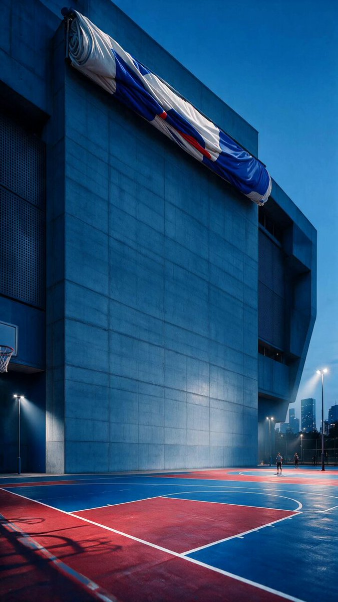

[Seedance 2.0 提示詞存檔](../seedance-2-0_zh-TW.md)

<a id="commercial-product"></a>
# 🏷️ Commercial / Product (33)

<a id="commercial-product-case-1"></a>
<!-- Case 1: Perfume-Style Anime Trio Dance Stage (by @ShadeLurk) -->
### 案例 1: [香水廣告風動畫三人舞台](https://x.com/ShadeLurk/status/2040671186984796632) (作者 [@ShadeLurk](https://x.com/ShadeLurk))

| 輸出 |
| :----: |
| <a href="https://x.com/ShadeLurk/status/2040671186984796632"></a> |

**提示詞:**

```
PR [Topview]
#TopviewAI #Seedance2
Dance

prompt:
Three anime girls perform Perfume-style formation dance on an illuminated stage. Each girl performs different assigned choreography, but all movements are locked to the exact same beat with mechanical precision. The camera cuts rapidly between full shots and medium shots every 0.7-1.0 seconds, occasionally switching to side angles and overhead angles. The structure follows a call-and-response pattern between the three dancers. The choreography ranges from sharp upright arm work to low crouching floor sweeps. Blue-white spotlights carve through purple haze. LED panels pulse with blue-to-purple gradients. Triangular formation.
```

<a id="commercial-product-case-2"></a>
<!-- Case 2: Dark Fantasy Church Duel (by @ZaraIrahh) -->
### 案例 2: [暗黑奇幻教堂決鬥](https://x.com/ZaraIrahh/status/2040667542390190245) (作者 [@ZaraIrahh](https://x.com/ZaraIrahh))

| 輸出 |
| :----: |
| <a href="https://x.com/ZaraIrahh/status/2040667542390190245"></a> |

**提示詞:**

```
Original Dark Fantasy Action Short Film: Inside a dilapidated church, a white-clad warrior and a black-armored opponent launch their final battle amid an atmosphere like a chorus. Stained glass shatters, moonlight penetrates the smoke and dust, and benches are overturned. The camera switches between high-angle overhead shots and low-angle upward shots, focusing on showing the sense of space of the religious building, the sense of oppression of the characters, and the temperament of a fateful decisive battle, just like the climax segment of an original fantasy animated film. A strong hook in the first 2 seconds, stable main body, coherent actions, movie-level composition, real light and shadow, epic sense, strong emotion, high-definition details, suitable for social media communication, avoiding copyrighted characters, avoiding brand logos, and completely original design.
```

<a id="commercial-product-case-3"></a>
<!-- Case 3: Dark Fantasy Shrine Hall Duel (by @MiraMusic_AI) -->
### 案例 3: [暗黑奇幻神社大殿決鬥](https://x.com/MiraMusic_AI/status/2040595365096034700) (作者 [@MiraMusic_AI](https://x.com/MiraMusic_AI))

| 輸出 |
| :----: |
| <a href="https://x.com/MiraMusic_AI/status/2040595365096034700"></a> |

**提示詞:**

```
Original Japanese-Style Dark Fantasy Action Short Film:
Inside a dilapidated shrine hall, a white-robed warrior and a black-armored samurai engage in their final battle amid an atmosphere reminiscent of ritual chanting. Wooden beams creak, paper screens tear apart, and fragments scatter as moonlight filters through drifting dust and smoke. Tatami mats are disrupted and scattered across the floor.
The camera alternates between high-angle overhead shots and low-angle upward perspectives, emphasizing the spatial depth of traditional Japanese architecture, the oppressive tension surrounding the characters, and the solemn intensity of a fateful duel—evoking the climactic moment of an original Japanese fantasy animated film.
A strong hook within the first 2 seconds, followed by a stable and cohesive progression. Fluid, continuous action with cinematic composition, realistic lighting and shadow, an epic atmosphere, intense emotional weight, and high-definition detail. Designed for social media engagement. Avoids copyrighted characters and brand logos, ensuring a completely original creation.
```

<a id="commercial-product-case-4"></a>
<!-- Case 4: Japanese Snack Commercial Punchline (by @aigeboku) -->
### 案例 4: [日式零食廣告反轉笑點](https://x.com/aigeboku/status/2040562471027782017) (作者 [@aigeboku](https://x.com/aigeboku))

| 輸出 |
| :----: |
| <a href="https://x.com/aigeboku/status/2040562471027782017"></a> |

**提示詞:**

```
Here it is.

A 15-second Japanese snack commercial.
Shot 1 (3s): A man walks through a shopping street. As he passes, two housewives whisper, "It's out."
Shot 2 (3s): The man turns around, slightly concerned by the two women, and an old man holding a newspaper says, "Is it out?"
Shot 3 (3s): Slightly flustered, the man looks at his smartphone, and a YouTube influencer says, "It's out!"
Shot 4 (3s): The man rushes into a Japanese convenience store. The clerk says, "It's out!" while holding the new snack package used in Shot 5.
Shot 5 (3s): Close-up of the new snack package. Narration: "It's out! New release!"
```

<a id="commercial-product-case-5"></a>
<!-- Case 5: Cinematic Martial Art Sequence for Seedance 2 (by @CharaspowerAI) -->
### 案例 5: [Seedance 2 電影級武術序列](https://x.com/CharaspowerAI/status/2040376349504815467) (作者 [@CharaspowerAI](https://x.com/CharaspowerAI))

| 輸出 |
| :----: |
| <a href="https://x.com/CharaspowerAI/status/2040376349504815467"></a> |

**提示詞:**

```
Cinematic Martial Art Sequence for Seedance 2
PROMPT
cinematic martial arts confrontation in broad daylight, a blind shaolin monk wearing a dark, stylized combat outfit inspired by legendary fighters stands calm and centered, eyes closed, surrounded by multiple hostile creatures emerging from a traditional Japanese landscape
Ultra cinematic choreography coverage, mix of slow dolly-ins + orbit moves + whip pans, transitions masked by body motion and impacts, alternating real-time and slow motion, continuous fluid sequence
(0-2s) wide establishing shot, monk standing still in center, wind moving fabric, creatures circling, tension builds
(2-4s) slow push-in close-up on monk’s face, eyes closed, subtle head tilt sensing movement
(4-6s) sudden attack from first creature, monk reacts instantly, precise sidestep + redirection, fluid motion
(6-8s) chained combat sequence, monk engages multiple opponents, spinning strikes, controlled movements, each impact sending creatures flying backward with stylized motion
(8-10s) slow motion highlight: mid-air dodge + counter sequence, cloth movement and body rotation emphasized, creatures suspended briefly before being thrown away
(10-12s) final burst of speed, monk flows through remaining opponents in one continuous movement, camera orbiting rapidly, enemies collapsing or being thrown aside
Traditional Japanese environment, open landscape with temples, wooden structures, distant mountains, clear daylight, subtle wind movement, dust and debris reacting to motion
Ultra realistic, high-end martial arts film choreography, precise body mechanics, cinematic slow motion, strong contrast lighting, volumetric atmosphere, fluid transitions, intense but controlled physical interaction, no distortion, no stretching
```

<a id="commercial-product-case-6"></a>
<!-- Case 6: Japanese Classroom Whisper Romance (by @AIGCOYJH) -->
### 案例 6: [日本教室耳語戀情](https://x.com/AIGCOYJH/status/2033119940216344616) (作者 [@AIGCOYJH](https://x.com/AIGCOYJH))

| 輸出 |
| :----: |
| <a href="https://x.com/AIGCOYJH/status/2033119940216344616"></a> |

**提示詞:**

```
15-second cinematic Japanese drama pure love ambiguous short film, ultra-realistic quality, warm golden sunlight in an empty classroom in the afternoon, spilling through the blinds onto the side-by-side desks, fine dust motes slowly floating in the light beams, old wooden desks, extremely natural subtle movements, breathing, and eye tension, characters maintain consistent faces, clothing, and hairstyles throughout without deformation, drift, or artifacts, real slight chest rise and fall synchronized with breathing, shallow depth of field, creamy blurred background, warm film grain, 8K sharp, Japanese youth restrained heart-fluttering suffocating atmosphere.
0-4 seconds: Extremely slow push-in shot from a medium shot of the desktop to a close-up of the two people's side profiles sitting side-by-side. A pure girl in a summer school uniform is focused on writing notes with her head down, long black hair and stray hairs by her ears are gently lifted by a slight breeze, long eyelashes cast subtle shadows, skin is naturally pink and tender, a slight, unintentional upturn of the corner of her mouth in concentration, light and even breathing.
4-9 seconds: Switch to a close-up of the boy. His school uniform collar is slightly loose, he props his elbow on the desk and secretly turns his head to gaze at her, his eyes filled with gentle, restrained affection and tenderness, pupils slightly dilated, his Adam's apple gently rolls. Suddenly noticing her pen pause, he quickly and flusteredly turns his head to pretend to look at his own notes, his earlobes quickly turn slightly red, his fingertips tremble slightly as he grips the pen, occasionally glancing at her from under his bangs, his breathing is slightly disordered, and his lips are tightly pressed in an effort to remain calm.
9-15 seconds: Extreme close-up of both faces in the same frame, slow-motion eyes suddenly meet: the girl slowly turns her head, first showing a dazed surprise, then quickly and shyly lowers her head for 0.3 seconds, gently biting her lower lip, her cheeks and earlobes instantly bloom with cherry blossom pink, her moist eyelashes timidly look up to meet his gaze again, while softly and shyly whispering, "...What are you looking at?"; the boy freezes completely, his pupils dilate, and he is stunned for 0.4 seconds, then flusteredly and quietly stutters in response, "N-nothing...". The girl whispers even quieter, biting her lip and peeking at him again, continuing to whisper, "...Liar.". The boy pauses, then gently sighs and whispers, "...Just looking at you.", the corner of his mouth slowly curls up into a shy, gentle, crooked smile, fine lines appear at the corners of his eyes, and his breathing noticeably deepens. An invisible current seems to pull the ambiguous tension between their faces, sharing each other's breathing temperature, the background completely melts into layers of creamy, dreamy light spots, warm halos, and fine air particles.
Lip synchronization is natural and precise, emotional micro-tremors and breathing are synchronized, dialogue is low-energy whispering with a shy tone, natural short pauses between 200-400 milliseconds, the mouth only moves slightly when speaking, without exaggeration or robotic feel, perfect natural lip-sync and emotional authenticity.
Overall Sound Effects: Distant summer cicada chirping faintly, the soft scratching sound of the pen touching the paper, the almost inaudible low-frequency pulse of their heartbeats, finally fading into a very light, airy piano. The dialogue is completely naturally integrated into the scene as whispers, the girl's voice is soft and shy, the boy transitions from flustered stuttering to gentle.
Character identity is maintained throughout, real subtle head tilts, eye movements, and breathing synchronization, no text, watermarks, or subtitles, pure Japanese style youth secret crush heart-fluttering suspense.
```

<a id="commercial-product-case-7"></a>
<!-- Case 7: LaFerrari Commercial Storyboard (by @Adam38363368936) -->
### 案例 7: [LaFerrari 商業廣告分鏡](https://x.com/Adam38363368936/status/2039932977287979053) (作者 [@Adam38363368936](https://x.com/Adam38363368936))

| 輸出 |
| :----: |
| <a href="https://x.com/Adam38363368936/status/2039932977287979053"></a> |

**提示詞:**

```
Supercar commercial cinematography storyboard

Shot 1 (1.5s): Opening frame on the supercar from the front, showcasing its signature aggressive face.

Shot 2 (1s): Close shot. The virtual camera slowly orbits around the emblem without spinning in a full circle, emphasizing the Ferrari prancing-horse logo.

Shot 3 (1.5s): Close shot, angled view of the LaFerrari's distinctive butterfly door from the side of the car, with a slow orbiting move that emphasizes the body lines.

Shot 4 (1s): Camera moves to the rear for a close shot, then slowly pulls backward using a Hitchcock dolly-zoom effect for visual impact.

Shot 5 (1s): Close shot of the car's side mirror with a slow orbiting move.

Shot 6 (1s): Camera slowly pushes forward using a low-angle advancing move. The car remains still, showing strong perspective, shifting light and shadow, professional automotive cinematography, deep background, cinematic composition, stable visual center, and high-definition live-action quality.

Shot 7 (1s): Lateral track move. The camera sweeps parallel across the LaFerrari body. The car stays completely still as the frame glides smoothly. Side lighting traces the waistline, includes wheel close-ups, delicate reflections, a premium feel, cinematic movement, and clean composition.

Shot 8 (1s): Top-down angle. The camera slowly descends. Static supercar, perfect body proportions, top-light texture, clean ground reflections, aerial-feel movement, the car remains still, symmetrical composition, luxurious texture, 8K ultra-realistic, advertising-grade image.

Shot 9 (1s): Slow push-in close-up from the full car toward the headlights / wheel / waistline. The car remains still. Macro detail, shifting light and shadow, cinematic shallow depth of field, premium texture, sharp detail, commercial photography.

Notes:

No transitions are needed between shots.

No people should appear in the frame.

Highest image quality: 8K.
```

<a id="commercial-product-case-8"></a>
<!-- Case 8: Hot-Blooded Anime Final Duel (by @gkxspace) -->
### 案例 8: [熱血動畫終極決鬥](https://x.com/gkxspace/status/2039894982434111716) (作者 [@gkxspace](https://x.com/gkxspace))

| 輸出 |
| :----: |
| <a href="https://x.com/gkxspace/status/2039894982434111716"></a> |

**提示詞:**

```
Tested it:

Original Hot-Blooded Duel Anime Short Film: Two top warriors launch their final duel against the backdrop of aerial ruins and thunderstorms. The camera emphasizes extreme speed, intense energy collisions and a sense of oppression from the characters. When moves are released, the surrounding buildings, clouds and debris are simultaneously affected by the force. The actions are like the top-level battle animation of TV anime, with theater-level color grading and lens language, focusing on highlighting the "highly intense, exciting, and blockbuster-like" vibe. A strong hook in the first 2 seconds, with a stable main body, coherent actions, movie-level composition and light and shadow, real texture, epic sense, strong emotion, high-definition details, suitable for social media communication. Completely original characters, worldview, costumes, weapons and moves, no copyright risks, and no use of well-known IPs, celebrity faces, brand logos or existing elements.
```

<a id="commercial-product-case-9"></a>
<!-- Case 9: Porcelain Couture Sky Mirror Runway (by @johnAGI168) -->
### 案例 9: [瓷藝高級時裝天空鏡面秀場](https://x.com/johnAGI168/status/2025849650654122348) (作者 [@johnAGI168](https://x.com/johnAGI168))

| 輸出 |
| :----: |
| <a href="https://x.com/johnAGI168/status/2025849650654122348"></a> |

**提示詞:**

```
[Style] Hollywood Haute Couture Fantasy blockbuster, 8K ultra-clear, Photorealistic, High-fashion Editorial Style, Unreal Engine 5 fluid rendering, visual illusion. [Duration] 15 seconds. [Scene] An endless, real-life Salar de Uyuni (Sky Mirror) salt flat. The sky is filled with oppressive dark clouds, and the ground perfectly reflects everything like a mirror, with the overall picture presenting a minimalist, cool tone. [00:00-00:05] Shot 1: Haute Couture Entrance and Porcelain Skin. Camera position: Extremely low-angle upward shot, ultra-telephoto lens zoom-in. Action: An Asian female model with a highly recognizable, high-fashion face walks coolly on the water surface. Effect: She is wearing not fabric, but a long dress made of flowing, real Liquid Blue-and-White Porcelain. As she walks, the skirt makes a crisp collision sound like real ceramic, with a flowing luster on the surface. The traditional blue-and-white patterns move across the white porcelain-textured skirt as if alive. [00:05-00:10] Shot 2: Physical Shattering and Ink-wash Descent. Camera position: Extreme close-up of the face, focus rapidly pulls back. Action: The model suddenly stops, stares coldly at the camera, and snaps her fingers crisply. Effect: The moment the fingers snap, her blue-and-white porcelain dress does not fall, but instantly explodes into thousands of extremely photorealistic Ink-wash Swallows. These swallows carry real water droplets and ink marks, dragging black fluid afterimages in the air, spinning frantically around her. [00:10-00:15] Shot 3: Dimensional Dissolution and Abyss Reflection. Camera position: High-altitude overhead shot, camera rapidly rotates and descends. Action: The swarm of ink-wash swallows plunges into the mirrored lake water beneath the model's feet. Effect: The surface tension of the originally solid salt lake instantly disappears. The entire extremely realistic world begins to violently bleed and dissolve like concentrated ink dropped into clear water. The real dark clouds and the model's figure transform entirely into an extremely grand 3D Fluid Ink Vortex, completely swallowing the camera into a black and white interwoven abyss.
```

<a id="commercial-product-case-10"></a>
<!-- Case 10: Modern Rural Creator Harvest Ad (by @johnAGI168) -->
### 案例 10: [現代鄉村創作者豐收廣告](https://x.com/johnAGI168/status/2021818021354848258) (作者 [@johnAGI168](https://x.com/johnAGI168))

| 輸出 |
| :----: |
| <a href="https://x.com/johnAGI168/status/2021818021354848258"></a> |

**提示詞:**

```
[Style]
Modern Rural Aesthetics, Cinematic Commercial quality, shot with Sony A7S3/cinema camera, 4K/8K ultra-clear, Extreme Macro, natural transparent lighting, healing ASMR, no historical costume drama feel.

[Scene]
A well-maintained modern farmhouse open kitchen, background is a lush vegetable garden, bright sunshine.

[Character]
Modern Rural Creator, black long hair casually tied up with a wooden hairpin, wearing a dark blue comfortable linen outfit, clear makeup, focused and peaceful eyes.

[Shot Details]
[00:00-00:05] Shot 1: Morning Harvest (The Freshness)
Visuals: High-definition close-up. Morning sunlight hits the plants with side backlighting.
Action: The Creator's bare hands (long, clean fingers) pick a bright red tomato with glistening dew drops from the vine.
Details: Extremely sharp focus, clearly showing the fuzz on the tomato surface and the trajectory of sliding water droplets. Background is blurred high-quality green.

[00:05-00:10] Shot 2: Extreme Craftsmanship (The Craft)
Visuals: Indoor stove area, full of life but spotless.
Action: The Creator is cutting vegetables, movements are skilled and precise (non-performance nature).
Details: Macro lens captures the moment the knife blade slices through the ingredients, juice splattering. Then switches to the orange flame flickering in the earthen stove, light and shadow are warm and real.

[00:10-00:15] Shot 3: Tranquil Time (The Moment)
Visuals: Full shot/Medium shot.
Action: A delicate home-cooked dish is placed on the wooden long table in the yard. The Creator sits down quietly, gently tidies a stray hair, and picks up a bite of food.
Atmosphere: Steam slowly rises against the backlight, the scene is so quiet you can almost hear the wind, showcasing the ultimate sense of relaxation modern people yearn for.
```

<a id="commercial-product-case-11"></a>
<!-- Case 11: Neon Street Racing Sequence (by @CharaspowerAI) -->
### 案例 11: [霓虹街頭賽車序列](https://x.com/CharaspowerAI/status/2039651574297792688) (作者 [@CharaspowerAI](https://x.com/CharaspowerAI))

| 輸出 |
| :----: |
| <a href="https://x.com/CharaspowerAI/status/2039651574297792688"></a> |

**提示詞:**

```
cinematic street racing sequence at night, a focused driver inside a high-performance car grips the steering wheel, intense eye focus, city lights reflecting on windshield, tension building before sudden acceleration

camera: rapid multi-angle system with seamless transitions, interior close-up → over-the-shoulder → exterior tracking → low ground shots, ultra dynamic camera movement, whip pans + speed ramp transitions + motion blur masking cuts, continuous flow illusion

(0-2s) interior close-up on driver, hand tightens on gear shift, subtle breathing, dashboard lights glowing
(2-4s) over-the-shoulder shot, road ahead stretching into neon-lit city, engine vibration building
(4-6s) extreme close-up on finger pressing NOS button, instant ignition reaction
(6-8s) explosive acceleration, camera snaps to exterior side tracking shot, car launches forward with violent speed surge
(8-10s) ultra low ground shot near asphalt, wheels spinning at extreme velocity, environment streaking past
(10-12s) high-speed chase through tight streets, sharp turns, camera whip pans between angles, reflections and light trails enhancing speed

Dense urban night environment, wet asphalt reflecting neon lights, tunnel passages, street lights streaking, high-speed city atmosphere
Ultra realistic, fast and furious inspired energy, photorealistic lighting, intense motion blur, high contrast neon reflections, cinematic depth of field, extreme sense of speed, fluid transitions, no distortion, no stretching
```

<a id="commercial-product-case-12"></a>
<!-- Case 12: Supermodel and Luxury Sports Cars (by @johnAGI168) -->
### 案例 12: [超模與豪華跑車](https://x.com/johnAGI168/status/2039984306085327298) (作者 [@johnAGI168](https://x.com/johnAGI168))

| 輸出 |
| :----: |
| <a href="https://x.com/johnAGI168/status/2039984306085327298"></a> |

**提示詞:**

```
Generate a visual blockbuster featuring an Asian supermodel and luxury sports cars with top-tier commercial quality, requiring director-level storyboard arrangement and a fast-paced, high-end rhythm. 0-2 seconds: [Macro to Micro] The opening uses an extreme push-in shot, instantly cutting from the sharp headlights of the sports car with delayed afterimages to a close-up of the pupils of the top Asian supermodel, showcasing the ultimate Oriental charm. 2-5 seconds: [LOCKED-ON SHOT] The camera locks onto the model's profile, tracking her with a lateral pan (Tracking Shot) as she walks confidently and elegantly. The model wears a high-fashion silk evening gown, her hair slightly moving in the wind, against a background of a blurred neon urban viaduct. 5-8 seconds: [360-degree Orbit Shot] The model stands at the center intersection of three sports cars, and the camera quickly orbits around her at a low angle. Use slow motion (slow-motion processing) to capture her cold, stunning glance back, with eyes possessing strong aggression and high-end appeal. 8-10 seconds: [Low-angle Hero Shot] The camera quickly pulls back from a ground perspective to a full view. The model stands proudly in the center of the luxury car cluster. The composition presents perfect symmetrical aesthetics, with light focusing on the face, displaying queen-like dominance. Visual Style: Extreme cinematic realism, 2.35:1 widescreen. The overall color tone leans towards cool Teal & Orange, with natural film grain and soft highlights. The character's skin texture is delicate and natural, possessing the makeup and styling quality of a top luxury magazine. Sound Design: Heavy bass electronic ambient music. Sound effects must sync with the camera cuts (Swish sound effects), and the visual rhythm should breathe with the music beats. Control Instructions: Lock the facial features and high-end makeup of the Asian model, ensuring character consistency across various shots; action transitions must be smooth without stuttering; light and shadow should produce real-time physical reflections as the model moves.
```

<a id="commercial-product-case-13"></a>
<!-- Case 13: Android Girl Lab Destruction Chase (by @aiehon_aya) -->
### 案例 13: [仿生少女實驗室破壞追逐](https://x.com/aiehon_aya/status/2040187587889905861) (作者 [@aiehon_aya](https://x.com/aiehon_aya))

| 輸出 |
| :----: |
| <a href="https://x.com/aiehon_aya/status/2040187587889905861"></a> |

**提示詞:**

```
An android girl malfunctions and proceeds to destroy an evil research lab one after another. The evil boss, a doctor with a bad face, chases the girl, shouting, "Waaah! Stop it! Please stop it!!" but the girl doesn't stop and continues to destroy things while laughing. In the end, there is a big explosion, and the lab is destroyed without a trace. The girl yawns and says, "Job complete," and falls asleep right there. The doctor kneels down, utterly dejected.
```

<a id="commercial-product-case-14"></a>
<!-- Case 14: Neon Ruined City Game Trailer (by @adrianaia_) -->
### 案例 14: [霓虹廢墟城市遊戲預告片](https://x.com/adrianaia_/status/2039972811067031657) (作者 [@adrianaia_](https://x.com/adrianaia_))

| 輸出 |
| :----: |
| <a href="https://x.com/adrianaia_/status/2039972811067031657"></a> |

**提示詞:**

```
Positive Prompt: Original action game concept trailer. The protagonist travels through a neon ruined city, where the debris by the road emits faulty advertising lights, and mechanical guards fall from the faults of high-rise buildings. After dodging with a slide, the protagonist pulls out a folding energy blade. The camera is like an AAA game debut trailer, with third-person follow, rapid switching between close-up and ultra-wide shots, strong rhythm and distinct scene layers. It finally stops at the silhouette of the boss's appearance, creating a strong feeling of "wanting to play this game". Negative Restrictions: No Cyberpunk 2077 logos, no well-known game UI, no existing game character outlines. A strong hook in the first 2 seconds, stable main body, coherent actions, movie-level composition, real light and shadow, epic sense, strong emotion, high-definition details, suitable for social media communication, avoiding copyrighted characters, avoiding brand logos, and completely original design.
```

<a id="commercial-product-case-15"></a>
<!-- Case 15: Original Dark Fantasy Action Short Film (by @Rufuszone) -->
### 案例 15: [原創暗黑奇幻動作短片](https://x.com/Rufuszone/status/2039949879607197828) (作者 [@Rufuszone](https://x.com/Rufuszone))

| 輸出 |
| :----: |
| <a href="https://x.com/Rufuszone/status/2039949879607197828"></a> |

**提示詞:**

```
Original Dark Fantasy Action Short Film: Inside a dilapidated church, a white-clad warrior and a black-armored opponent launch their final battle amid an atmosphere like a chorus. Stained glass shatters, moonlight penetrates the smoke and dust, and benches are overturned. The camera switches between high-angle overhead shots and low-angle upward shots, focusing on showing the sense of space of the religious building, the sense of oppression of the characters, and the temperament of a fateful decisive battle, just like the climax segment of an original fantasy animated film. A strong hook in the first 2 seconds, stable main body, coherent actions, movie-level composition, real light and shadow, epic sense, strong emotion, high-definition details, suitable for social media communication, avoiding copyrighted characters, avoiding brand logos, and completely original design.
```

<a id="commercial-product-case-16"></a>
<!-- Case 16: 00:00-00:04 Shot 1: Follow shot (by @IamEmily2050) -->
### 案例 16: [00:00–00:04 鏡頭 1：跟拍](https://web.archive.org/web/*/https://x.com/IamEmily2050/status/2040213294443847933) (作者 [@IamEmily2050](https://x.com/IamEmily2050))

| 輸出 |
| :----: |
| <a href="https://web.archive.org/web/*/https://x.com/IamEmily2050/status/2040213294443847933"></a> |

**提示詞:**

```
[00:00-00:04] Shot 1: Follow shot. In a smoky underground rave club, a female cyborg with an exposed red mechanical spine walks through the crowd. She suddenly turns around, her delicate white porcelain face beginning to convulse violently. [00:04-00:10] Shot 2: Close-up to mid-shot. The cyborg's porcelain face doesn't just split; it is violently shattered from the inside like an eggshell. A massive amount of thick, black viscous fluid erupts outward as an alien head with rusted metallic fangs and multiple mandibles forces its way out of her neck. Simultaneously, her red mechanical spine violently tears through her back, mutating into a giant, multi-jointed metallic scorpion tail dripping with corrosive acid. [00:10-00:15] Shot 3: Wide shot. The club's lighting turns a sickly fluorescent green. The alien tail violently impales the dance floor, suspending the cyborg's ruined body in mid-air as it emits an ear-piercing, non-human shriek. The surrounding crowd is paralyzed with absolute terror, pinned against the walls by webs of black organic matter. Extreme biomechanical horror, terrifying VFX mixing flesh and metal.
```

<a id="commercial-product-case-17"></a>
<!-- Case 17: Train-Top Tactical Fight Sequence (by @ImperfectEngel) -->
### 案例 17: [列車頂部戰術格鬥序列](https://web.archive.org/web/*/https://x.com/ImperfectEngel/status/2039796558238286329) (作者 [@ImperfectEngel](https://web.archive.org/web/*/https://x.com/ImperfectEngel))

| 輸出 |
| :----: |
| <a href="https://web.archive.org/web/*/https://x.com/ImperfectEngel/status/2039796558238286329"></a> |

**提示詞:**

```
"Dramatic low-angle tracking shot speeding along rain-slicked train tracks through a narrow mountain gorge. Dark rocky cliff walls rise on both sides, with overhead bridges and power lines crossing above. Moody overcast sky. The camera rushes forward at high speed. Two women — one with pink hair in all-black tactical gear, the other in a white bodysuit — fight on top of the moving train, exchanging martial arts blows as sparks fly. Dynamic action choreography, dark teal-grey color grade, cinematic speed and motion blur, sci-fi action film aesthetic."
```

<a id="commercial-product-case-18"></a>
<!-- Case 18: Manhattan Trading Floor Frenzy (by @johnAGI168) -->
### 案例 18: [曼哈頓交易大廳狂潮](https://x.com/johnAGI168/status/2039277115690877430) (作者 [@johnAGI168](https://x.com/johnAGI168))

| 輸出 |
| :----: |
| <a href="https://x.com/johnAGI168/status/2039277115690877430"></a> |

**提示詞:**

```
Hollywood movie-level commercial blockbuster quality, handheld photography, slight camera shake, fast-paced montage editing, the scene is full of energy and oppression, no subtitles appear.
The open-plan office hall of a luxurious securities company in Manhattan, USA, in the 1990s. Hundreds of young male brokers in suits densely fill the entire space. American flags hang around, ribbons fall in the air, and the entire hall is plunged into a religious ritual-like collective frenzy.
00:00-00:04 Wide-frame panoramic push-in shot: A powerful middle-aged male protagonist in a suit stands on top of a desk, arms spread, cheering loudly, shouting: "I am not leaving! We are not leaving!" Hundreds of employees below him respond wildly, waving their arms, pounding desks, hugging each other, the hall roaring and shaking. Handheld camera powerfully pushes towards the crowd, creating an overwhelming sense of presence.
00:04-00:09 Quick cut switch: Close-up of the protagonist above the chest, slightly sweaty, eyes burning, lips forcefully shouting: "They want to take it all away from you — ARE YOU GONNA LET THEM?!" The dialogue cue switches to close-ups of employees—young faces contorted in extreme excitement. Some are crying, some are tearing off their ties, some are jumping on tables and howling in response: "NO!!!"
00:09-00:15 The protagonist single-handedly pounds his chest, raising his other fist high, saying the last sentence in a low, forceful voice: "This is who we are." The camera suddenly pulls back from the close-up to a panoramic view—the hundreds of people in the hall erupt in the highest climax of shouting at the same moment. Ribbons pour down, the camera slightly tilts up to capture the protagonist's silhouette standing against the light at the top of the crowd, freezing in that high-energy moment where heroism and madness coexist.
```

<a id="commercial-product-case-19"></a>
<!-- Case 19: (Poliziottesco Wednesday) (by @ChrisGwinnLA) -->
### 案例 19: [警匪片風格星期三](https://x.com/ChrisGwinnLA/status/2039456415111393356) (作者 [@ChrisGwinnLA](https://x.com/ChrisGwinnLA))

| 輸出 |
| :----: |
| <a href="https://x.com/ChrisGwinnLA/status/2039456415111393356"></a> |

**提示詞:**

```
(Poliziottesco Wednesday): Detective Rossi: Deep Heat (Commissario Rossi: la polizia in crisi nera).
A crime wave has hit the city and the cops can't seem to get it together. Detective Rossi has had enough of the bureaucracy and the politicians tying his men's hands (and freeing the criminals to terrorize the city again!) - but can one hardnosed cop make a difference in a world gone mad? Maybe this nosey journalist can become an important ally!
```

<a id="commercial-product-case-20"></a>
<!-- Case 20: Foldable Smartphone Fashion Ad (by @Adam38363368936) -->
### 案例 20: [摺疊螢幕手機時尚廣告](https://x.com/Adam38363368936/status/2039157138002780202) (作者 [@Adam38363368936](https://x.com/Adam38363368936))

| 輸出 |
| :----: |
| <a href="https://x.com/Adam38363368936/status/2039157138002780202"></a> |

**提示詞:**

```
Product: Color-shifting gradient foldable smartphone (e.g., light purple to ice blue gradient)

Style: Trendy fashion, energetic fast pace, high-end texture, no people, minimalist light and shadow, fashionable trend style
Tones: High-saturation contrasting colors, light purple gradient frosted glass texture, clean and bright, cinematic light and shadow
Camera Language: Macro close-up, fast rotating camera movement, orbiting camera movement, handheld dynamic camera movement, push-pull quick cuts, smooth transitions
Tempo: 15 seconds tight quick cut, beat-synced editing, sharp transitions

Visual Content:
The light purple gradient foldable phone rapidly rotates against a pure black background, with light flowing across the body; macro close-ups of the ultra-thin hinge structure, the glass texture of the outer screen, the brushed metal close-up of the camera module, and the extremely thin side bezel; quick cuts showing the moment the phone unfolds from folded state, the visual impact of the inner screen's ultra-narrow bezel; paired with simple trendy scenes such as a minimalist office desk, an art gallery corner, late-night city neon, or a trendy collectible display case; fashionable and energetic. No models throughout, focusing only on the product.

Sound Effects: Trendy electronic drum beats, metallic clinks, mechanical click sound of the screen unfolding, beat-synced sound effects
Quality: 4K high definition, commercial advertisement quality, smooth dynamics, vibrant colors
Requirements: Fast pace, tight transitions, high-end fashion, youthful energy, no people appearing.
```

<a id="commercial-product-case-21"></a>
<!-- Case 21: Travel Suitcase Buddy Montage (by @ChaseAIx) -->
### 案例 21: [旅行箱夥伴蒙太奇](https://x.com/ChaseAIx/status/2045080469533057252) (作者 [@ChaseAIx](https://x.com/ChaseAIx))

| 輸出 |
| :----: |
| <a href="https://x.com/ChaseAIx/status/2045080469533057252"></a> |

**提示詞:**

```
SHOT 1: ECU, 85mm push-in / 04:00 on a digital watch screen. A hand slams it. / SFX: alarm beep, palm slap.

SHOT 2: WS, 35mm handheld jolt / Rhythmic cut into the man jolting upright, grabbing the suitcase by the handle like a hand-shake, and swinging it off the bed in one motion. / SFX: mattress spring, leather creak.

SHOT 3: MCU, 50mm slide / Cut on action into a passport hitting a tray, followed by a pair of sunglasses. / SFX: plastic thud, metallic clink.

SHOT 4: Insert shot, 85mm rack focus / Match cut into the suitcase zipper closing with a satisfying, high-speed "zip." / SFX: fast zipper slide.

SHOT 5: Exterior Wide, 24mm low-angle / Object pass as the man and suitcase "sprint" into frame against the Great Pyramids. Sand kicks up. / SFX: desert wind, running footsteps in sand.

SHOT 6: Insert shot, 50mm handheld / Rhythmic cut into a chilled coconut being cracked open, the suitcase "sitting" on a beach chair beside him. / SFX: coconut crack, liquid splash.

SHOT 7: MCU, centered 50mm push-in / Match cut into a selfie-angle: The man leans his head against the suitcase like a best friend, the Eiffel Tower sparkling behind them. / SFX: camera shutter, city chatter.

SHOT 8: Bird's-eye insert, 35mm overhead / Cut on action into the suitcase wheels spinning furiously across Andean stone. / SFX: wheel hum, stone rattle.

SHOT 9: MS, 35mm pivot / Camera wipe into a chaotic market in Marrakech. The man maneuvers the suitcase through silk stalls; the suitcase "dodges" a vendor. / SFX: fabric rustle, distant flute, shouting.

SHOT 10: Insert shot, 50mm overhead / Match cut into a stamp slamming down onto a passport page. / SFX: heavy ink thud.

SHOT 11: WS, 24mm parallax / Whip pan transition into a speeding train window. The man’s reflection and the suitcase's reflection are side-by-side as mountains blur past. / SFX: train rhythm, wind whistle.

SHOT 12: MS to CU, 35mm glide into 85mm push-in / Sound bridge into the airport lounge. He rests his feet on the suitcase; they both "exhale" as the sun sets through the terminal glass. / SFX: muffled PA system, deep sigh.

SHOT 13: Insert to MCU, 50mm snap zoom / Smash cut to a front door lock turning. The man and suitcase "stumble" into the dark apartment, looking dusty but happy. / SFX: key turn, door creak.

SHOT 14: OTS, 35mm handheld / Rhythmic cut into the man kicking off his boots and the suitcase falling onto its side with a heavy, tired "flop." / SFX: boot thud, leather heavy impact.

SHOT 15: WS, 50mm pull-out / L-cut with a match from the floor to the bed. The man collapses onto the mattress; the suitcase "collapses" right next to him on the pillows. He flings an arm over the suitcase like a spouse. Lights fade. / SFX: mattress groan, collective exhale, silence.
```

<a id="commercial-product-case-22"></a>
<!-- Case 22: Top-Down Fashion Lookbook — Outfit Change Sequence (by @johnAGI168) -->
### 案例 22: [俯拍時尚型錄——換裝序列](https://x.com/johnAGI168/status/2040767631213363656) (作者 [@johnAGI168](https://x.com/johnAGI168))

| 輸出 |
| :----: |
| <a href="https://x.com/johnAGI168/status/2040767631213363656"></a> |

**提示詞:**

```
prompt 👇

【风格】时尚杂志固定俯拍变装卡点（Top-Down Fashion Lookbook），电影质感，8K超清，丝滑卡点，极具冲击力的视觉节奏

【时长】13秒

【场景】固定俯拍视角（Bird's Eye View），镜头锁定正下方不移动。前景：模糊深棕色木质吊扇叶片缓慢旋转，偶尔遮挡镜头，营造空间景深。灰白纹理地毯，棕色方形靠垫。

【角色】年轻亚洲女性，黑色长直发，始终平躺地毯同一位置头枕靠垫，换装时主体位置固定，仅服装配饰道具和手部姿态丝滑闪切，@人物

[00:00-00:03] 造型1：慵懒丝绸（Silk Robe）

黑色丝绸吊带短裙与长袖睡袍，丝绸反射柔光。右侧地板放一杯红酒，右手举黑色遥控器指向镜头上方，神态慵懒。

[00:03-00:05] 造型2：纯白优雅（All White｜瞬间闪切）

全白系：白色挂脖上衣、白色百褶短裙、半透明袖套、白色细皮带。双手手腕交叉轻放胸前，姿态优雅。

[00:05-00:06] 造型3：狂野猫耳（Leopard Cat｜极速闪变）

豹纹紧身吊带上衣配白色百褶裙，黑色猫耳发饰，缎带choker，白色长袜与高跟鞋。双手随意举过头顶放靠垫边缘。

[00:06-00:08] 造型4：冷峻豹纹（Leopard Dress｜丝滑切换）

紧身豹纹连衣短裙，黑色长袜。双手自然放身体两侧地板，眼神冷峻直视镜头。

[00:08-00:09] 造型5：职场特工（Office Tie｜硬切）

白色修身短袖衬衫、黑色领带、豹纹短裙。左侧地板出现白色平板电脑，右侧出现银色小方包，左手轻放腹部上方。

[00:09-00:10] 造型6：暗黑摇滚（Rock Black｜瞬间变身）

全黑：黑皮夹克、黑背心、黑皮短裤、黑色过膝长筒袜、半指皮手套。怀里斜抱浅色木吉他。

[00:10-00:13] 造型7：复古惊艳（Vintage Qipao｜定格收束）

红黑印花复古无袖短款旗袍，左侧发际别一朵红花，黑色过膝长筒袜。右手持半开黑色折扇置于胸前，右侧地板摆红色高跟鞋。红黑配色收束全片。
```

<a id="commercial-product-case-23"></a>
<!-- Case 23: Premium Lifestyle Commercial — Vlog Selfie Style (by @johnAGI168) -->
### 案例 23: [高端生活方式廣告——自拍影片部落格風格](https://x.com/johnAGI168/status/2041374063243800793) (作者 [@johnAGI168](https://x.com/johnAGI168))

| 輸出 |
| :----: |
| <a href="https://x.com/johnAGI168/status/2041374063243800793"></a> |

**提示詞:**

```
prompt 👇

【风格】高级商业氛围短片（Premium Lifestyle Commercial），高清手机前置镜头质感（Vlog互动视角），电影写实色彩，面部柔光打光，注意分镜编排和对口型，单人出镜

【时长】15秒

【场景】卧室+调酒区一体空间，温馨台灯与紫黄霓虹氛围光交织，微醺暖调

【角色】完全参考@ 的人物外貌特征（顶级亚洲明艳神颜），穿深蓝蕾丝吊带裙、长卷发，全程形象高度一致

[00:00-00:03] 镜头1：POV慵懒起床（POV → Medium Shot 丝滑转场）

主观视角（POV），镜头从第一人称俯视角度对准床上盖着毯子的双腿，手伸入画面掀开被子，双腿落地起身。镜头随起身动作自然抬起并快速切至中景——女主已站在床边面对镜头，慵懒又带一丝霸道地说："睡什么睡，起来喝酒。"（中文口型精准同步）

[00:03-00:06] 镜头2：优雅倒酒（Medium Shot）

中景，机位切至卧室调酒区，背景台灯暖光与紫黄霓虹光映在墙面。女主拿起白酒瓶，手腕微倾，透明酒液沿瓶口流入银色量酒器，随后将量酒器中的酒液倒入杯中并加入橙汁，液体混合的色彩层次清晰可见。

[00:06-00:09] 镜头3：挤柠檬特写（Close-up）

近景动作特写。女主双手各持半个切开的青柠，用力对挤，柠檬汁水真实地滴落进调酒壶，汁液飞溅的细节清晰，随后抓起一把冰块丢入壶中，冰块碰撞发出清脆声响。

[00:09-00:12] 镜头4：摇酒（Close-up / Shake）

近景。女主双手持调酒壶举至脸侧，有节奏地快速摇晃，长卷发随动作轻微摆动，壶内冰块撞击声清脆卡点。她保持迷人微笑注视镜头，眼神明亮带笑。

[00:12-00:15] 镜头5：品尝与收尾（Medium Shot）

中景。女主手持一杯蓝黄渐变的精致鸡尾酒，杯中气泡缓缓上升。她轻抿一口，眉眼舒展露出满意的微醺神情，随后对镜头开心挥手，定格。
```

<a id="commercial-product-case-24"></a>
<!-- Case 24: Beat-Synced Waterproof Sneaker Film (by @madpencil_) -->
### 案例 24: [節拍同步防水運動鞋廣告](https://x.com/madpencil_/status/2075600475299447000) (作者 [@madpencil_](https://x.com/madpencil_))

| 輸出 |
| :----: |
| <a href="https://x.com/madpencil_/status/2075600475299447000"></a> <a href="https://x.com/madpencil_/status/2075600475299447000"></a> |

模型變體：Seedance 2 Omni

**提示詞:**

```
15-second image-to-video, 9:16 vertical. The uploaded 15-second music track is the master timeline the video maps one-to-one to the track from first frame to last, with hard cuts on downbeats, single-frame flickers on hi-hats, speed ramps hitting their slow-point exactly on beat drops, and the final freeze landing on the track's last hit.

The madpencil sneaker from the reference keeps its exact design at all times: same silhouette, same nubuck and knit textured upper, same tonal "m" logo on the side panel, same madpencil wordmark on the midsole, same outsole and laces the shape, proportions, materials, and logos never change. But the COLORWAY of the shoe snaps to a new color on every beat: olive to coral red, to powder blue, to lemon yellow, to bubblegum pink, to lilac, to pure white, to matte black, cycling continuously each color change is an instant hard swap, like a colorway strobe, always tonal head-to-toe with the logo and midsole shifting to match. Critically, the shoe's MOVEMENT is continuous and unbroken across every color change: if it is rotating, the rotation carries on seamlessly through each swap; if a droplet is rolling, it keeps rolling; if water is mid-splash, the splash continues only the color jumps, never the motion, never the position, never the camera. The shoe is the only subject, floating hero-style, no feet, no people. This is a premium product film for a waterproof sneaker cut as a hyper-kinetic flicker edit: one shoe, every color, undefeated by water.

The structure: from 0 to 2 seconds, the cold open the sneaker floats center frame on a flat solid pastel backdrop, rotating slowly and continuously while its colorway strobes on every beat, single-frame macro flickers of knit weave, nubuck grain, and the "m" logo punching between, each macro in a different colorway. From 2 to 5 seconds, the first water hit a sheet of water flies at the shoe in a speed ramp: normal speed launch, extreme slow motion as the water wraps the toe and explodes into crystal droplets with halftone dots rippling outward and even inside the slow-motion, the colorway keeps snapping on the beat while the droplets hang frozen then full speed as every droplet beads and rolls off, the shoe bone dry. From 5 to 9 seconds, the detail flicker tour cuts every 0.2 to 0.4 seconds: laces pulled taut, water beading like mercury on the side panel, droplets sitting in the outsole tread refusing to soak, a droplet rolling across the madpencil midsole text, mist bouncing off the knit as spray every single detail shot in a different colorway, the backdrop always a contrasting solid pastel so shoe and background never share a color. From 9 to 12 seconds, the gauntlet a crown splash from below ramping slow at its peak, rain streaking past in whip-panned frames, a full dunk with the shoe rising out, ramping from slow underwater bubbles to a fast surface breach, water sheeting off instantly, colorway strobing through the entire sequence while the water physics run unbroken. From 12 to 15 seconds, the hero close the strobing slows with the track: color changes stretch from every beat to every two beats, then settle, the sneaker landing softly on a flat solid backdrop in its original olive-grey home colorway one slow push-in, a single last droplet rolling off the toe, halftone dots settling as it locks into a still magazine-cover frame.

Water physics stay crisp and glassy: sharp crown splashes, distinct suspended droplets, clean sheeting; droplets always bead and roll off, never absorb, never darken the material regardless of the current colorway; the shoe emerges instantly dry from every hit.

Visually: flat solid neon pastel backdrops only powder blue, lemon yellow, bubblegum pink, coral red, white snapping on beats and always contrasting the shoe's current color. No lights, bulbs, or glowing tubes; color from flat backdrops and soft studio light. Soft 35mm grain, gentle bloom, halftone ripples radiating from water impacts and pulsing on colorway swaps, chromatic aberration on flash frames, single-frame white flashes, quick black-and-white frames intercut.

Camera: one continuous orbiting hero rotation as the spine of the film, crash zooms to macro texture, focus hunting between droplet and logo, whip pans between details, speed ramps only on water impacts, then a locked slow push-in for the ending. Audio: follow the uploaded 15-second track end to end colorway snaps ticking on the beat like a visual hi-hat, deep sub whoosh into the ramps, crystal splash hits on slow-points, a clean water-drop plink on the final droplet, the video resolving exactly as the track resolves.
```

<a id="commercial-product-case-25"></a>
<!-- Case 25: Mangosteen Serum Product Reveal (by @ritesh_ai) -->
### 案例 25: [山竹精華液產品亮相](https://x.com/ritesh_ai/status/2076580389867692447) (作者 [@ritesh_ai](https://x.com/ritesh_ai))

| 輸出 |
| :----: |
| <a href="https://x.com/ritesh_ai/status/2076580389867692447"></a> |

**提示詞:**

```
Use @ Image1 as the visual storyboard. 1 continuous shot, 10s, 9:16 vertical. Subject: NECTARY — a minimalist skincare extraction machine in translucent lilac acrylic and brushed gold — processes a whole mangosteen into @ Image2 , a violet-tinted vitamin C serum, in one unbroken transformation. Machine: Wide, squat, rounded-rectangle footprint, not tall or narrow. Translucent glossy lilac acrylic body, brushed gold metal accents. Flat rounded-rectangle top lid, "NECTARY" embossed flush into a front lid bar, same lilac tone as the body. Four round glass pillars at the outermost corners, filled with smooth violet fluid, no bubbles. Thin gold support rods set inboard of the pillars, running from lid to base. One unified opaque brushed-gold housing rides on those inner rods — short and wide like a rounded drum, wider than tall, flat underside, no neck or vessel shape. Two tall stadium-shaped clear glass slots cut into its front face. Stepped rounded-rectangle glass-and-gold base platform below. Reference: @ Image2 defines the exact bottle geometry and label. Location: Seamless lilac-to-violet gradient background, glossy mirror-reflective floor, soft studio environment, no other objects in frame. Visual Style: Ultra-clean CGI product cinematography, glossy and hyper-tactile, premium beauty-tech aesthetic. Camera: One continuous slow push-in for the full ten seconds, locked center axis, no cuts, no other movement. Lighting: Soft diffused overhead key light, warm gold rim light catching the housing and support rods, gentle volumetric glow rising from the base platform. [00:00–00:02] Wide shot. The machine in full view, a whole mangosteen — deep violet rind, small green calyx — resting on the base platform in the open gap beneath the raised gold housing. [00:02–00:04] The gold housing slides down along the inner rods, descending to enclose the stationary mangosteen. The fruit itself doesn't move. [00:04–00:07] With the housing lowered, violet rind and pearly white flesh swirl into a marbled gradient inside it, visible through the two glass slots, rising and deepening, tiny gold flecks suspended in the liquid. [00:07–00:08.5] The housing rises back up along the rods, revealing @ Image2 now resting on the platform where the fruit once sat. [00:08.5–00:10] The continuous push-in arrives close on @ Image2 alone, label clean and legible, soft violet glow beneath it. Audio: Soft mechanical hum, glass resonance, a telescoping slide as the housing lowers and rises, a rising crystalline shimmer as the liquid deepens, a gentle chime at the reveal. No music, no voiceover. Goal: A living product demonstration — one whole fruit, transformed into its own serum, in a single unbroken shot.
```

<a id="commercial-product-case-26"></a>
<!-- Case 26: Mumbai Suitcase Taxi Reveal (by @rahulnanda86) -->
### 案例 26: [孟買行李箱計程車亮相](https://x.com/rahulnanda86/status/2076874322145390605) (作者 [@rahulnanda86](https://x.com/rahulnanda86))

| 輸出 |
| :----: |
| <a href="https://x.com/rahulnanda86/status/2076874322145390605"></a> |

**提示詞:**

```
Ultra-realistic handheld smartphone footage, vertical 9:16, recorded by a random bystander outside Mumbai International Airport at the arrivals pickup lane on a bright monsoon morning. The entire clip feels like genuine viral phone footage accidentally capturing an unbelievable new invention. Authentic smartphone characteristics throughout: slight handshake, autofocus breathing, rolling shutter, tiny exposure shifts as the camera moves between the shaded terminal and bright outdoors, realistic phone HDR, natural compression, subtle oversharpening, and no cinematic grading or CGI look.

The recording begins as a young Indian couple exits the arrivals terminal. The man wears a backpack and casually rolls a large cream-colored hard-shell suitcase beside him while the woman walks next to him carrying their toddler. Morning airport activity is calm—only a handful of taxis, app cabs, luggage trolleys, airport staff, and scattered travelers move through the pickup lane. The person filming casually follows them, assuming they're just another family leaving the airport.

Without warning, the man stops beside the curb and presses a hidden button on the suitcase handle.

Within seconds the suitcase transforms mechanically into a compact three-wheeled electric scooter. Wheels deploy smoothly from underneath, handlebars unfold upward and lock into place, the seat flips out, the footboard extends, and a lightweight transparent rain canopy automatically rises overhead from neatly folded panels. Every movement feels like a genuine engineered consumer product rather than science fiction. Nearby travelers stop, stare, smile, and instinctively pull out their phones to record.

The woman smiles and casually climbs onto the rear seat while holding the child securely. The transparent canopy settles into place above them. The tiny electric scooter quietly pulls away into the airport pickup lane, merging naturally with the light morning traffic. The bystander filming instinctively pans to follow them, taking a few quick steps while trying to keep them centered. A couple of people laugh in disbelief while another points toward the transforming luggage.

As the futuristic luggage scooter disappears down the airport road, the filmer quietly mutters in disbelief:

"Bhai... yeh toh future aa gaya."

The recording ends naturally while still following them into the distance.

Maximum realism. Looks exactly like accidental viral smartphone footage filmed outside Mumbai Airport on a quiet morning. No cinematic shots, no cuts, no impossible camera angles—only authentic handheld bystander footage with believable phone-camera imperfections throughout.
```

<a id="commercial-product-case-27"></a>
<!-- Case 27: Clifftop Villa Influencer Tour (by @Ankit_patel211) -->
### 案例 27: [懸崖別墅網紅導覽](https://x.com/Ankit_patel211/status/2077762917198671925) (作者 [@Ankit_patel211](https://x.com/Ankit_patel211))

| 輸出 |
| :----: |
| <a href="https://x.com/Ankit_patel211/status/2077762917198671925"></a> |

模型變體：Seedance 2 Mini

**提示詞:**

```
Raw vertical iPhone footage style, real mobile phone recording shot on iPhone 16 Pro, natural bright daylight on a private clifftop, strong sun, endless horizon views, handheld with natural shake and micro movements, authentic phone camera look, no cinematic emulation, no film grain, no photorealism, looks exactly like a real influencer video posted on Instagram, natural vibrant colors.

[IMAGE REFERENCES]

Ref image is wearing a stylish casual-luxury outfit with subtle yellow and green accents, very expressive and excited when showing details.

[TIMELINE SECOND BY SECOND]

0-3s: [Handheld phone shot, natural shake] The influencer walks toward a modern luxury villa built on a private clifftop with 360º views. The villa has a distinctive rounded yellow and white design. Parked outside is a small, quirky luxury car in bright yellow. She points at it smiling: "Look at this. They actually made the car real."

3-6s: [Quick cut to main living area] She enters the bright open-plan living space. The entire back wall is glass with insane views of the sea and horizon. She gestures at the minimalist but warm interior and says: "Everything is designed so you feel like you're floating above the world."

6-9s: [Quick cut to garden terrace] She walks out onto a large circular terrace with perfectly cut grass and a small garden area. There’s a big round stone table in the center. She runs her hand over it and says: "This is where you sit and watch the clouds go by for hours."

9-12s: [Quick cut inside special room] She enters a round meditation-style room with floor-to-ceiling curved windows. The light fills the entire space. She turns slowly and says with a smile: "This room… you can literally see the whole world from here. No exaggeration."

12-15s: [Quick cut to edge of terrace] She stands at the very edge of the terrace, wind in her hair, with nothing but open sky and sea behind her. She looks at the camera and says: "Private clifftop villa. Feels like your own little planet. Would you live here?"

[STYLE & QUALITY BOOSTERS]

Real iPhone 16 Pro footage look, natural bright daylight, authentic mobile camera movement and slight shake, natural vibrant colors, coherent physics, stable character, real phone video quality, no film look, no artifacts, looks like genuine Instagram Reel footage shot on location.
```

<a id="commercial-product-case-28"></a>
<!-- Case 28: Resort Yoga Mat Commercial (by @ou_zhen599) -->
### 案例 28: [高端度假村瑜伽墊廣告](https://x.com/ou_zhen599/status/2080343369637839009) (作者 [@ou_zhen599](https://x.com/ou_zhen599))

| 輸出 |
| :----: |
| <a href="https://x.com/ou_zhen599/status/2080343369637839009"></a> |

**提示詞:**

```
15-second professional product commercial for Seedance 2, a high-end yoga mat brand. Female lead (see Image 1): A Western woman with a healthy, toned physique and naturally defined curves; long, wavy blonde hair; an authentic, sophisticated look—not a “social media influencer” face. She wears a light blue, form-fitting long-sleeve yoga top and pink high-waisted yoga pants, presenting a clean, crisp overall look with a natural, confident aura. Product Reference Image 2: A caramel-brown yoga mat with neat edges when rolled up; when unfolded, the surface features a fine, authentic texture. The material is supple and flexible, with a premium feel. The overall style should resemble an international light-luxury sports brand advertisement, featuring cinematic-quality lighting and shadows, restrained composition, negative space, and sharp details—resulting in a sophisticated, clean, elegant, and authentic visual.

The scene is set in the outdoor yoga courtyard of a high-end resort hotel or private club. Soft, natural morning light fills the air, which is crisp and clear. The scene features a meticulously manicured, high-end lawn and a white or light beige natural stone floor. Minimalist modern architecture and the edge of the pool are blurred in the distance, accented by a few exquisite green plants. The environment must be authentic, tidy, luxurious, and quiet—free of passersby, cluttered facilities, a cheap park-like feel, or the atmosphere of an ordinary gym. The space should exude a high-end resort vibe and an elite lifestyle ambiance.

0–3 seconds: Establish the setting and introduce the action. A low-angle shot glides close to the edge of the lawn and stone flooring; morning light falls on the surface, and the air is crisp and clear. The camera naturally pans to the already unfolded caramel-brown yoga mat. The female lead stands on the mat and begins an elegant, stretching opening pose, raising her arms as her body stretches out. The camera gently rises from the mat’s surface and her feet to her waistline and arms, showcasing both the upscale setting and clearly highlighting the relationship between the product and the subject. She softly and naturally delivers an English line: “Let’s begin.”

3–7 seconds: The yoga sequence begins. The camera follows her in a low-angle, semi-circular tracking shot as she transitions naturally from a standing pose to Downward Dog or a lunge sequence. Her palms press firmly against the mat, and her soles and toes grip the mat realistically; the details of her knees touching the mat are clearly visible. The camera must not stray from the yoga mat; the mat must remain in the core visual area at all times to emphasize a sense of support, stability, comfort, and authentic use. The texture of the material, the lines along the edges, and the subtle changes in the mat’s surface under pressure should be rendered realistically and with fine detail. Soft light gently washes over the skin, clothing, and mat surface, creating a look that is both luxurious and natural.

7–10 seconds: Conclusion of the sequence and emotional build-up. She finishes a set of poses and slowly sits or kneels on the yoga mat, her breathing slowing as her fingers gently trace the edge of the mat, as if interacting with a familiar training partner. The camera starts with a close-up of her hand on the mat, then gently follows the movement of her fingers to her profile and the line of her shoulders and neck, capturing a relaxed, focused, and authentic expression. She naturally murmurs her second line of English: “Perfect balance.” Her tone is like a quiet affirmation of her physical state at the end of a practice—avoid a sales-pitch tone.

10–12 seconds: She begins to roll up the mat, and the product takes center stage. She leans forward and rolls the mat up from one end with fluid motion—clean, skilled, and crisp. The camera glides close to the rolling path, following the curve of the caramel-brown yoga mat as it transitions from flat to rolled, emphasizing the neat edges, moderate thickness, supple material, and high-end surface texture. The rolling process is smooth and seamless, showcasing the product’s aesthetic appeal. This sequence should be filmed as an elegant ritual, rather than a mundane tidying-up action.

At 12–15 seconds, the final “hero shot” is highlighted, making the conclusion even more impactful and luxurious. She picks up the rolled-up yoga mat and walks toward the foreground of the frame, while the camera pulls back slightly to follow her movement. She gently places the rolled-up caramel-brown yoga mat on the edge of a light beige natural travertine or high-end white stone pedestal closest to the camera. The product is positioned steadily at a two-thirds side angle, with the layers of the roll, the contours of the cut edges, the material texture, and the highlights in the morning light all clearly visible, presenting a luxurious, understated, and minimalist hero shot of the product. The focus transitions naturally from the subject to the product in the foreground, which is sharp and clear, while the background is slightly blurred. After setting down the yoga mat, she stands up and walks away, her silhouette moving quietly toward the depths of the courtyard bathed in morning light. She does not look back; her movements are composed, and the spatial negative space is opened up. The camera does not follow her but remains steadily focused on the product in the foreground, allowing the caramel-brown yoga mat to harmonize with the high-end stonework, the morning light, and the elegant courtyard to create a sophisticated and premium brand conclusion. Finally, a very brief English voiceover is added: “Made to move.”

Overall Requirements: Authentic human performance, authentic yoga poses, and authentic storage logic; the interaction between the product and the subject must feel natural. The visuals must be detailed, beautiful, clean, and luxurious, emphasizing the aura of an international high-end sports brand. Avoid exaggerated expressions, cheap-looking staged shots, excessive saturation, a plastic-like texture, multiple people or cluttered backgrounds, a low-quality park atmosphere, fixed camera angles and abrupt cuts, and a generic e-commerce feel.
```

<a id="commercial-product-case-29"></a>
<!-- Case 29: Yoga Terrace Bottle Hero Ad (by @ou_zhen599) -->
### 案例 29: [瑜伽露台水瓶主視覺廣告](https://x.com/ou_zhen599/status/2079905616571818004) (作者 [@ou_zhen599](https://x.com/ou_zhen599))

| 輸出 |
| :----: |
| <a href="https://x.com/ou_zhen599/status/2079905616571818004"></a> |

**提示詞:**

```
15 seconds, 9:16 vertical format, realistic high-end lifestyle product ad, shot in a single take with no hard cuts.

【Reference Guidelines】
@Image 1 is used solely to establish the female subject: Maintain the same authentic face, long wavy blonde hair, light blue long-sleeved sports top, pink yoga pants, and white sneakers; body proportions and clothing color schemes must remain consistent; Do not replicate the white studio background or collage-style layout.
@Image 2: To be used solely for the yoga water bottle: Maintain the white matte, rounded-corner bottle body, silver metal lid, and curved metal handle; the bottle proportions and lid structure must be identical; the bottle must always appear intact, rigid, and undistorted, with no text, logos, or labels; no color changes; and no straws or other accessories added.

【Setting and Style】
An upscale outdoor yoga terrace at dawn, featuring light-colored natural stone flooring, a neat solid-wood yoga mat, a few elegant potted plants, and serene mountain scenery and sky in the distance. The space is clean and open, with no other people or clutter. Realistic commercial advertisement aesthetic, with authentic skin and fabric textures. Warm white morning light streams diagonally from the lower left rear of the frame, casting a soft contour light on the subject; a clean, understated highlight appears on the silver lid of the water bottle, with stable, flicker-free lighting. A gentle morning breeze rustles the hair, sleeves, and distant plants, while the water bottle maintains a sense of stability consistent with its weight.

【Continuous Shot and Movement】
The camera begins from a low, three-quarter side angle close to the kettle and follows the action with a steady, forward-side tracking shot throughout the sequence; the shot composition changes naturally only when the subject walks past the light-colored pillar, using the foreground to create a natural transition—no quick cuts or shaky camera work are used.
0–3 seconds: The woman has just finished her rest and is sitting at the edge of her yoga mat, her right hand naturally gripping the water bottle’s handle. As she stands up, she lifts the water bottle smoothly off the ground; the camera follows the rising water bottle to frame her and the terrace setting.
3–6 seconds: She walks briskly toward the terrace railing with the water bottle, which sways slightly and naturally with her steps; as she walks, she switches the bottle from her right hand to her left, while her right hand gently tucks her hair back as it is blown by the morning breeze.
6–9 seconds: She stops at the railing, holding the bottle steadily in her left hand while unscrewing the silver lid with her right; the camera smoothly pans to a medium-close-up from her side and front as she takes a small sip of water, her movements calm and authentic.
9–12 seconds: She screws the lid back on, her fingertips gliding naturally over the handle; she pauses briefly facing the camera and mouths the words in English with a relaxed, natural expression: “Ready for what’s next.”
12–15 seconds: Carrying the water bottle, she continues walking deeper into the terrace, passing a light-colored column; the camera smoothly emerges from behind the column and slows down, finally settling on a clear three-quarter front “hero shot” of the water bottle, with the subject continuing to walk against a softly focused background.

[Audio]
English throughout. 0–3 seconds: Female voiceover in English: “The practice may pause.”
3–6 seconds: Female voiceover in English: “The feeling stays with me.”
6–9 seconds: Retain the sound of a gentle breeze, light footsteps, the sound of a metal cup lid unscrewing, and the natural sound of drinking; the music’s tempo rises slightly.
9–12 seconds: Only the character’s synchronized line: “Ready for what’s next.”—do not overlay with voiceover.
12–15 seconds: Female voiceover in English: “Move freely. Hydrate simply.”
The music should feature a light, modern, and understated rhythm reflecting a premium active lifestyle.

[Restrictions]
The subject, water bottle, and environment must remain consistent throughout; the number of fingers shown must be normal, and both hands must remain natural at all times; the drinking motion must be realistic, with no spills; no yoga poses, exaggerated poses, slow motion, shaky camera work, generated subtitles, brand text, or watermarks are allowed.
```

<a id="commercial-product-case-30"></a>
<!-- Case 30: Knitted Crest Reveal (by @insmind_com) -->
### 案例 30: [針織徽章揭曉](https://x.com/insmind_com/status/2080646752894664968) (作者 [@insmind_com](https://x.com/insmind_com))

| 輸出 |
| :----: |
| <a href="https://x.com/insmind_com/status/2080646752894664968"></a> |

**提示詞:**

```
A premium sportswear motion graphic built from knitted material. Start on a close low-angle view of the blue-and-white jersey chest. Keep the camera subtle and product-focused. Gold, sky-blue, white, and deep navy yarn flows across the fabric, interweaves, tightens, and gradually forms the full Argentina AFA crest.

Where the yarn moves, the stitches grow. The camera should clearly show the yarn entering the fabric and building the crest layer by layer. The gold shield, stars, top bars, AFA lettering, and laurel branches must all form as one continuous embroidered logo. Every shape should be created by real arriving yarn, with visible plush stitch depth.
```

<a id="commercial-product-case-31"></a>
<!-- Case 31: Crimson Cola Retro Ad (by @DjajaYerry75) -->
### 案例 31: [緋紅可樂復古廣告](https://x.com/DjajaYerry75/status/2080666062690140315) (作者 [@DjajaYerry75](https://x.com/DjajaYerry75))

| 輸出 |
| :----: |
| <a href="https://x.com/DjajaYerry75/status/2080666062690140315"></a> |

**提示詞:**

```
A premium 15-second cinematic 8K commercial for a retro soda brand. Begins with a slow camera push-in on a chilled, rocket-shaped glass bottle with sparkling condensation in a sepia-toned desert sunrise. The bottle cap pops open in slow motion, releasing a burst of fizzy red carbonation and glowing crimson energy. Dynamic FPV drone sweep following the crimson energy as it transforms the barren desert into a vibrant, colorful 1950s raygun-gothic retro-futuristic city. Cheering people in vintage blue and yellow jumpsuits celebrate, a floating metallic retro robot serves drinks, and a character in a heavy dieselpunk armor suit toasts with a bottle. The camera pans up to a magnificent rocket-styled soda fountain under warm golden-hour light, ending on a hero shot of the bottle overlooking the radiant neon city. Anamorphic lens, 8K resolution, volumetric lighting, smooth camera motion, luxury advertising aesthetic.
```

<a id="commercial-product-case-32"></a>
<!-- Case 32: Sprite Fountain Summer Ad (by @AIwithSynthia) -->
### 案例 32: [雪碧噴泉夏日廣告](https://x.com/AIwithSynthia/status/2081383131668701519) (作者 [@AIwithSynthia](https://x.com/AIwithSynthia))

| 輸出 |
| :----: |
| <a href="https://x.com/AIwithSynthia/status/2081383131668701519"></a> |

**提示詞:**

```
Use the uploaded reference image as the exact character reference. Preserve her facial identity, hairstyle, eye color, skin tone, body proportions, and natural expressions throughout. She wears a white fitted crop top, emerald green pleated mini skirt, white sneakers, silver jewelry, and sunglasses resting on her head. Bright summer afternoon, colorful downtown plaza with murals, fountains, palm trees, and skate park. Premium commercial cinematography, vibrant green-and-white Sprite-inspired color palette, photorealistic 4K HDR, 16:9.
The video opens with her smiling confidently at the camera while balancing an ice-cold Sprite can on her palm. She flips the can into the air, catches it effortlessly, and pops it open with a crisp "pssst!" A cinematic macro shot captures sparkling fizz, crushed ice, lime slices, and condensation glistening in the sunlight as she takes a refreshing sip.
Instantly energized, she laughs while running through dancing fountains, playfully chases floating bubbles, then joins friends at a skate park where she briefly rides a skateboard and celebrates together. Dynamic handheld tracking shots capture genuine smiles, splashing water, and carefree summer energy.
The final hero shot shows her stepping toward the camera, holding the chilled Sprite can close to the lens as the fountain sparkles behind her. She smiles and says,
"Stay cool. Stay fresh."
Natural ambient audio only: can opening, fizzy bubbles, splashing fountain water, skateboard wheels, footsteps, laughter, birds, gentle breeze, and city ambience. No background music, no subtitles, no logos, no watermarks, and no on-screen text (except the Sprite branding on the can). Premium beverage advertising, realistic liquid physics, cinematic handheld and gimbal movement, shallow depth of field, vibrant summer storytelling.
```

<a id="commercial-product-case-33"></a>
<!-- Case 33: Monumental Banner Rollout (by @insmind_com) -->
### 案例 33: [巨幅廣告布幕展開](https://x.com/insmind_com/status/2082096371818275092) (作者 [@insmind_com](https://x.com/insmind_com))

| 輸出 |
| :----: |
| <a href="https://x.com/insmind_com/status/2082096371818275092"></a> |

**提示詞:**

```
Use the rolled-up state in reference image 1 and the fully deployed state in reference image 2. Keep the camera locked, with the advertising banner always remaining the visual center of the frame. The huge advertising banner mounted on the building beside the basketball court slowly lowers from the top, carrying the weight and inertia appropriate to its monumental scale, until it fully reaches the advertising state shown in image 2.

After the banner reaches the bottom, it naturally rebounds under the installation tension and sways gently. The amplitude gradually diminishes, while a slight residual motion remains at the end of the shot. Continue the scene, art direction, lighting, and advertising content of the reference images.
```
